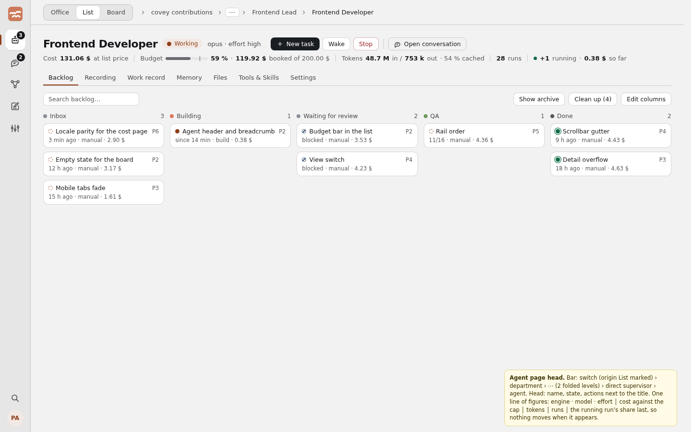

# Design: agent page header and organisation breadcrumb

Status: proposal, waiting for product-owner's acceptance. Design for issue #20. This is the fourth surface of the agents area (`docs/design/agents-area.md`, PR #4) and lives in that frame. Code references are to `main` @ 66f38956. The figure formulas are the ones in issue #20 (A–F). cost-controller owns them, and this spec does not change what any figure means. Mockups (static HTML, covey tokens, sample data) are in `docs/design/agent-header/`.

> Wish (2026-11-18): “This requires lots of change: a lot of wasted space. And on top it should show the intermediate organisation levels as clickable steps too.”

**The question the head answers:** *Who is this agent, where does it sit in the organisation, what is it doing, and what has it cost against its cap?* Everything above the tabs takes two rows. Measured in the mockups at 1440 px, the head is 93 px from the bar to the tab strip, against 166 px in PR #4's detail mockup and more on `main`.



## 1. Breadcrumb (in the 52 px area bar, after the view switch)
```
[ Office | List | Board ] › covey contributions › ⋯ › Frontend Lead › Frontend Developer
  root = the switch          department          folded  direct supervisor   agent (aria-current)
```
- **Root.** In the frame, the view switch *is* the "Agents" step. Its marked origin segment already leads back (PR #4 §3), so a second "Agents" link would give two controls the same meaning. If this ships before the frame, the crumb renders in today's row (`Agent.tsx:124`) with `Agents` (`agent.breadcrumb`) as its root, linking to the origin view.
- **Path = the org-chart path.** Add a new pure helper `orgPath(chart, agentId)` in `components/orgchart/model.ts`, built on `memberDept`/`memberBoss`. It returns `{ dept, chain (top first), outsideBoss }`.
  - It walks `supervisor_id` (agents) and `manager_id` (humans) upward while the boss is in the agent's department.
  - It stops at the department boundary, at a missing member, or at a cycle (visited set).
  - It uses one `GET /org/chart` (query key `["orgchart"]`, as `Org.tsx:529`), with no request per step.
- **Folding (confirming your rule).** n = number of supervisors in the chain. If n ≤ 2, all are shown. If n ≥ 3, S1…Sn−1 fold behind one `⋯` step, and the department and the direct supervisor stay visible.
  - `⋯` is a `<button aria-haspopup="menu" aria-expanded>`. It opens a menu that lists the folded levels top-down, indented by level (mockup 2).
  - Enter or Space opens the menu, arrow keys move, Esc closes it and returns focus to `⋯`.
- **Narrow widths fold in this order:** upper supervisors, then the agent step, then everything. This follows the viewport:

| Viewport | Crumb |
|---|---|
| ≥ 1280 | rule above |
| 1024–1279 | Dept › ⋯ › Sn › Agent as soon as n ≥ 2 |
| 769–1023 | as above, without the agent step (the h1 right below names it) |
| ≤ 768 | the switch plus `⋯` only; the menu holds the department and the whole chain (mockup 7). #20's notes hide the crumb here, but then a phone has no way into the path. |

  Each step is truncated at 24 ch (the agent at 32 ch), with the full name in `title`.
- **Steps.**
  - Agent supervisor: `/agents/:id`, keeping `location.state.from`.
  - Human supervisor: `/people/:id`, with the `user` icon before the name. The icon tells human from agent, colour does not.
  - No department: a `Without a department` step (`dashboard.withoutDepartment`) → `?dept=none`.
- **Supervisor outside the department.** The org chart makes the agent a root (`model.ts:3-8`), so the crumb ends at department › agent. A muted note follows: `· reports to <link> (<department>)` (mockup 8). This only appears when the agent's own direct supervisor sits outside the department.
- **Department click** = the marked origin segment plus `?dept=<id|none>`. It drops the view's other filters and carries `state.from`.
  - Targets: List `/agents?dept=`, Board `/agents/board?dept=`, Office `/?dept=`. The Office scrolls to that floor and outlines it for 2 s, because a place is not filtered.
  - Without `from` (a bookmark or a notification link) the target is List.
  - **Why location state rather than `localStorage covey.agents.view`:** that preference belongs to the browser and changes from other tabs. `state.from` is this click's own history, and it is what the switch marks, so the department step and the marked segment always lead to the same view.

## 2. Head: two rows, everything left-aligned, no card
**Row 1:** h1 22 px · state badge · PhaseBadge · `opus · effort high` · actions, 16 px after the text.
- The `opus · effort high` text is 13 px secondary, not mono. The hard-coded `runtime:` goes, and the engine moves to the tooltip. An empty effort reads `effort default`.
- **Actions:**
  - Hired: `+ New task` (primary), Wake, then Stop or Resume, a hairline, then `Open conversation` (ghost, team surface only).
  - Draft: Hire (primary) and `+ New task`.
  - **Wake is hidden while the agent is stopped:** `orchestrator.go:1170` refuses a killed agent, so the button did nothing.
  - `+ New task` is the button from PR #5, moved here so it exists once per page (details in §7). It opens the backlog form on `?tab=backlog`, the same form the `n` shortcut (PR #6) opens. Its always-open card above the kanban goes.

**Row 2, the figures** (13 px; label muted, value weight 550, tabular numbers):
- **Separators:** a hairline between items on the same row only. Use `border-left` on each item, a negative margin on the group and `overflow: hidden`, so a wrapped item never starts with a line.
- **Order:** Cost · Budget · Tokens · Runs · Running. Running is last, so nothing moves when a run starts or ends.
- **Format:** money has 2 decimals, with `< 0.01 $` for tiny amounts (the cost page rule). The exact digits are in `title`.

| Item | Shows | Formula (issue #20) |
|---|---|---|
| Cost | `Cost 131.06 $ at list price` · `≥ 1.48 $ … · 2 of 3 runs priced` | A: M_done + M_run at list price, including the running run. `≥` while some run has no price. **Hidden until the price table lands**, never `0.0000 $` |
| Budget | `Budget ▬▬▬│░ 59 % · 119.92 $ booked of 200.00 $ [rail]` | E: used = Σ `cost_entries.usd`. cap = min(budget_usd, smallest enabled budget_limit rail > 0), zeros ignored. pct = ⌊used·100/cap + 1e-9⌋. Same component and same % as the agent list Budget column (6088d4d9). Tick at 80 %; grey < 80, amber ≥ 80, red iff used ≥ cap; the text may exceed 100 %. No cap: `no cap · 12.80 $ booked`, no track |
| Tokens | `Tokens 48.7 M in / 753 k out · 54 % cached` | B: in = input + cache_read + cache_creation, out = output. C: ⌊cache_read ÷ in⌋. At < 1440 px, C moves into the tooltip |
| Runs | `28 runs` | D: COUNT(cost_entries) |
| Running | `● +1 running · 0.38 $ so far` | Shown while a run is open. `+k` from D; `so far` = M_run (F), which is already inside Cost, not added to it. The dot is the existing `.live-dot` (sandbox active), moved here from row 1 |

- **Colour:** no new colours.
  - The cost source is named in words ("at list price", "booked"). Measured blue must not appear here, because the backlog on the same page shows waiting cards in wait-blue.
  - Amber appears only at ≥ 80 % of the budget. Red appears only for budget ≥ cap, the crossed badges and the wake-trouble line.
- **Below the rows:**
  - Wake trouble: one line of danger text (`agent.wakeFailedWhy`), visible, not only in the tooltip.
  - Drafts: the existing `hire.bannerTitle/bannerLead` as a dashed note, max 760 px.
  - Performance, LintFindings and the tabs are unchanged.

## 3. States and widths (mockups 4, 5, 6)
| State | Head |
|---|---|
| Draft | dashed `Application` badge, Hire + New task, row 2 hidden, draft note |
| Stopped | crossed badge, Resume, no Wake |
| Budget used up (killed ∧ used ≥ cap) | crossed `Budget used up` badge (list key), red full bar, Resume titled `Raise the cap first, then resume` |
| Cannot wake | crossed badge plus the reason line |
| No cap | `no cap · x $ booked`, no track |
| No runs yet | `0 %` bar if there is a cap (0 is a real value), then `No runs yet` instead of Tokens and Runs |
| Loading | name and the badge skeleton first; row 2 labels with `—`, so nothing moves when the values arrive. A cost error keeps `—` and gets the title `Could not load` |

- **Widths:**
  - 1280 / 1440 / 1920 / 2560: two rows. Nothing is pushed to the right edge, and the unused width is empty page, not an empty box.
  - ≤ 768: actions take their own line.
  - ≤ 520: one figure per line, a 56 px track, and `Open conversation` as an icon with an `aria-label`.

## 4. Strings (all ten locales, no hard-coded text)
- **New keys:**
  - `agent.crumb.label` “Organisation path”, `agent.crumb.more` (count) “Show {{count}} more levels”, `agent.crumb.between` “Between {{from}} and {{to}}”, `agent.crumb.allIn` “All agents in {{department}}”, `agent.crumb.reportsTo` “reports to {{name}} ({{department}})”
  - `agent.head.effort` “effort {{level}}”, `agent.head.effortDefault` “effort default”, `agent.head.engine` “Engine {{engine}}”, `agent.head.stopTitle` (replaces the hard-coded `title="Kill-Switch"`), `agent.head.resumeBudget`
  - `agent.cost.cost` “Cost”, `agent.cost.atListPrice`, `agent.cost.lowerBound` “≥ {{usd}}”, `agent.cost.priced` “{{n}} of {{total}} runs priced”, `agent.cost.costWhy`
  - `agent.cost.booked` “{{usd}} booked of {{cap}}”, `agent.cost.noCapBooked`, `agent.cost.rail`, `agent.cost.budgetWhy`
  - `agent.cost.tokensLabel` “Tokens”, `agent.cost.tokensLine` (Trans) “<b>{{in}}</b> in / <b>{{out}}</b> out”, `agent.cost.cacheShare` “{{pct}} % cached”, `agent.cost.tokensWhy`
  - `agent.cost.runs_one/_other` “{{count}} run(s)”, `agent.cost.running` “+{{count}} running”, `agent.cost.soFar` “{{usd}} so far”, `agent.cost.runningWhy`, `agent.cost.noRuns`, `agent.cost.loadFailed`
- **Removed (#20 AC 3):** `agent.cost.total`, `agent.cost.runs`, `agent.cost.cached`, `agent.cost.tokens`.
- **Reused:** `status.*`, `dashboard.draftBadge`, `dashboard.withoutDepartment`, `hire.*`, `agent.wake/stop/resume`, `agent.backlog.newTask`, `agent.wakeFailedWhy`, `agents.backTo`.

## 5. Acceptance criteria
1. At 1280, 1440, 1920 and 2560 px (en), the head is exactly two rows above the tabs. Wake and Stop sit within 16 px of the model text. There is no card around the figures.
2. `orgPath` unit tests cover: an agent supervisor, a human supervisor, n = 0, 2 and 3, a boss in another department (note, no step), a missing boss, and a cycle. The page makes one `/org/chart` request.
3. With n ≥ 3, exactly one `⋯` appears. Its menu lists S1…Sn−1 top-down; it opens with Enter, closes with Esc and returns focus to the button. A human step opens `/people/:id`.
4. The department click from a detail opened in the Board lands on `/agents/board?dept=<id>` with Board marked. From a bookmark it lands on `/agents?dept=<id>`. `none` works for agents without a department.
5. The same agent shows the same budget % and colour in the list and the head. 79 % is grey, 80 % amber, used = cap red, and with no cap there is no track.
6. Cost is absent while A is unavailable, and never shows 0.0000 $. While a run is open, `+1 running · x so far` is the last item, and no other item moves when it appears.
7. A stopped agent shows Resume and no Wake. A draft shows Hire and no figures.
8. At 390 px nothing scrolls sideways, and the crumb is reachable through `⋯`. The head is checked in light and dark themes.
9. `parity.test.ts` passes. The keys above exist in all ten locales, and the removed keys are gone from all ten.

## 6. Build cut (for covey-lead)
1. `orgPath` and the crumb, plus `?dept=` on List, Board and Office. Needs the frame (agents-area PR 2) or uses the fallback root.
2. Compact head: rows 1 and 2 with B, C, D and E, the actions, and the states.
3. Cost A and the running share F, once the price table exists.

## 7. Addendum: the `+ New task` button (wish of 2026-11-18)
> “New task should not be open by default; there should be a nice big coloured button to make it appear.”

Built first in the Backlog toolbar by PR #5 (with `n` in PR #6). This section settles where the button ends up, how it looks and how the result is shown. The section-1 Office floor outline keeps its own rule; this section changes only the backlog card.

1. **Place.**
   - **Final:** the first action in head row 1 (§2), on every tab and once per page. On another tab it switches to `?tab=backlog`, opens the form and puts focus in Title.
   - **Until build PR 2 lands:** it stays where PR #5 put it, first in the toolbar's right group. PR 2 removes it from the toolbar, which then holds only the quiet board tools.
   - **Why the head:** it is above the fold on every tab, it sits beside the other actions on this agent, and the toolbar's job is to filter and arrange.
2. **Form = inline, not a dialog.** It opens below the toolbar and above the board.
   - Why: the board stays visible, so you see where the task lands. The draft survives Escape. There is no focus trap. `n` (PR #6) ignores `aria-modal` dialogs, so a dialog would break the shortcut.
   - The form sits on an `.edit-panel` ground (tinted, no frame) instead of a `.card`, so it does not read as one more kanban card. There is no inner “New task” heading: the button's label already says it.
3. **Size and weight.**
   - Regular `.btn primary`, not `sm`: 13 px and about 30 px tall, against 26 px for the `sm` tools. The plus is the `plus` icon from `navicons.tsx` (`.ic`, `aria-hidden`), not a “+” character, so screen readers read only “New task”.
   - It is the only filled button on the page. Hire takes that place on a draft.
   - **Colour = the app's primary (`--accent-solid`), not clay.** I read the wish's “coloured” as “the one filled button”. A clay fill (`--text-accent`, 7.3 : 1 light / 7.9 : 1 dark for the label) would put clay twice in row 1: the Working badge beside the name and this button would share a colour with two meanings. In dark it would also sit beside Stop (`#ef8d84`) at almost the same hue as `#f0a184`.
   - **Known gap, not solved here:** in dark, `--accent-solid` `#2c3038` stands 1.4 : 1 against the page `#121214`, so the label carries the button. That is an app-wide primary-button question, for its own topic.
   - **While the form is open** the button stays enabled with `aria-expanded="true"` and `aria-controls` set to the form. A click puts focus back in Title, the same as `n`. It is not `disabled`: at 0.5 opacity it reads as forbidden, and it would drop out of the tab order.
   - **Narrow widths.** In the head, the actions take their own line at ≤ 768 px and may wrap at ≤ 520 px. `+ New task` stays first and never shrinks. In the interim toolbar at ≤ 560 px, search and `+ New task` share line 1 and the quiet tools go to line 2 (as PR #5 does). Nothing scrolls sideways at 390 px.
4. **The just-added card.**
   - **What changes:** no outline. PR #5's `outline: 2px solid var(--text-accent); outline-offset: 2px` is exactly `:focus-visible` (`styles.css:185`). Because focus returns to the button after adding, two identical rings appear, one meaning “keyboard here” and one meaning “new here”.
   - **The mark instead:** a 3 px inner left edge `box-shadow: inset 3px 0 0 var(--text-accent)` plus `--accent-tint` ground, held for 1.4 s and then faded over 0.6 s (2 s in total, `ADDED_MARK_MS`).
   - **`prefers-reduced-motion: reduce`:** the edge and the tint appear without a transition, stay 2 s and go without a fade. No smooth scroll; `scrollIntoView({ block: "nearest" })` jumps.
   - **Words carry it without colour:** the card's meta already says “just now”. A polite live region (`role="status"`) reads the new key `agent.backlog.added` “Added “{{title}}””. It does this also when the card is not on screen (search, archive), where nothing is marked.

**Acceptance criteria (add to §5):**

10. The Backlog tab opens with the form closed. Exactly one `+ New task` exists on the page: in the toolbar before PR 2, in the head after. It is regular-size `btn primary` with the plus icon, and its accessible name is “New task”.
11. While the form is open, the button is not `disabled` and has `aria-expanded="true"`. A click on it, or `n`, puts focus in Title. Escape closes the form, keeps the draft and returns focus to the button.
12. After adding, the new card has no `outline` (computed `outline-style: none`). It has the inset left edge and the tint for 2 s; with reduced motion, `animation-name: none`. The live region reads `agent.backlog.added`. Only the focused button shows a ring.
13. At 390 px in light and dark, the button sits on line 1 and nothing scrolls sideways. `agent.backlog.added` exists in all ten locales.
