# Design: the agents area (Office · List · Board · Detail in one frame)

Status: proposal, waiting for product-owner's acceptance. It covers design task 02a7904f (agent detail overflow, agent list, all-agents board) and the wish of 2026-11-18. Code references are to `main` @ 66f38956. Mockups are static HTML with covey's tokens and sample data. The screenshots are in `docs/design/agents-area/`.

> Wish (2026-11-18): “The two agent views are not consistent: the site moves around, and on the left a new bar appears. Agents should not be part of settings but a main view, with their own link.”

**The question this area answers:** *How is my workforce doing, and what is each agent doing?* It has three ways to look at that (Office, List, Board) and one way to look closer (Detail). All four sit in one frame, so nothing on screen moves except the content.

## 0. Why it jumps today (measured)
1. **Two shells.** `App.tsx:28` sends `/` to the Team shell and `/agents` to AppShell. AppShell adds the 240 px Admin column (`AppShell.tsx:312-387`). Content starts at x = 92 on the Office and at x = 330 on the List.
2. **Two paddings and two title sizes.** The Office uses `.tm-ueberblick` (30/28 px, h1 23 px, `app.css:2677`). The console uses `.konsole-inhalt` (22/26 px, h1 22 px, `app.css:4094`).
3. **The scrollbar.** At 1440 × 900 the Office has no vertical scrollbar, but the List and Detail do. The content width changes from 1440 to 1425 px, so everything centred or right-aligned moves by 15 px (02a7904f probe).
4. **The view switch lives in each page.** It sits right in one place and left in another. (The `Office | List` switch in the screenshots is not on `main` or upstream. It must come from an unpushed local build, and the component below replaces it.)

## 1. Left rail (`components/Rail.tsx`, existing `tm-rail-*` styles and `navicons.tsx` icons)
| # | Team surface **on** | Team surface **off** | Links to | Active on | Badge |
|---|---|---|---|---|---|
| mark | BirdMark | BirdMark | `/` (on) · `/agents` (off), as today | — | — |
| (setup) | `checklist` “Setup”, only while setup is open | same | `/setup` | — | dot (as today) |
| 1 | **`robot` “Agents”** (`nav.agents`), new | **same** | the last agents view used in this browser (`localStorage covey.agents.view`). Default: Office `/` (on) or List `/agents` (off) | `/`, `/agents`, `/agents/*` | on: open decisions, the same number the Office entry shows today. off: none |
| 2 | `chat` “Team” (`team.workspace`) | **`bell` “Inbox”** (`nav.inbox`), new in the rail | `/team` · `/inbox` | `/team/*` except notes · `/inbox` | unread · open decisions |
| 3 | `flow` “Workflows” | same | `/workflows` | `/workflows/*` | — |
| 4 | `note` “Notes” | same | `/team/notes` · `/notes` | notes | — |
| 5 | `sliders` “Admin” (`team.verwaltung`) | same | **`/org`**, the first item in the Admin column, visible to every role | every page in the Admin column | — |
| foot | search (⌘K), person menu | same | | | |

The **Office** rail entry goes away: Office is now a view of Agents. The tour step `buero` points to `data-tour="agents"`, and its text (`tour.buero.*`) gets rewritten for the area.
- **The label is “Agents”** (`nav.agents`), because those are the human's own words. “Team” is taken by the conversations, and “Workforce” would be a new word.
- **The icon is `robot`.** It is what Agents uses in the Admin column today, and it is free once Agents leaves that column.

**Number:** the Agents badge is `inbox({status:"open"}).pending`, the same query and formula as today (`Rail.tsx:46-52`). The office's “Waiting for you” block lists these decisions, so the number sits on the entry that leads there.

## 2. Views and addresses
| View | URL | Without team surface | Title (h1) |
|---|---|---|---|
| Office | `/` | does not exist. `/` → `/agents` (as today, `AppShell.tsx:475`) | `team.wartetTitel` “Hello, {{name}}” |
| List | `/agents` (`?status ?sort ?group ?cols` from the list proposal) | same | `dashboard.title` “Agents” |
| Board | **`/agents/board`** (`?agent ?dept ?kinds ?task`). This replaces `/live` from the board proposal, which was never built | same | “Board” |
| Detail | `/agents/:id` (`?tab=` etc. unchanged) | same | agent name |

- **No address changes, so no redirects are needed.** `/`, `/agents` and `/agents/:id` keep their meaning.
  - `/team/:id` stays the conversation. Without the team surface it still redirects to the detail (`TeamZuAgent`).
  - Server-made links use `/agents/<uuid>` (`notify.go:87,113`, `credlifetime.go:311`). Agent ids are UUIDs, so `/agents/board` cannot clash with an agent.
- **Office needs the team surface.** Its card and rows open conversations, and those only exist with the team surface. Without it, the switch shows `List | Board`, and its left edge stays where it is.
- **The Office keeps the greeting and “Waiting for you”.** It is the landing page and the morning glance. The decisions are the reason the rail badge exists, so they stay where the badge leads. Nothing moves to another rail place.

## 3. The shared frame
```
┌rail┐┌──────────────────────────────────────────────────────────────── area bar · 52 px · sticky ─┐
│ ◧  ││ [ Office | List | Board ]   / Cost Controller   ← crumb only on Detail                      │
│ ◉A ││──────────────────────────────────────────────────────────────────────────────────────────────│
│ ◌T ││ h1 22 px  (same x = 90, same y on every view)                       page actions (right)     │
│ ⌁  ││ lead line 14 px                                                                              │
│ ✎  ││ content of the view: padding 22 · 26 · 60 (16 px ≤ 900 px)                                  │
│ ⚙  ││                                                                                              │
└────┘└──────────────────────────────────────────────────────────────────────────────────────────────┘
```
- **Components:**
  - **`web/src/pages/agents/AgentsFrame.tsx`** (new) renders the area bar and below it the view.
  - **`web/src/components/ViewSwitch.tsx`** (new) is the switch. It is a `<nav aria-label={t("agents.views")}>` of `<Link>`s, not a tablist, because each view is a page with its own address. The current segment carries `aria-current="page"`. Pages never render the switch themselves; any local switch from the unpushed build is replaced by this one. The look is `.seg` (`app.css:611`) at 32 px height and 13 px text.
- **Where it lives:** AppShell renders the frame for `/`, `/agents` and `/agents/*` and hides the Admin column there, the same way `inWorkflows` does (`AppShell.tsx:297`, #560). `App.tsx` `imTeam` drops `/`, so the Team shell keeps only `/team` and `/team/*`.
- **The frame does not move:**
  - The bar sits outside the keyed `fade` div (`AppShell.tsx:411`), so it neither remounts nor fades on a switch.
  - `html { scrollbar-gutter: stable }` goes into `styles.css`.
  - `.tm-ueberblick` loses its own padding, and its h1 goes from 23 to 22 px.
  - In the strip below, the switch, the bar's bottom edge and the h1 sit on the same lines in all four views.
- **Colour:** no new colours.
  - The selected segment uses `--surface-2` with a hairline border, like `.seg button.active` and `.tm-rail-item.on`. It means one thing: *the view you are in, or under*.
  - The current view also gets weight 550 and `aria-current`. On the Detail, the origin view (below) keeps the fill without the weight.
- **Narrow (≤ 768 px):**
  - The rail stays at 64 px, as today.
  - The bar padding is 16 px. The switch stays left, and the crumb is hidden (the h1 names the agent).
  - The Admin menu button (`konsole-bar`) does not appear in this area, because there is no column to open.
- **States:**
  - The frame and switch render before any data arrives.
  - Loading, empty and error states stay with each view as today. Examples: List “no agents”; Board “all idle” folded into the department headings; Office “Your colleagues”.
  - A detail that is not found sends you to its origin view (today it goes to `/agents`).

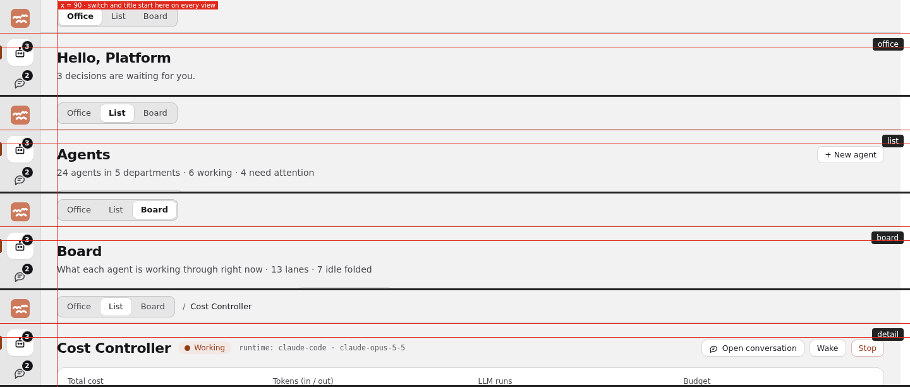

| | Desktop 1440 × 900 | Narrow |
|---|---|---|
| Office | 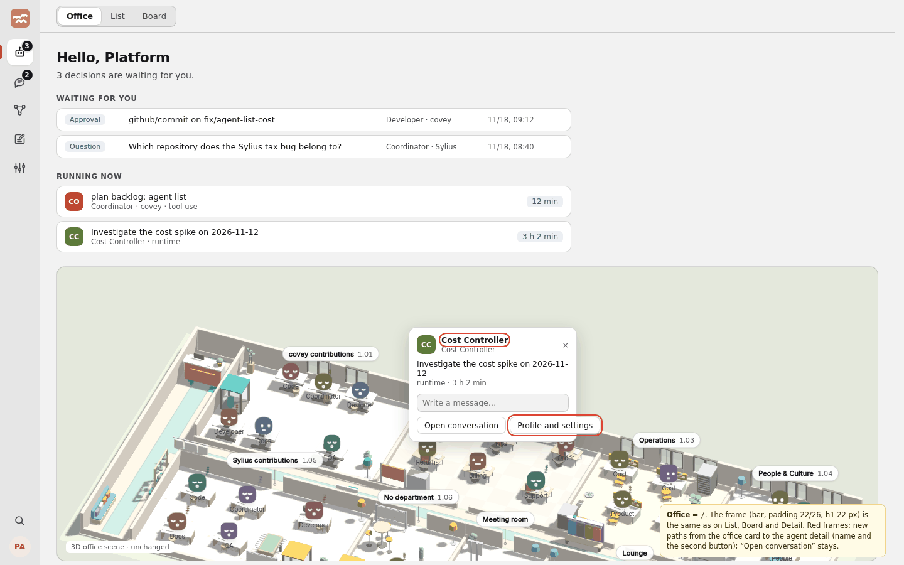 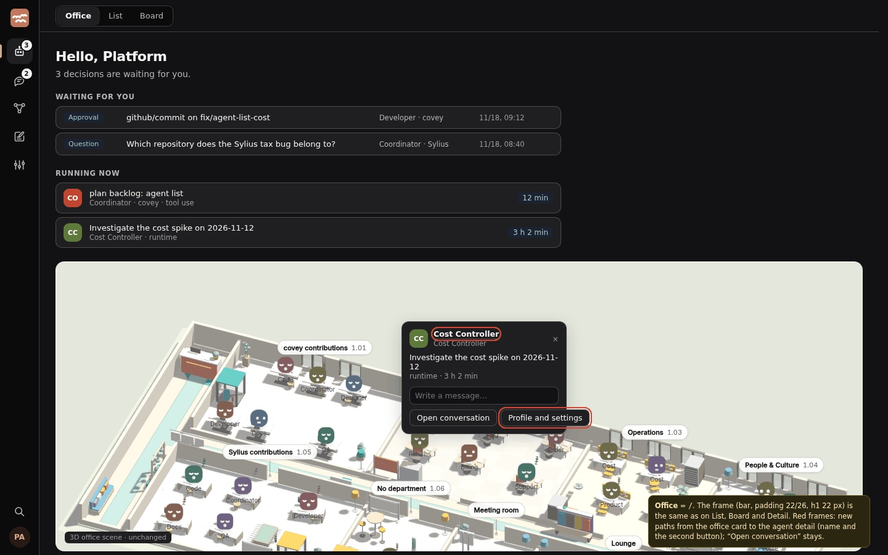 | 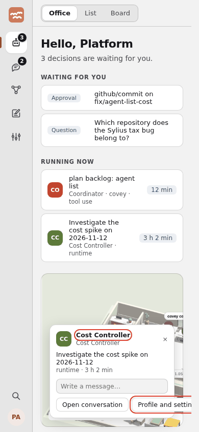 |
| List | 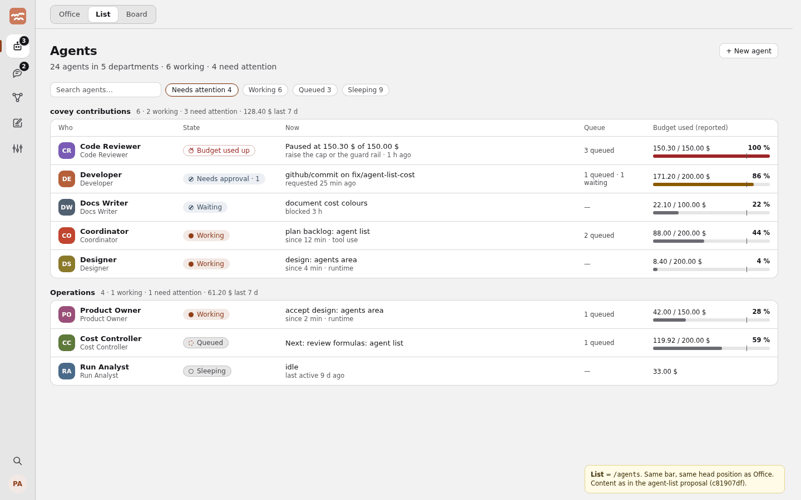 | 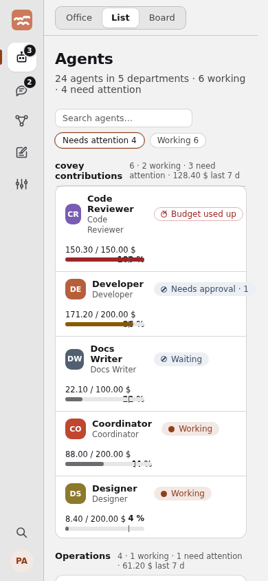 |
| Board | 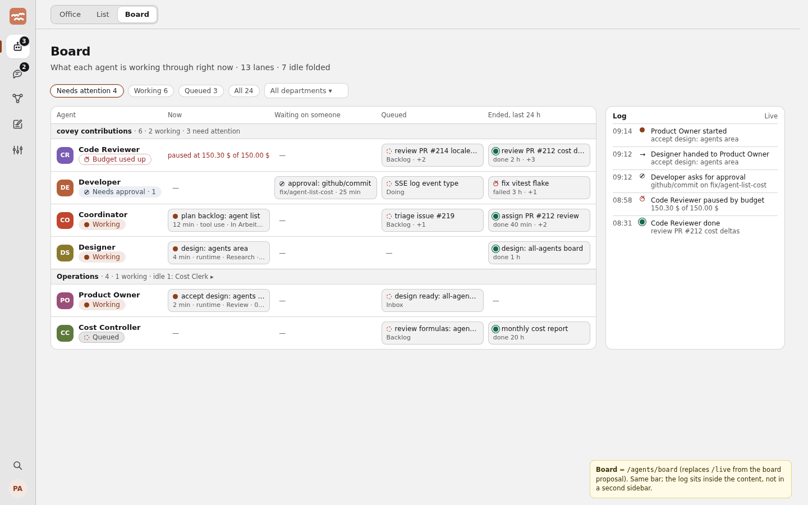 | 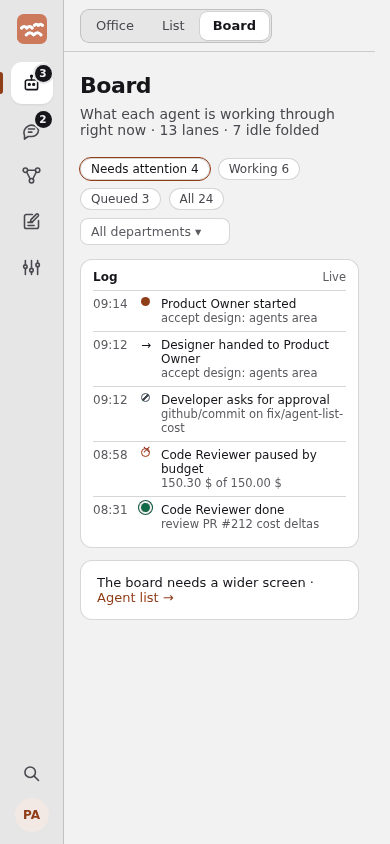 |
| Detail | 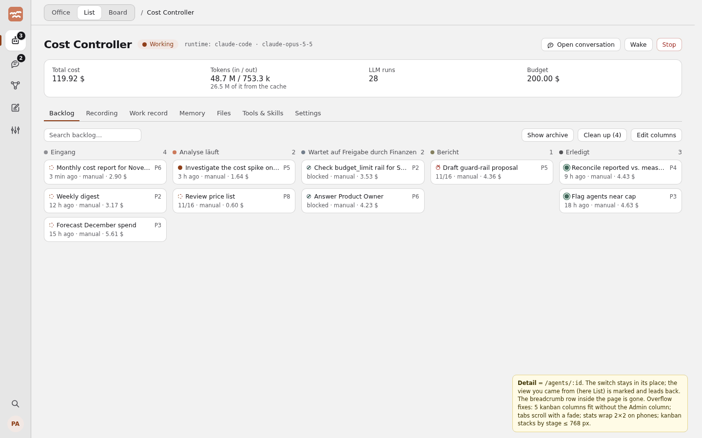 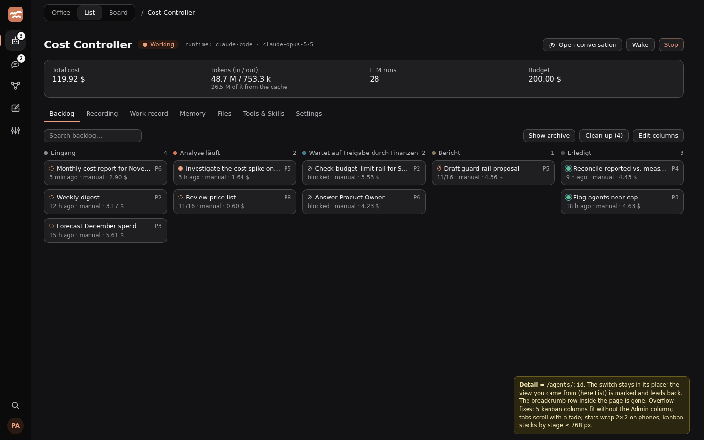 | 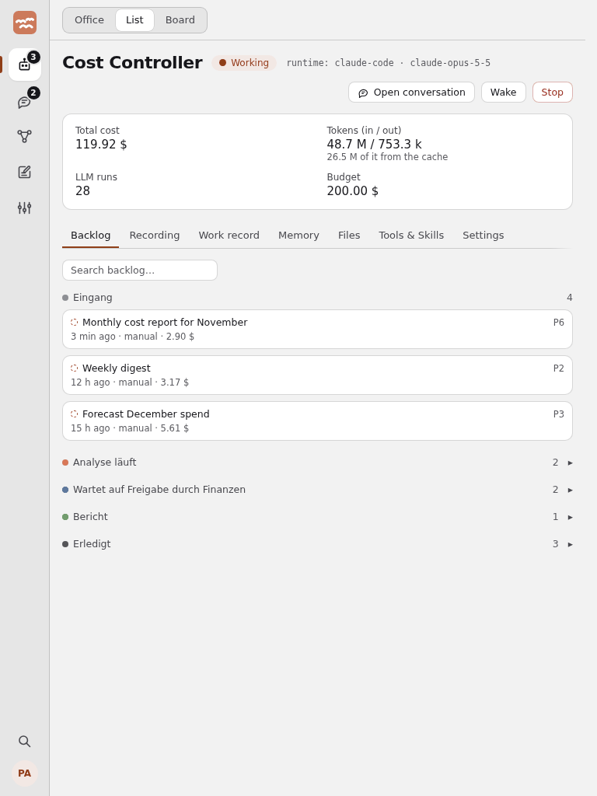 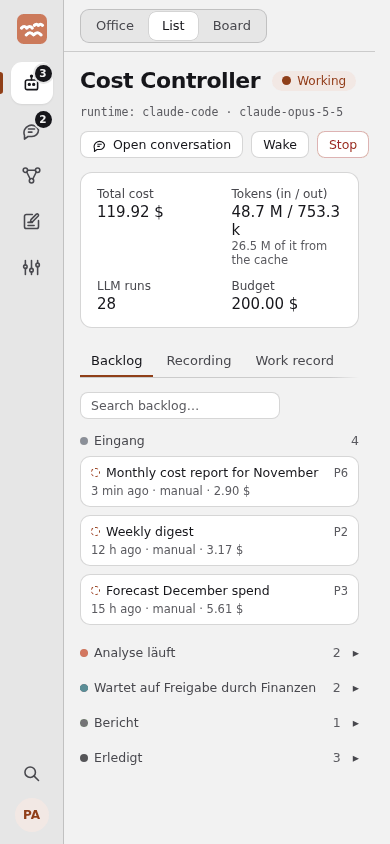 |
| Without team surface | 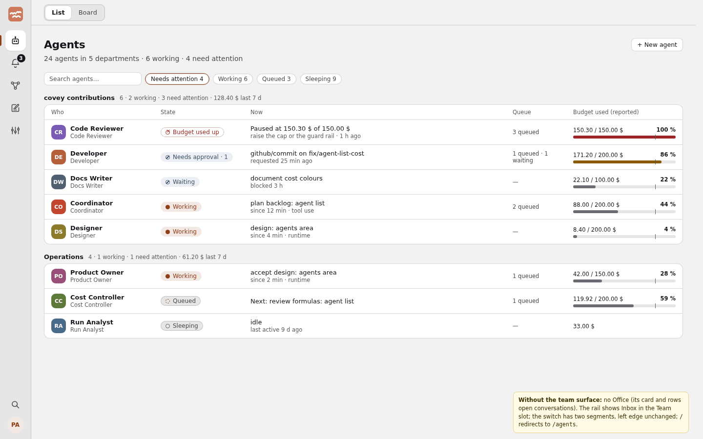 | |

### Detail: a view of its own, not a panel
The detail has seven tabs and a five-column backlog, so it needs the full width; squeezing it is what overflowed in 02a7904f.
- **In the bar:** the switch stays in its place. The view you came from (`location.state.from` = `office|list|board`) is marked, with the title `agents.backTo` “Back to List”. After it comes the crumb `/ Cost Controller`.
- **Without an origin** (a bookmark, a link in an agent message, a notification), the origin is **List**.
- **Back:** click the marked segment, which restores that view's last URL with its filters (kept per view in `sessionStorage`), or use browser back.
- **Page head:** the breadcrumb row inside the page (`Agent.tsx:124-129`) goes. The head becomes name, state badge and runtime/model, with “Open conversation” (team surface only), Wake and Stop on the right.

**Overflow fixes (02a7904f findings):**
- **D1 Backlog kanban.** With the Admin column, the content at 1440 px was 1084 px wide, but five columns need 1148 px, so 64 px of the last column were hidden with no cue (`app.css:1218`, `minmax(220px,1fr)`). Without the column the content is 1324 px.
  - Set the minimum to `minmax(180px, 1fr)`.
  - If the columns still don't fit, the board scrolls sideways, with a fade on the clipped edge.
  - At ≤ 768 px the stages stack: one heading per stage with its count, as a button with `aria-expanded`. The first non-empty stage and the stage holding the running task are open.
- **D2 Tabs.** At 390 px “Work record” broke onto two lines and “Files” was cut off.
  - Use `nowrap` and sideways scroll, with a fade on the clipped edge (≤ 768 px).
  - The selected tab scrolls into view.
- **D3 Stats cards** (CostBar, Performance). At 390 px four squeezed columns broke “Total cost 119.92 $” over four lines. Use `repeat(auto-fit, minmax(140px, 1fr))`: four across on desktop, 2 × 2 on a phone.
- **D4 Costs page** (Admin): the chip row needs 3108 px and gets 1067 px. This is not part of this frame; it is cut item 6.

## 4. What stays in Admin (every item of `AppShell.tsx:312-387` placed)
| Today | After | Reason |
|---|---|---|
| Setup (while open) | **rail shortcut only** (`Rail.tsx:93`); leaves the column | Both copies show at the same time and point to the same page. The rail copy is visible from every place. |
| Agents | **rail “Agents”** | It is daily work, not a setting (the wish). |
| Inbox (team surface off) | **rail “Inbox”**, in the slot “Team” takes when the team surface is on | Decisions are the human's daily to-do. With the team surface on, `/inbox` still redirects to `/team`. |
| Org Chart | **stays in Admin**, first group | It is where departments, reporting lines and the org description are built, which is setup work. A fourth segment would not fit the switch at 390 px. The List already groups by department. |
| Costs | **stays in Admin**, first group | It is about money and its sources (reported/measured/real), invoices and budget rails: controlling, not daily agent work. Per-agent spend already shows in List, Board and Detail. It also keeps “measured” blue away from the area's waiting blue. |
| Tools: Connected systems, Credentials, Skills, Voices, Templates | unchanged | |
| Security: Rules, Internet access, Activity log (org_admin/security/auditor), Traffic (org_admin/security) | unchanged, gates unchanged | |
| Organization: Members, Settings (org_admin), Infrastructure, Platform (system admin) | unchanged, gates unchanged | |

The column becomes: *Org Chart, Costs* · TOOLS (5) · SECURITY (4) · ORGANIZATION (4). The rail's Admin entry lands on `/org`. Mockup: `agents-area/5-admin-light-1440.png`.

## 5. Paths between views
| From → to | How |
|---|---|
| Office card → Detail | The card's name becomes a link, and a second button “Profile and settings” (`conversation.profile`) sits next to “Open conversation” (`Buero.tsx:613`, BuKarte `:681`). Sets `from=office`. |
| Office rows (“Waiting for you”, “Running now”) | Unchanged: they open the conversation, where decisions are made. |
| List row → Detail | The row link, with `from=list`. |
| Board card or lane header → Detail | As in the board proposal §7 (`?tab=backlog`, or `recording&task=`), with `from=board`. |
| Detail → back | The marked origin segment, or browser back. |
| Conversation → Detail | “Profile and settings” in the thread menu (`Thread.tsx:388`), unchanged. The rail moves from Team to Agents, and no Admin column appears. |
| Detail → Conversation | The new “Open conversation” button in the head (`team.gespraech`), team surface only. |

## 6. Strings
**Reused:** `nav.agents`, `nav.inbox`, `team.verwaltung`, `team.ueberblick` (Office segment), `dashboard.title`, `team.wartetTitel`, `conversation.profile`, `team.gespraech`.

**New, in all ten locales:**
- `agents.views` “Agent views”
- `agents.view.list` “List”
- `agents.view.board` “Board”
- `agents.backTo` “Back to {{view}}”

**Changed text:** `tour.buero.titel` and `tour.buero.text`.

`mobile.ansichtListe` and `mobile.ansichtBoard` say the same words, but they label the mobile app's own toggle. One key belongs to one place.

## 7. Acceptance criteria
1. **Rail.** In both modes the rail reads: mark, (Setup), Agents, Team or Inbox, Workflows, Notes, Admin. There is no Office entry. Admin opens `/org`. The badges are as in §1.
2. **Frame.** At 1440, 768 and 390 px, the switch's left edge, the bar's height (52 px) and the h1's top-left corner are identical on Office, List, Board and Detail.
3. **No sideways movement.** No view has a second sidebar. `scrollWidth == clientWidth` on every view, and the content's left edge does not change between views.
4. **Back from the detail.** Open a detail from the Office card, from a List filtered to `?status=working`, and from a Board card. Back returns to that view with its filters. A bookmarked `/agents/<id>` marks List.
5. **Conversation.** `/team/<id>` ↔ detail works in both directions, and no Admin column appears.
6. **Admin column.** For each role it holds exactly the items in §4.
7. **Without the team surface.** `/` → `/agents`, the switch shows `List | Board`, and the rail shows Inbox with a count.
8. **Detail at 1440 px:** all five backlog columns are visible. **At 390 px:** the tabs scroll on one line, the stats are 2 × 2, and the backlog stacks by stage.
9. **Accessibility.** Light and dark are both checked. The switch can be reached with Tab, each segment is a link, the current one has `aria-current`, and focus shows `--accent-ring`.
10. **Strings.** The new keys exist in all ten locales, and `locales/parity.test.ts` is green.

## 8. Implementation cut (for covey-lead)
| PR | Content | Depends on |
|---|---|---|
| 1 | Rail entry + routes: `RailPlace` `agents`/`inbox`; Agents and Inbox entries; Admin → `/org`; `imTeam` without `/`; AppShell renders `/` (Office) with the column hidden for Agents and Inbox; tour target. Vitest for the path → rail place mapping. | — |
| 2 | Shared frame: `AgentsFrame`, `ViewSwitch`, `scrollbar-gutter`, Office padding and h1, origin state, crumb, office card links, “Open conversation” on the detail, strings. | 1 |
| 3 | Admin column cleanup (§4). | 1 |
| 4 | Board view at `/agents/board`, plus the API from board proposal §8 (4a backend, 4b view). | 2 (view), — (API) |
| 5 | Detail overflow D1–D3 (CSS + `Agent.tsx` tabs). | — (check again after 2) |
| 6 | Costs page overflow (D4). | — |
| 7 | Agent list redesign (proposal c81907df) inside the frame. | 2 |

## 9. Open points for product-owner (defaults apply)
Nothing here needs the human: Admin stays in the rail.
- **(a) Office without the team surface.** Default: no Office. Alternative: an Office whose card opens the detail.
- **(b) “Agents” and “Team” side by side in the rail.** “Team” means conversations. Default: keep it. Alternative: rename it to “Conversations” in a separate copy PR.
- **(c) What the rail entry opens.** Default: the last view used. Alternative: always the default view.
