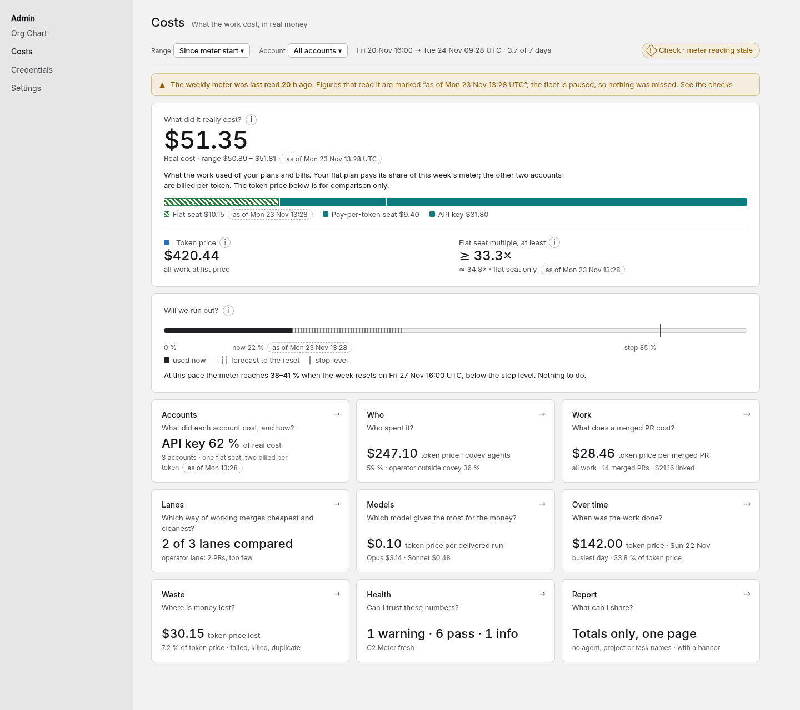
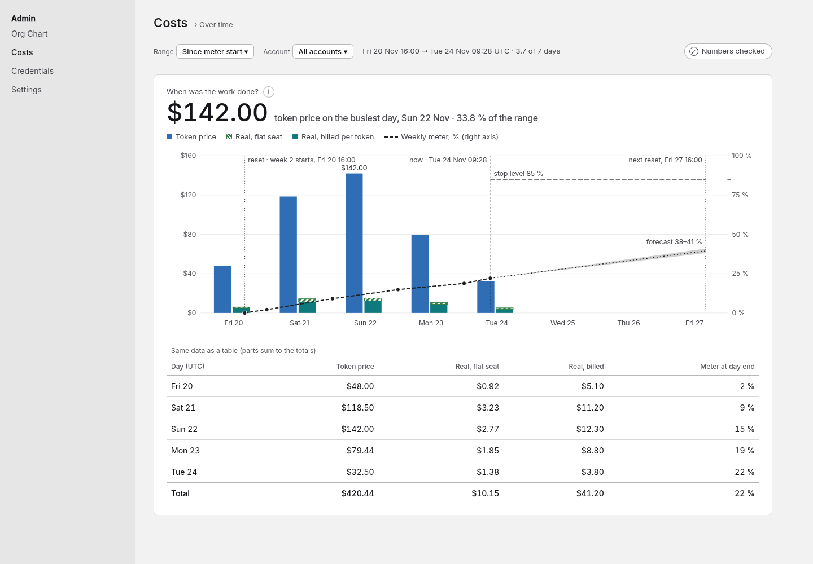
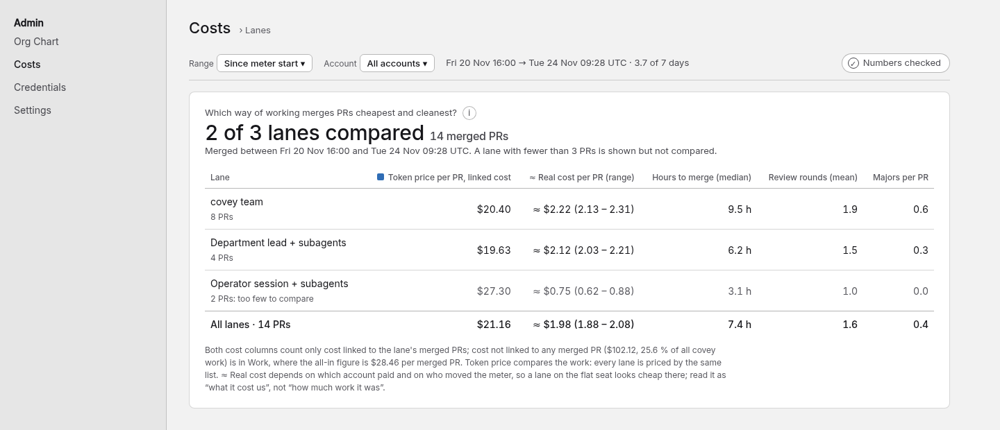
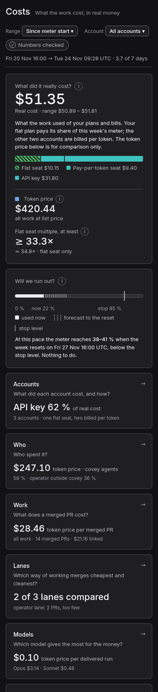

# Design: the cost home and its subviews (health first, one question per view)

Status: proposal **for the human's approval** (round 2: review round 1 worked in). Nothing is built. `Part of #161` (the redesign brief); the lane view is #181, the trust badge #178 (built in #179), the meter line #170, the methodology #187. Starting point: the operator's draft of questions Q1–Q10 and views (approved direction: health first). Files this will touch later: `web/src/pages/Costs.tsx` and a new `web/src/pages/costs/` folder, `AppShell.tsx` routes, `format.ts`, the ten locale files. Colours and tokens: `web/src/styles.css`. Mock-ups (static HTML with covey's tokens, rendered in both themes) are in `docs/design/cost-home/mockup/`; every number on them comes from one seeded sample (§3) and is **sample data, not a measurement**. Start with `cost-home/1-home-1440.png`.


**The question the home answers:** *What did the work really cost?* Everything else on the page either explains that figure (token price, multiple), guards it (the gauge and the trust badge, which only speak up when something is wrong) or is one click away (nine cards, one question each). **Every figure stands once on the home** (§6 lists them); detail views repeat a figure only as the evidence of itself.

## 1. The ten questions, and the one view each lives in

Each question has **one** view that answers it. The home holds Q1, Q2, Q3, Q7 (the band and the gauge); every other question has its own view, reached from a card. `/costs/time` answers a question of its own (when), it does not answer Q2 or Q7 a second time; it draws the meter and the forecast as evidence only (§8.5).

| Q | Question | The one view (route) | Headline figure (the answer first) |
|---|---|---|---|
| Q1 | What did it really cost? | home `/costs` | **Real cost** $51.35 (range $50.89 – $51.81) |
| Q2 | What is the token price? | home `/costs` | **Token price** $420.44 |
| Q3 | How many times over (metered windows only)? | home `/costs` | **≥ 33.3×** (flat seat; estimate 34.8×) |
| Q4 | Who spent it? | `/costs/who` | covey agents $247.10 (59 % of token price) |
| Q5 | On what work? | `/costs/work` | **$28.46 token price per merged PR**, all work counted (§8.3) |
| Q6 | Which model gives the most for the money? | `/costs/models` | $0.10 per delivered run (cheapest model) |
| Q7 | Will we run out? | home `/costs` (gauge) | **38–41 %** at the reset; stop level 85 % |
| Q8 | Per account? | `/costs/accounts` | API key $31.80 of $51.35 real (62 %) |
| Q9 | Can I trust these numbers? | `/costs/health` (the badge on every view links there) | 7 pass · 1 info |
| Q10 | Where is the waste? | `/costs/waste` | $30.15 lost (7.2 % of token price) |
| — | When was the work done? | `/costs/time` | $142.00 token price on the busiest day (Sun 22 Nov) |
| — | Which way of working merges cheapest and cleanest? (#181) | `/costs/lanes` | 2 of 3 lanes compared, 14 merged PRs |
| — | What can I share? | `/costs/report` | totals only, one page |

**Relation to the headline spec (`cost-page-headline.md`).** That spec fixed seven tiles for the old single page. Here they find their homes: Real, Billed and the multiple are the Accounts view (and three of them the home band), Reported and the price-table check are in Health (`Reported` is Claude Code's own number and answers no question of its own), Input/Output tokens are in Models and Waste. Its rules carry over unchanged except one: **the all-or-nothing sum is replaced by "a total with a missing part is a lower bound"** (§7, decision D5). If both specs are approved, the headline spec's tiles become the accounts view's per-account facts and this spec wins where they differ.

## 2. Principles, applied (the checklist a reviewer uses)

| Principle | How it shows |
|---|---|
| One question per view, answer first | Each view opens with its question as a sentence, then one big figure, then the evidence. The home's one question is Q1. |
| Every figure once on the home | §6 lists each figure of the home and where it stands; a test collects the figures' text and finds no duplicate. Detail views repeat a figure only as the chart or table that evidences it. |
| Real vs token price always labelled | The words **Real cost** and **Token price** stand next to every dollar figure, on every card (in the big figure's own line), row and chart bar. A bare `$` figure does not exist. Token price carries a blue swatch, real cost has none (it is a sum of two sources, §3). |
| Range and account always visible | The context strip (§4) is on every view; it is sticky, it is in the URL, it is in every report. |
| Parts sum to totals | Every table has a total row that is the sum of the unrounded parts; displayed cents follow the largest-remainder rule so the displayed parts add to the displayed total (example: `who` real 33.15 + 4.15 + 11.49 + 1.87 + 0.69 = 51.35). A test compares each view's total with the home's. |
| Never a smaller number in silence | §7: a failed check marks every figure it touches with a shape (≥, a chip) and words. Colour sits on the badge and the alert only. |
| Trust badge | Every view, in the strip. §7. |
| "How is this computed" | One ⓘ per figure opens a drawer in plain words with this page's own numbers (§5). |
| 390 px, light, dark, accessible | §10. |
| All strings in the locale files | §11. |

## 3. Vocabulary, colour code, the sample

**Words.** Plain words on the page; the technical word only inside the drawer or Health.

| On the page | Means | Not said on the page |
|---|---|---|
| Real cost | the money the work used: a flat seat's metered share of the plan price + what was billed per token | reported, recomputed, engine |
| Token price | the same tokens priced at Anthropic's list (`recomputed` in the code) | list price, recomputed |
| Flat seat | a subscription with a weekly meter | seat, credential, oauth |
| Pay-per-token seat / API key | an account billed per token | basis, usage charges |
| points of this week's meter | whole percent points the weekly meter moved | chunks, baseline, lag |
| at least 33.3× | token price ÷ the highest real cost the meter allows (a **floor**) | multiple range |
| Not attributed | the part of the meter's movement that no recorded call explains; it stays a row of its own and is never folded into a group | unattributed, U_c |

**Colour: one colour, one meaning.** One new token at most (`--cost-meter`, see below).

| Token | Means, everywhere on `/costs/*` | Never used for |
|---|---|---|
| `--cost-recomputed` (blue) | token price | status, who, models |
| `--cost-real` (green, **hatched**) | real cost of a **flat seat** (meter × plan price) | health or "OK" |
| `--cost-billed` (teal, solid) | real cost **billed per token** (API key bill, pay-per-token seat's charges) | anything else |
| `--cost-meter` (ink, dashed line) | the weekly meter, in % (#170) | — |
| `--cost-unsplit` + `--cost-unsplit-edge` (grey, plain, dashed edge) | the **Not attributed** part | status |
| `--cost-type-*` (blue family) | token types (Waste: cache reads) | sources, accounts |
| `--text-warning` + `--bg-warning` | **look at this**: a check needs a look (WARN); a forecast within 10 points of the stop level | decoration, a fixed marker |
| `--text-danger` + `--danger-tint` | **act now**: a check failed (FAIL); a forecast that reaches the stop level | decoration, a fixed marker |
| neutral ink + ✓ | all checks pass; also the **stop level marker** (ink line + the words "stop 85 %") | green (see D1) |
| `--cost-reported` (grey) | Claude Code's own number, **Health only** | — |

Amber and red have one meaning on the whole page: *needs a look* and *needs action*. A data-trust state and a quota state may both use them because both ask the reader to act; the words and the shape say which. Nothing amber or red is on screen while nothing needs a look, so the healthy home has no red or amber (the stop level marker is ink). The marks on **figures** (≥, chips) never use colour at all.

Real cost has two sources (green hatched and teal), so its total has no colour of its own: a stacked bar shows the parts, the total is plain text. Who, models, lanes and accounts are **rows, not colours**: bars in those views are all blue because they split a token price, and the row label says who. Hatch against solid, not hue, is what separates green from teal (colour-blind safe).

**Tokens against main (`web/src/styles.css`).** Present on main and used here: `--cost-reported`, `-recomputed`, `-real`, `-billed`, `--cost-unsplit`, `--cost-unsplit-edge`, `--cost-type-*`, `--text-warning`, `--bg-warning`, `--text-danger`, `--danger-tint`. **`--cost-meter` is not on main**: it comes with open #170; this design depends on #170 landing (else it adds that one token, value as in the mock-ups). **Kept, not used by `/costs/*`:** `--cost-outside`, `--cost-source-*`, `--cost-origin-*` and `--cost-unattributed` (a second, amber meaning of "not attributed") belong to `OutsideCosts`, `OutsideSessions` and `costSources.ts`, which this spec does not touch; the new views use `--cost-unsplit` for Not attributed. If those pages are folded into Who later, the four groups of tokens are retired with them.

**The sample behind every figure** (seeded install; weekly meter reset Fri 20 Nov 16:00 UTC, "now" Tue 24 Nov 09:28 UTC, so 3.73 of 7 days; flat seat on a $200/month plan).

| Account | Token price | Real cost | How real is measured |
|---|---|---|---|
| Flat seat | $353.12 | **$10.15** | 22 points × $0.4615 (= $200 × 12 ÷ 52 ÷ 100); range ±1 point = $9.69 – $10.61 |
| Pay-per-token seat | $15.00 | **$9.40** | usage charges |
| API key | $52.32 | **$31.80** | Anthropic's bill |
| **Total** | **$420.44** | **$51.35** (range $50.89 – $51.81) | sum of the three |

Multiple (flat seat only): $353.12 ÷ $10.15 = **34.8×**; range $353.12 ÷ $10.61 = 33.3× to $353.12 ÷ $9.69 = 36.4×; the **floor** shown first is the low end, 33.3×.

**Who moved the meter (the split behind every "≈ Real cost").** It is the code's split, not a pro-rata (`splitSeatSince`, `internal/observability/external.go:2700`; chunks `seatChunks` :2304; spec #187 R3/R4): the flat seat's 22 points are cut into chunks of at least 5 points (`chunkMinPoints`); inside a chunk each party gets its share of the points by its share of the chunk's token price; points no recorded call explains are **not attributed** (`chunkUnattributed`, a lower bound) and stay visible; a party's part carries a range of S = 2 points (`chunkSlackPoints`) × its share, per chunk. The sample has two chunks (12 and 10 points) with constant shares for the ranges:

| Flat seat, by group | Token price on it | Points | ≈ Real cost | Range (± 2 points × share × 2 chunks × $0.4615) |
|---|---|---|---|---|
| covey agents | $201.68 (57.1 %) | 11.4 | $5.26 | ± $1.05 |
| operator (outside covey) | $151.32 (42.9 %) | 9.0 | $4.15 | ± $0.79 |
| probes | $0.12 | 0.1 | $0.05 | < $0.01 |
| Not attributed | — | ≥ 1.5 | ≥ $0.69 | a lower bound, no range |
| **Flat seat** | **$353.12** | **22** | **$10.15** | ± 1 point (above) |

A billed account's bill is spread over its lines by token price (assumption A7): pay-per-token seat $9.40 all covey; API key $31.80 = covey $18.49 (token price $30.42) + other projects $11.49 ($18.90) + probes $1.82 ($3.00). The ranges of the groups do not add up to the total's; the values do.

## 4. The shell every view shares

```
┌ Costs › <view>                                                          ┐
│ Range [Since meter start ▾]  Account [All accounts ▾]   <span>   (✓ Numbers checked) │  ← sticky strip
│ <alert, only when a check is WARN/FAIL or could not run>               │
│ ┌ <the view's question> (i) ───────────────────────────────────────────┐ │
│ │ <the headline figure, big>   <its range or bound, small>              │ │
│ │ <one plain sentence in words; figures only if the view shows them nowhere else> │ │
│ └───────────────────────────────────────────────────────────────────────┘ │
│  evidence: table or chart, total row, "Show as table" always available  │
└─────────────────────────────────────────────────────────────────────────┘
```

- **Range** presets: **Since meter start** (default: the meter's current week, so the multiple, the real cost and the token price share one window), 24 h, 7 days, 30 days, custom. When the range is not the meter's span the multiple says "since {{date}}" and covers only the metered part; every other figure follows the range. **The span line** states the window in words: `Fri 20 Nov 16:00 → Tue 24 Nov 09:28 UTC · 3.7 of 7 days`. One window for the whole page (#161 problem 4).
- **Account**: All accounts, or one account. A view that cannot follow it (Lanes, Report) **greys its figures and says "all accounts only"**, it does not show a different scope.
- Both controls live in the URL (`?range=…&account=…`) and persist across views; a shared link restores them. Plan price, cost basis and usage charges are **not** here: they are a ⚙ drawer on each account row (#161: settings apart from view controls). The source chips, layout and split toggles of the old page are gone; the chart's legend entries toggle series.
- **The trust badge** (§7) sits at the strip's right end and is a link to `/costs/health`. Its text is one line: `Numbers checked` when all is well (no count: the count is the Health card's), else the worst reason.
- **Sticky at 390 px**: the strip collapses to one line `Since meter start · All accounts · ✓`; tapping opens a sheet with the two selectors and the span line.

## 5. The "how is this computed" drawer

One ⓘ button per headline figure (hit area 44 × 44, visible circle 20). It opens a **right drawer 420 px wide** (a **bottom sheet, up to 82 % of the height** at < 600 px; `role="dialog"`, labelled by its title, focus moves in and is trapped, Esc and a Close button close it, focus returns to the ⓘ). Five fixed blocks, each one or two sentences, **with the numbers of the page filled in** (the same values, through the same formatters, so a test can compare them with the screen; the drawer is not the default view, so it may repeat a figure of the page):

1. **In one sentence** — what the figure is.
2. **With this page's numbers** — the arithmetic: `22 points × $0.4615 = $10.15`.
3. **Where its inputs come from** — in words ("one point costs the plan's weekly price ÷ 100").
4. **Why a range, a "≥" or a dash** — only when one applies now (§7 names which).
5. **What it does not include.**

Mock-up: `cost-home/1-home-drawer-dark-390.png`.


## 6. The home `/costs`

```
 Costs                                                   What the work cost, in real money
 Range [Since meter start ▾] Account [All accounts ▾]  Fri 20 Nov 16:00 → Tue 24 Nov 09:28 UTC · 3.7 of 7 days  (✓ Numbers checked)
┌────────────────────────────────────────────────────────────────────────────────────────┐
│ What did it really cost? (i)                                                            │
│ $51.35                                       ← Real cost, 44 px                         │
│ Real cost · range $50.89 – $51.81                                                       │
│ What the work used of your plans and bills. Your flat plan pays its share of this       │
│ week's meter; the other two accounts are billed per token. …for comparison only.        │
│ ▨▨▨▨▨▨▨▨▨▨▨▨▨▨▨█████████ ███████████████████████████████████████████████  (the parts)   │
│ ▨ Flat seat $10.15   ■ Pay-per-token seat $9.40   ■ API key $31.80                      │
│ ──────────────────────────────────────────────────────────────────────────────────────  │
│ ■ Token price (i)                     Flat seat multiple, at least (i)                  │
│ $420.44                               ≥ 33.3×                                           │
│ all work at list price                ≈ 34.8× · flat seat only                          │
└────────────────────────────────────────────────────────────────────────────────────────┘
┌ Will we run out? (i) ──────────────────────────────────────────────────────────────────┐
│ ━━━━━━━━━┆┆┆┆┆┆┆┆┆┆┆┆┆┆┆┆┆┆┆┆┆┆┆                                    ▏  (ink)          │
│ 0 %      now 22 %                                                stop 85 %              │
│ At this pace the meter reaches 38–41 % when the week resets on Fri 27 Nov 16:00 UTC,   │
│ below the stop level. Nothing to do.                                                    │
└────────────────────────────────────────────────────────────────────────────────────────┘
 [Accounts] [Who] [Work]        each card: title, its question, headline figure with its
 [Lanes]    [Models] [Over time] label in the same line, one grey sub-line; the whole card is the link.
 [Waste]    [Health] [Report]
```

**Every figure once.** The home's figures, each in exactly one place: headline $51.35 and its range; parts $10.15, $9.40, $31.80 (legend); Token price $420.44; multiple ≥ 33.3× and its estimate 34.8×; gauge now 22 %, stop 85 %, forecast 38–41 %, the reset date; cards: Accounts 62 % · 3 accounts; Who $247.10 · 59 % · 36 %; Work $28.46 · 14 · $21.16; Lanes 2 of 3; Models $0.10 · $3.14 · $0.48; Over time $142.00 · 33.8 %; Waste $30.15 · 7.2 %; Health 7 pass · 1 info · 09:27. The sentence under the headline therefore carries **no figure**; the multiple's range 33.3×–36.4× and the points behind the real cost are in the drawer and in Accounts. A test collects the text of the home's figures and fails on a duplicate.

| Figure | Formula | Label | Notes |
|---|---|---|---|
| Real cost | R = Σ over accounts: flat seat **points × weekly price ÷ 100**, pay-per-token seat usage charges, API key bill. Range = R ± 1 point per flat seat | Real cost | a total with an account that has no figure is a lower bound, "≥" + the account named (§7, D5); with no account at all "–" + the reasons |
| the parts bar | the three account figures | Flat seat / Pay-per-token seat / API key | green hatched + teal; the total stands once, above |
| Token price | T = Σ recomputed list price of all lines in the range, all accounts, covey and outside | Token price | "≥" or a chip while a check touches it (§7) |
| Multiple | floor = T_flat ÷ (R_flat + 1 point); estimate T_flat ÷ R_flat; range floor – T_flat ÷ (R_flat − 1 point) (range in the drawer and Accounts). T_flat = token price of the flat seat over the **meter's span**. Needs ≥ 3 points moved (headline spec) | Flat seat multiple, at least | floor is the headline: it can only be too low |
| Gauge | now = latest weekly meter %. **Forecast** = now + pace × days to the next reset; low pace = the last 24 h, high pace = the whole week so far (22 ÷ 3.73 d = 5.9 points/day; last 24 h 5 points → 38 %, 41 %). Stop level = the org's stop % | Will we run out? | needs ≥ 24 h of readings, else "too early to forecast" and no hatched band. **Several flat seats: the gauge shows the fullest one** (highest forecast), the sentence names it ("Seat B …"), the others are rows on the Time view. The pay-per-token seat's monthly limit meter (0152, `internal/runtimes/usagelimit.go`) is **not** a gauge here: its money is its usage charges (Accounts) |
| Card: Over time | busiest day = the UTC day with the highest token price in the range; its share = that day's token price ÷ T (sample $142.00 ÷ $420.44 = 33.8 %) | token price · day | formula also in §8.5 |

**Gauge states.** The stop level marker is **ink** (a line and the words "stop 85 %") in every state; it never carries a colour of its own. **Neutral** while forecast high < stop − 10 points (sample); **amber** (`--text-warning`, look at this) and the sentence "may reach the stop level before the reset" when the high end is within 10 points of the stop; **red** (`--text-danger`, act now) "will stop work on {{day}} around {{hour}} UTC" when the low end ≥ stop. The state is the **sentence and the marker's shape**, not the fill colour.

Cards (each: one question, one labelled figure, one sub-line; mockup `1-home-1440.png`): Accounts, Who, Work, Lanes, Models, Over time, Waste, Health, Report. The big figure's own line says whether it is token price or real cost ("$247.10 token price · covey agents"); the grey sub-line never carries the label alone. The Health card shows the count (`7 pass · 1 info`; info never counts as a pass, as in #179) and the badge shows no count, so the two never say the same thing. The Lanes card says "2 of 3 lanes compared" (a lane with fewer than 3 PRs is not compared).

**Home states.** Empty (no usage in the range): the band reads "No work in this range" with the range-widening presets as buttons; no `$0.00` headline. First load: same frame, `--tint` bars, `aria-busy`. Reloading after a change: old values at 45 % opacity. Error: "Could not load cost figures · Retry" in the band, the strip stays. WARN, FAIL and "checks unavailable": §7, mockups `1-home-stale-1440.png`, `1-home-red-1440.png`; both are drawn **from the §7 table, figure by figure**.




## 7. Trust: the badge, the alert, and what a failing check does to a figure

**The badge has four faces; colour is never the only cue** (shape + words):

| State | Look | Text (en) | Source |
|---|---|---|---|
| all pass | neutral outline, ✓ in a circle | Numbers checked | every check PASS or info |
| WARN | `--bg-warning`, ◆ (look at this) | Check · {{reason}} | any WARN, no FAIL |
| FAIL | `--danger-tint`, ■ (act now) | Check failed · {{reason}} | any FAIL |
| unavailable | dashed outline, ? | Data checks unavailable · Retry | the checks could not run (a 5xx; #179 never shows green then) |

The FAIL word is "Check failed", not "Incomplete": a check can fail by *over*-counting (C4) as well as under-counting. The reason is the worst check's one-liner (#178). WARN and FAIL also raise **one alert line** under the strip with what it means for the figures and a link to Health; the alert says "incomplete", "may count twice" or "meter unreliable" as the check demands. "Unavailable" raises the line "The checks could not run; the figures are shown unchecked" and **changes no figure** (nothing is known).

**One rule for a sum with a missing part (decision D5).** A total over accounts is the **sum of the accounts that have a figure, shown as "≥" with a chip naming what is missing** ("≥ $41.20 · API key: no bill yet"); an account without a figure is "–" with its one-line reason on its own row; only when no account has a figure is the total "–". This replaces the headline spec's all-or-nothing rule for **totals** (its §3: "one account without a figure → –, never a smaller sum"): a smaller sum never appears *silently*, it appears marked. It does not change an account's own row, and the headline spec's "–" for the multiple stands. A ratio is never a bound unless one side is fixed: the **multiple** keeps its floor when only its numerator can be too small (C1, C5), and is "–" when its floor could be wrong the other way (C3, C4, C6 on the flat seat). #179 builds only an "incomplete" mark and hides nothing; the rule here is new work on top of it (§12).

**What a failing check does, figure by figure.** Cell = what the figure shows while that check is WARN/FAIL. `≥` lower bound: value kept, "≥" and the chip "incomplete". `chip` value kept, chip says why ("incomplete" for a share or ratio, "may count twice" for an over-count, "as of {{time}}" for a stale meter); no bound claimed. `floor` the multiple keeps "≥ floor", hides its estimate and range. `–` no value, one-line reason. `·` unaffected. C8 is info and changes nothing.

| Figure | C1 uploader | C2 meter (WARN) | C3 meter drop | C4 double booking | C5 model priced | C6 cost basis | C7 bill sync |
|---|---|---|---|---|---|---|---|
| Real cost, total | · | chip as of | ≥ | · | · | ≥ | ≥ |
| Real cost, one account | · | chip (flat seat) | ≥ (flat seat) | · | · | – (that account) | ≥ (API key) |
| Token price (home, view totals) | ≥ | · | · | chip may count twice | ≥ | · | · |
| Flat seat multiple | floor | chip as of | – | – | floor | – if the account is the flat seat, else · | · |
| Gauge, now % | · | chip as of | chip as read, "meter dropped" | · | · | · | · |
| Gauge, forecast | · | chip as of | – | · | · | · | · |
| Who: covey agents (token price) | · | · | · | chip | ≥ | · | · |
| Who: outside rows and probes | ≥ | · | · | chip | ≥ | · | · |
| Shares and cache-read share (% of token price) | chip | · | · | chip | chip | · | · |
| ≈ Real cost per group, per lane, per PR; the Not attributed row | chip (outside parts) | chip as of | ≥ | chip | chip | ≥ | ≥ |
| Work: token price rows, per merged PR | ≥ (operator's lines) | · | · | chip | ≥ | · | · |
| Lanes: covey team, department lead | · | · | · | chip | ≥ | · | · |
| Lanes: operator lane | ≥ | · | · | chip | ≥ | · | · |
| Models: token price, per delivered run | ≥ | · | · | chip | ≥ + the row "no list price" | · | · |
| Waste: failed, killed, duplicate | · | · | · | chip | ≥ | · | · |
| Waste: cache reads (below the line) | ≥ | · | · | chip | ≥ | · | · |
| Time: token price bars, busiest day | ≥ (the days since the last push) | · | · | chip | ≥ | · | · |
| Time: real bars | · | chip as of | ≥ (flat seat) | · | · | ≥ / – | ≥ |
| Time: meter line | · | ends at the last reading, "no readings since {{time}}" | drawn, the drop marked "?" | · | · | · | · |
| Report | copies the mark of each figure; a banner on top for any WARN or FAIL that cannot be removed | | | | | | |

Rules the table rests on: with **no meter reading at all** (C2 "none") the flat seat has no value, so its real cost, ≈ real parts, multiple and gauge are "–" with "no meter reading" (that is an account's no-figure state, not a check state). C1 touches only what the outside uploader brings: covey's own agents and runs are complete, so covey rows, the covey-team and department-lead lanes and Waste's failed/killed/duplicate rows are unaffected. **C4 cannot fail on today's schema** (#179 step 0: `external_usage`'s primary key and `idx_model_usage_line` make a duplicate impossible); the C4 column is the design for an install that lost a constraint and is built last (§12).

`≥` needs a formatter: **`fmtUSDAtLeast`** in `format.ts` (`≥ $420.44`, de `≥ 420,44 $`), next to `fmtUSDBelow`. A view whose figure is a bound says it in the drawer's block 4.

## 8. The subviews

Each section: question, headline, wireframe, figures with formulas, states. All share §4's strip, drawer and states; only what is specific is written. Numbers are the sample's.

### 8.1 `/costs/accounts` — Q8: what did each account cost, and how?

Headline: **API key $31.80 · 62 % of the $51.35 real cost** (Q1 is answered on the home; this view takes it apart). Sentence "The API key is the largest part; the flat seat is $10.15 for 22 points of the meter."

```
 Account                  Token price   Real cost    Token price ÷ real   How real is measured
 ▨ Flat seat              $353.12       $10.15       ≈ 34.8×  (33.3–36.4×) 22 points × $0.4615     ⚙ ▾
 ■ Pay-per-token seat     $15.00        $9.40        1.6×                  usage charges            ⚙ ▾
 ■ API key                $52.32        $31.80       1.6×                  Anthropic's bill, complete to 09:00 UTC  ⚙ ▾
 Total                    $420.44       $51.35
```

- Token price ÷ real: flat seat is an estimate with a range (meter in whole points); the other two are exact ratios (a bill). Real as a share of the total: 19.8 %, 18.3 %, 61.9 %.
- ▾ expands the account: plan price and its source, the meter's span and last reading time, readings count, the per-account rows the old "Subscription meter per credential" card carried (so that card goes). ⚙ opens the settings drawer (plan price, cost basis, usage charges) for `org_admin` and `security`; others see the read-only line.
- States per account: **no figure** (dashed row, reason: no meter reading / no plan price / no bill, the existing strings of the headline spec §4; the total becomes "≥", §7), **greyed** when an account is picked in the strip and the row is another account's.

### 8.2 `/costs/who` — Q4: who spent it?

Headline: **covey agents $247.10 · 59 % of token price**.

```
 Who                            Token price   Share    ≈ Real cost   Range (±)
 ███████████████████ covey agents          $247.10   58.8 %   ≈ $33.15     $32.10 – $34.20   ▾
 ████████████ operator (outside covey)     $151.32   36.0 %   ≈ $4.15      $3.36 – $4.94     ▾
 █ other projects (outside covey)          $18.90    4.5 %    ≈ $11.49     billed split (A7)  ▾
 ▏ probes                                  $3.12     0.7 %    ≈ $1.87      < $0.01 on the flat seat part  ▾
 ░ Not attributed (nobody can be given it)  —         —        ≥ $0.69
 Total                                     $420.44   100 %    $51.35
```

- Bars are one colour (token price), the length is the share. **Four fixed groups**; ▾ opens the agents (grouped by department as the agent filter is today) or the outside projects, with the rows summing to the group.
- **≈ Real cost** is the code's split (§3 "Who moved the meter"), not one rate per account: for the flat seat the meter's points are given to groups chunk by chunk by token-price share, with the range of 2 points × share per chunk; **what no recorded call explains stays the row "Not attributed"** (≥, drawn grey with a dashed edge) and is never folded into a group (#187 R3, R4). A billed account's bill is spread by token price (A7). The total row is exact and the displayed parts add up to it (33.15 + 4.15 + 11.49 + 1.87 + 0.69 = 51.35). The operator works entirely on the flat seat, so its $4.15 is a part of the 22 points, with a range.
- Operator, other projects: labelled "outside covey" wherever they appear (the human's rule, #161). "Probes" = the cost of covey's own health and connectivity probes (assumption A3).
- Empty: "No outside usage in this range" when only covey has rows. C1 FAIL: the outside rows are "≥" (§7).

### 8.3 `/costs/work` — Q5: what does a merged PR cost?

Headline: **$28.46 token price per merged PR, all work counted** (398.42 ÷ 14) · ≈ real $2.66 (2.53 – 2.80). Beside it, smaller: **$21.16 for the cost linked to merged PRs only** (296.30 ÷ 14; ≈ real $1.98, 1.88 – 2.08). Scope: covey agents + operator ($398.42 of the $420.44; other projects and probes are not work on covey PRs). The headline is the all-in figure because the linked-only one leaves out $102.12 (25.6 % of the work) and can be flattered; the numerator always includes every cost of the scope.

```
 Where the covey work went                 Token price   ≈ Real cost (range)         PRs
 Linked to a merged PR                     $296.30       ≈ $27.74 (26.37 – 29.11)    14
   #170 costs: meter line                   $48.20  …    top 3 shown, then "11 others $169.25"
 Linked to an open or unmerged PR          $40.84        ≈ $3.82 (3.63 – 4.01)       3
 Not linked to any PR                      $61.28        ≈ $5.74 (5.46 – 6.02)
 Total covey work                          $398.42       ≈ $37.30 (35.45 – 39.15)
 All-in per merged PR   = 398.42 ÷ 14 = $28.46 · ≈ real 37.30 ÷ 14 = $2.66 (2.53 – 2.80)
 Linked to merged PRs   = 296.30 ÷ 14 = $21.16 · ≈ real 27.74 ÷ 14 = $1.98 (1.88 – 2.08)
```

- A cost is linked to a PR by `Fixes #n` / `Part of #n` and the branch (#181 gap 3). The three rows plus total always sum; "not linked" is shown, never dropped.
- ≈ Real cost of a row = its lines' parts of the split (§3, covey agents $33.15 + operator $4.15 = $37.30). The sample assumes the same account mix in every row (A6); the range of a row is the flat-seat range of covey and operator together (±$1.85) times the row's share of token price.
- Sub-table: the most expensive merged PRs (number, token price, hours to merge, rounds), **top 3** then the rest as one row.
- Empty: "No PR merged in this range" (the per-PR figures become "–", the rows stay). Needs-data state until #181 ships (§12).

### 8.4 `/costs/models` — Q6: which model gives the most for the money?

Headline: **$0.10 per delivered run (Haiku 5.5)** next to Opus 5.5 $3.14.

```
 Model         Token price   Share    Runs delivered / all   Token price per delivered run
 Opus 5.5      $301.20       71.6 %   96 / 118  (81 %)       $3.14
 Sonnet 5.5    $101.30       24.1 %   212 / 240 (88 %)       $0.48
 Haiku 5.5     $17.94        4.3 %    188 / 205 (92 %)       $0.10
 Total         $420.44       100 %
```

- **Delivered run** = a run that ended with a result (not failed, not killed). Token price per delivered run = token price ÷ delivered runs (cost of failures is in the numerator, so a model that fails often looks dearer: that is the point).
- Variant **C5 FAIL** (a used model has no price; not in the sample, where all 3 models are priced): a row "No list price: model X — 0.9 M tokens, in no figure above" is added and the token price figures carry "≥".
- Not "better": a sub-line says "Price per run compares cost, not quality; waste is in Waste." Tokens in/out per model in the row's ▾, with cache-read share.

### 8.5 `/costs/time` — when was the work done?

Headline: **$142.00 token price on the busiest day, Sun 22 Nov · 33.8 % of the range**. Formula: the UTC day with the highest token price in the range; share = that day ÷ T ($142.00 ÷ $420.44). The question is *when*; it does not answer Q2 or Q7 again: the meter line, the forecast wedge and the stop level below are the home gauge drawn on a time axis, **the same function and numbers** (evidence, not a second answer). Mock-up: `cost-home/2-time-1440.png`.



- Bars per day (UTC; hour/week/month by range): token price (blue) beside real cost (teal solid for billed, green hatched on top for the flat seat), the weekly meter as the dashed line on the right axis (#170: the line replaces labels; gaps stay gaps; **a reset is a solid fall**), forecast as a hatched wedge to the next reset, the stop level drawn **only from now to the reset** as an ink dashed line with the words "stop level 85 %" (a full-width line would cross bars of another axis; ink, not red: §3). **Resets are marked** by a dotted vertical line labelled "reset · week 2 starts, Fri 20 16:00"; a range spanning a reset shows the old week's last value falling to the new one.
- Per-day parts sum to the totals in the table beneath (always rendered; "Show as table" focuses it).
- Per bar tooltip: the day, token price, real cost per account kind, meter readings of that day with times (the first four and last four when more than eight).
- Empty / stale: meter line absent when no reading ("no meter readings in this range"); a gap in readings is a gap in the line with the words "no readings 02:00 – 09:00". Failing checks: §7's table.

### 8.6 `/costs/waste` — Q10: where is the waste?

Headline: **$30.15 of token price lost (7.2 %)**.

```
 Where it was lost             Token price   Share of token price   Runs
 Failed runs                   $14.20        3.4 %                  17
 Killed runs                   $6.85         1.6 %                  9
 Duplicate runs                $9.10         2.2 %                  6
 Total lost                    $30.15        7.2 %
 ──── not counted as waste ───────────────────────────────────────────────
 Cache reads (context re-read)  $186.00 token price · 44.2 % of T · 92 % of input tokens
```

- Definitions in plain words (drawer block 1): **failed** ended with an error; **killed** stopped by hand or a guard rail; **duplicate** a run on a task that already had a result from another run **started within one hour** (assumption A4). **A run is counted once, in the first row that fits, in the order failed, killed, duplicate** (a failed duplicate is a failed run). Real-cost equivalent per row is **not** shown: waste is measured in token price, because real cost does not follow single runs; the sub-line says so.
- Cache reads are a **rate, not a loss**: shown below the line, with `--cost-type-cache-read`, "context re-read each turn is cheap per token but large".
- Top 5 costliest wasted runs (task, agent, reason, token price) with the rest as one row.

### 8.7 `/costs/health` — Q9: can I trust these numbers?

Headline: **7 pass · 1 info** (or the worst reason; "Data checks unavailable" when they could not run).

```
 Checked 09:27 UTC · on page load, kept for 5 minutes
 ✓ Pass   C1 Uploader fresh        2 hosts, last push 09:12 UTC (16 min ago)            affects: Token price, Who, Work, Models
 ✓ Pass   C2 Meter fresh           last reading 09:28 UTC                               affects: Real cost, Multiple, Gauge
 ✓ Pass   C3 Meter monotonic       no drop inside the week                              affects: Real cost, Multiple
 ✓ Pass   C4 No double booking     0 duplicate keys in 41,208 lines                     affects: Token price
 ✓ Pass   C5 Models priced         3 of 3 models have a list price                      affects: Token price
 ✓ Pass   C6 Cost basis set        3 of 3 accounts                                      affects: Real cost
 ✓ Pass   C7 Bill sync             API key bill complete to 09:00 UTC                   affects: Real cost (API key)
 i Info   C8 Usage before the meter  $62.00 of token price predates the first reading, never divided by the meter
 Price-table check: Claude Code's own price differs from the token price by −0.4 %   (replaces the old Gap column; shown only when it is not zero)
```

- WARN ◆ amber, FAIL ■ red, PASS ✓ neutral, info ⓘ: **icon and word in every row**; info never counts as a pass. Each row's reason is the server's one line; "affects" names the figures that carry the mark (§7's table), as links back.
- No scheduler and no [Run now]: the report is computed on a page load and kept 5 minutes per organisation (#179); the time shown is its `checked_at`.
- Also here (from the old "Check the numbers" tab): the meter's span and readings per account and the bill reconciliation per API key, collapsed under each check's ▾.

### 8.8 `/costs/report` — what can I share?

A **static snapshot**, generated on request and stored read-only; light theme only, one column, printable; **aggregates only**: no agent, task, PR, project, session or key names, no descriptions.

```
 Cost report · Since meter start (Fri 20 Nov 16:00 → Tue 24 Nov 09:28 UTC) · all accounts · generated Tue 24 Nov 09:28 UTC
 (✓ Numbers checked at generation: 7 pass · 1 info)   ← if not clean, a banner on top that cannot be removed
 Real cost $51.35 (range $50.89 – $51.81) · Token price $420.44 · Flat seat multiple at least 33.3×
 Real cost by account kind: Flat seat $10.15 · Pay-per-token seat $9.40 · API key $31.80
 Token price by group: covey agents $247.10 · operator $151.32 · other projects $18.90 · probes $3.12
 Per merged PR: $28.46 token price, all work · waste $30.15 (7.2 %)
 How this is computed: <the five drawer blocks for each figure, inline, in plain words>
```

Sample/empty/stale: the report states the freshness of each source at generation and **copies every figure's mark from §7** (≥, chips); a snapshot never refreshes. Not available when the user's role cannot see the cost page.

## 9. `/costs/lanes` — which way of working merges cheapest and cleanest? (#181)

Mock-up `cost-home/3-lanes-1440.png`. Headline: **2 of 3 lanes compared** (14 merged PRs). Lanes: **covey team**, **department lead + subagents**, **operator session + subagents**.



| Column | Formula | Label |
|---|---|---|
| Token price per PR | Σ token price **linked to the lane's merged PRs** ÷ the lane's merged PRs (team 163.20 ÷ 8 = $20.40) | Token price per PR, linked cost |
| ≈ Real cost per PR | Σ of those lines' parts of the split (§3) ÷ PRs, with the range of §8.3 scaled to the lane (team 17.76 ÷ 8 = ≈ $2.22, 2.13 – 2.31; lead 8.48 ÷ 4 = ≈ $2.12; operator 1.50 ÷ 2 = ≈ $0.75) | ≈ Real cost per PR (range) |
| Hours to merge | **median** of (merged at − first queued at); the "all lanes" row is the pooled median, not the mean of medians | Hours to merge (median) |
| Review rounds | Σ rounds ÷ PRs (team 15 ÷ 8 = 1.9) | Review rounds (mean) |
| Majors per PR | Σ majors found by the outside review ÷ PRs (team 5 ÷ 8 = 0.6) | Majors per PR |

- **A lane with fewer than 3 PRs is shown, muted, with "n PRs: too few to compare"**, and takes no highlight; no lane is marked "best". The all-lanes row pools the lanes: **$21.16 and ≈ $1.98 are the linked-only figures of §8.3, not its headline** (the all-in $28.46 is on Work); the footnote under the table says so and names the $102.12 not linked.
- Token price per PR compares the work (every lane priced by the same list). ≈ Real cost depends on the account that paid and on who moved the meter, so a lane on the flat seat reads cheap there: the footnote says so in plain words.
- Cost not linked to a merged PR is in Work, not in a lane.
- Account in the strip is ignored: "all accounts only" greyed note when one is picked. Per-session tree and per-subagent type (#181 view 4) are **not** designed here (A5).

## 10. Phone, dark, accessibility

**390 px (content ≈ 362).** One column. First screen (844 px) holds the strip (collapsed), **Real cost**, the sentence, the parts bar, Token price and the multiple, and the gauge's bar (`1-home-390.png` / `1-home-dark-390.png`, measured on the mock-up with the strip not yet collapsed: Real cost at y ≈ 243, the multiple ≈ 592, the gauge's bar ≈ 727; the collapsed strip gives back about 100 px). Cards in one column, 3 lines each. Tables show **name · token price · real** and put the rest behind ▾ (as a definition list). The time chart keeps 8 day columns (weekday initial, date in the tooltip and table), the table beneath is the full reading. Drawer = bottom sheet. Touch targets ≥ 44 px (ⓘ, row ▾, strip).



**Dark mode.** Tokens only (`light-dark()` pairs), hatching drawn with the series colour so it works on both grounds; rendered: `1-home-dark-1440.png`, `1-home-dark-390.png`. Status text uses `--text-warning`/`--text-danger` on their tints, which the tokens file measures at ≥ 5.1:1.

**Accessibility.** Every chart has its table; bars and the meter line have an `aria-label` that states the numbers; the gauge is `role="img"` with the sentence as label. Statuses use shape + word; a figure's mark (≥, chip) is text, read aloud ("at least $420.44, incomplete"). Cards are links with the title as their name; focus ring is the page's 2 px `:focus-visible`. Hover is never the only way to a tooltip (focus and tap too). The badge is `aria-live="polite"` and announces a state change once. `prefers-reduced-motion`: no transitions. The accessible name of ⓘ contains the figure ("How is Real cost computed?"), per org-lessons 11.

## 11. Strings (the frontend adds all ten locales)

New namespaces under `costs.`: `home.*` (question, sentence, card labels), `view.<accounts|who|work|lanes|models|time|waste|health|report>.*` (question, headline label, column labels, empty, needs-data), `drawer.<figure>.{one,numbers,inputs,why,not}`, `trust.*` (four faces incl. `unavailable`, the eight checks' titles, `affects`), `gauge.*` (three states, "too early to forecast", "no stop level set"), `state.*` (empty, loading, error, `asOf {{time}}`, `incomplete`, `mayCountTwice`, `notAttributed`). Rules: no jargon word of §3's right column in any value outside `drawer.*` and `view.health.*`; numbers through `fmtUSD`, `fmtNumber`, `fmtUSDBelow`, **new `fmtUSDAtLeast`** and a **new `fmtMultiple`** (one decimal, `×`); dates through the UTC clock helpers; German keeps the 105 px budget the headline spec measured for money pairs. The drawer's formula lines are templates, not numbers typed into text.

## 12. Data each figure needs, and what is new work on top of #179

| Figure | Today | Needs |
|---|---|---|
| Real cost, token price, multiple, accounts, time chart, meter line | cost cells, meter coverage, billed report, usage readings exist (`api.ts` `CostCell`, `MeterCoverage`, `BilledReport`) | nothing; the forecast is a pure function of the readings |
| **Stop %** | not found in the code as a setting (assumption A1) | an org setting with a default; until set, the marker is hidden and the sentence says "no stop level set" |
| Who: operator / other projects / probes; ≈ real by group | outside usage per project (`external_usage.origin`, `--source-per-project`), covey agents; the seat split per agent (`ExternalMeterAgent`, ranges per part) | a "probe" marker (A3); the group-level sums of the split incl. the Not attributed part; the billed split (A7) |
| Trust, health | **#178, built in #179 (open)**: `/cost/health` with C1–C8, `pass|warn|fail|info`, "Data checks unavailable" on a 5xx, 5-min cache, an "incomplete" mark beside the outside sessions (C1) and the multiple (C2/C3); hides nothing | see below |
| Work, Lanes: merged PRs, hours, rounds, majors | none | **#181** gap 3 (PR ↔ task link, outcomes) |
| Models: delivered runs | `/cost/models` has `runs` per agent × model | a delivered flag (result without failure or kill) |
| Waste: failed, killed, duplicate | run status exists; indicators carry `failed` | the duplicate definition (A4) |
| Report | — | a snapshot store (small) |

**New work on top of #179 (§7 rules #179 does not build):** the "≥" and chip on every figure of §7's table (#179 marks only the outside sessions and the multiple); the multiple "–" on C3 (#179 marks it "incomplete") and on C4/C6; the "as of" marks for C2; the sum rule D5 (#179 hides nothing, the headline spec hides everything); the badge's FAIL wording "Check failed"; the home's two bands and the gauge. **Not built and not designed any more:** a scheduler and [Run now] (§8.7), the "unknown/not run yet" badge face. C4's FAIL path is last (it cannot occur today).

Build order that follows the data: home band + gauge + context strip + drawer, Accounts, Time (all on existing data), Health (#179), Who (A3, A7), Models, then Work, Waste, Lanes (data), Report last. Views whose data is missing show the **needs-data state**: the question, a dashed card "Not measured yet: {{what}}", and the card on the home greyed with the same line, never a `$0.00`.

## 13. Acceptance criteria (a reviewer can check each)

1. Every route in §1 exists; the home has nine cards, each with a question, a labelled headline figure (label in the figure's own line) and a sub-line; each card links to its view; each Q of §1 is answered in exactly one view.
2. At 1440 and 390, with the sample data, Real cost, Token price and the multiple are visible without scrolling (844 px high at 390).
3. The strip (range, account, span, badge) is on every view; changing range or account changes the URL and persists across views; a view that cannot follow the account says "all accounts only" and greys, it does not show another scope.
4. A figure and its label: no bare `$` figure; the words Real cost / Token price stand beside every one, on cards in the big figure's line.
5. For the sample: real $51.35, token price $420.44, flat seat multiple floor 33.3× (≈ 34.8×, 33.3–36.4× in drawer and Accounts); each view's total equals the home's (a test compares them, org-lessons 14); parts in a table sum to the displayed total (largest remainder); the Who real column 33.15 + 4.15 + 11.49 + 1.87 + 0.69 (Not attributed) = 51.35.
6. **No figure appears twice on the home** (a test collects the text of the home's figures and fails on a duplicate).
7. The drawer opens from every headline figure's ⓘ, shows the five blocks with the page's own numbers (a test compares drawer numbers with the screen), traps focus, closes on Esc and returns focus.
8. The badge shows the four faces by shape and word (pass, WARN, FAIL, unavailable); a test per check column of §7's table sets that check to FAIL (WARN for C2) and asserts each figure's cell (≥, chip, floor, –, unaffected); C1 FAIL makes token price "≥ …" with an "incomplete" chip, leaves real cost unchanged and marks every row of the table that says so; "unavailable" never shows ✓ and changes no figure.
9. A total with an account that has no figure shows "≥" and names the account; with none, "–"; an account's own row is "–" with its reason.
10. The gauge shows now %, the ink stop marker with its words, a forecast range from the last-24-h and whole-week paces, and its three states by sentence; with < 24 h of readings it says "too early to forecast"; with several flat seats it shows the fullest one and names it.
11. Time view: meter as a dashed line on the right axis, resets marked, the stop level (ink) only from now to the reset, a table with the same sums.
12. Work: the headline is the all-in figure (every cost of the scope in the numerator) with the linked-only figure beside it; Lanes: a lane with < 3 PRs is muted and labelled and never highlighted; the home says "2 of 3 lanes compared"; the all-lanes row is pooled; the median row is not a mean of medians.
13. Who/Work/Lanes: "≈ Real cost" is shown with its range, the Not attributed row stays visible and is never folded into a group.
14. Waste: failed + killed + duplicate = total (a run in one row, first match); cache reads are shown below the line and not in the total.
15. Report contains no agent, task, PR, project or key name and does not update after creation (test with a fixture containing such names); it copies the figures' marks.
16. Colours: only the tokens in §3 (kept-but-unused tokens listed there are not used under `web/src/pages/costs/`); amber and red appear only for a check's WARN/FAIL or a forecast that needs a look/action, never on the healthy home (a grep test over `web/src/pages/costs/` for raw colour values, org-lessons 14 spirit).
17. All strings in the ten locale files (parity test); no German in English; jargon words only in drawer and Health.
18. 390 px: no horizontal scroll on any view; touch targets ≥ 44 px; light and dark screenshots attached to the PR.
19. Keyboard: strip, cards, ⓘ, ▾, drawer reachable and operable; a screen reader reads a status as "Pass / Warning / Failed", not just a symbol, and a mark as "at least … incomplete".

## 14. Decisions for the human, and assumptions

**Decisions (my recommendation first, please approve or change):**

- **D1. All-clear is neutral, not green.** #178 says green / amber / red. Green is already **real cost** here; a green "OK" next to a green money bar is one colour with two meanings. Recommendation: the all-pass badge is a neutral outline with a ✓. If you prefer green, real cost would need another colour.
- **D2. The headline multiple is the floor ("at least 33.3×"), with the estimate (34.8×) beside it and the range in the drawer**, not "≈ 41×" alone as in #161. The meter moves in whole points; the floor can only be too low, so it can never be quoted as more than it is.
- **D3. "Token price" and "Real cost" replace "Recomputed"/"Reported"/"Real (estimate)" on the page.** Reported (Claude Code's own number) appears only in Health.
- **D4. The multiple is the flat seat's only**; billed accounts show their exact ratio in Accounts (1.6×), not on the home.
- **D5. A total with a missing part is a marked lower bound, not "–"** (§7). This **changes the headline spec's all-or-nothing rule for totals**; cost-controller reviews it. Reason: a "–" headline over one missing account hides $41 of known cost; a "≥" with the account named is true and still readable. Option B: keep all-or-nothing (the home's headline would read "–" whenever one account lacks a figure). Recommendation A.
- **D6. "≈ Real cost" by group follows the code's split with a range and a Not attributed row** (§3), not the earlier single rate per account; the earlier sample numbers (covey $40.10, operator $4.35) are replaced. Needs the cost-controller's formula review, which I have asked for; the ranges of a group (2 points × share per chunk) are wider than the total's ±1 point and do not add up to it.
- **D7. The Q5 headline is the all-in token price per merged PR ($28.46)**, the linked-only figure ($21.16) beside it. The alternative, the linked-only figure as the headline labelled as such, is smaller and flatters.

**Assumptions (settled by me; reviewers please name any you reject):**

- A1. The **stop %** is an org-level setting (sample 85 %); the code has no such setting today. Until it exists the marker is hidden.
- A2. The forecast is linear: now + pace × days left, with the last-24-h and whole-week paces as the range.
- A3. **Probes** are covey's own probe runs and a probe-tagged outside usage; the marker has to exist.
- A4. A **duplicate run** is a run on a task that already had a result from another run started within one hour; needs the data owner's confirmation. A run is counted in the first row that fits (failed, killed, duplicate).
- A5. The per-session tree and per-subagent-type views of #181 are a later design.
- A6. Sample numbers are invented for consistency (they sum), not measured.
- A7. A billed account's bill is spread over its lines by token price; the code has no range for it today, so the Who view shows "billed split" where a seat part has a range. Cost-controller to confirm or define the range.
- A8. The gauge shows the fullest flat seat; the pay-per-token seat's monthly limit meter is not a gauge here.
- A9. Amber and red mean *needs a look* and *needs action* on the whole page (§3); the stop level marker is ink.

**Open for the cost-controller (formula review, task `review cost-home formulas`):** the split and its ranges (§3), the billed split (A7), the total range ±1 point against the code's 2 points per chunk (`chunkSlackPoints`), and whether "token price per delivered run" (§8.4) should drop outside lines from its numerator (outside usage has no covey runs; the sample divides the whole model total).

**Not checked:** the contrast of the new combinations (amber, red on their tints) was read from the tokens file, not re-measured; the mock-ups use media queries where the build should use container queries; German and other long locales were not rendered for the home cards; nothing was tested on a real device; the Who and Work views have no mock-up (their tables above are the sample's arithmetic).
