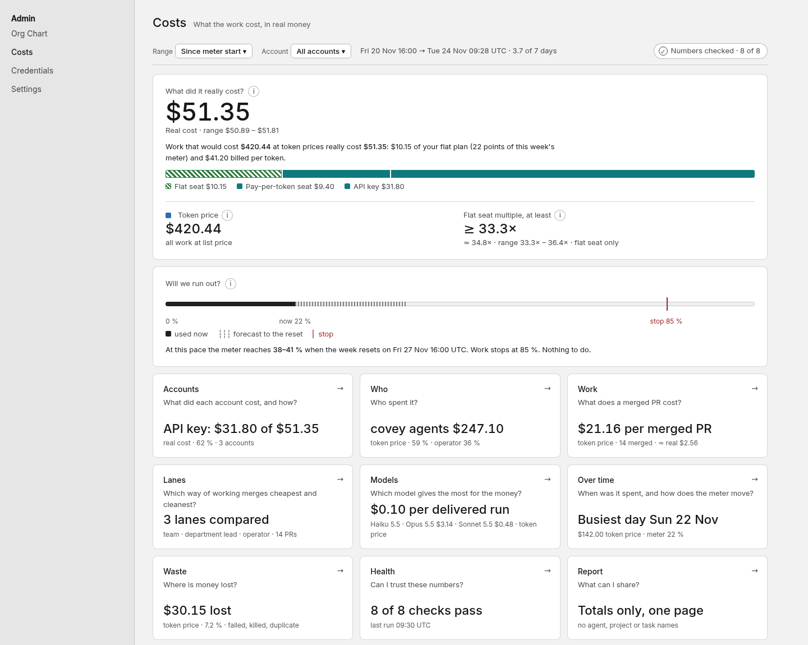
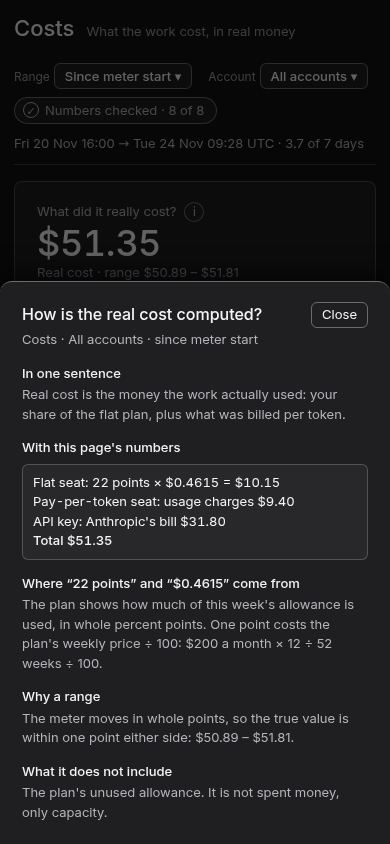
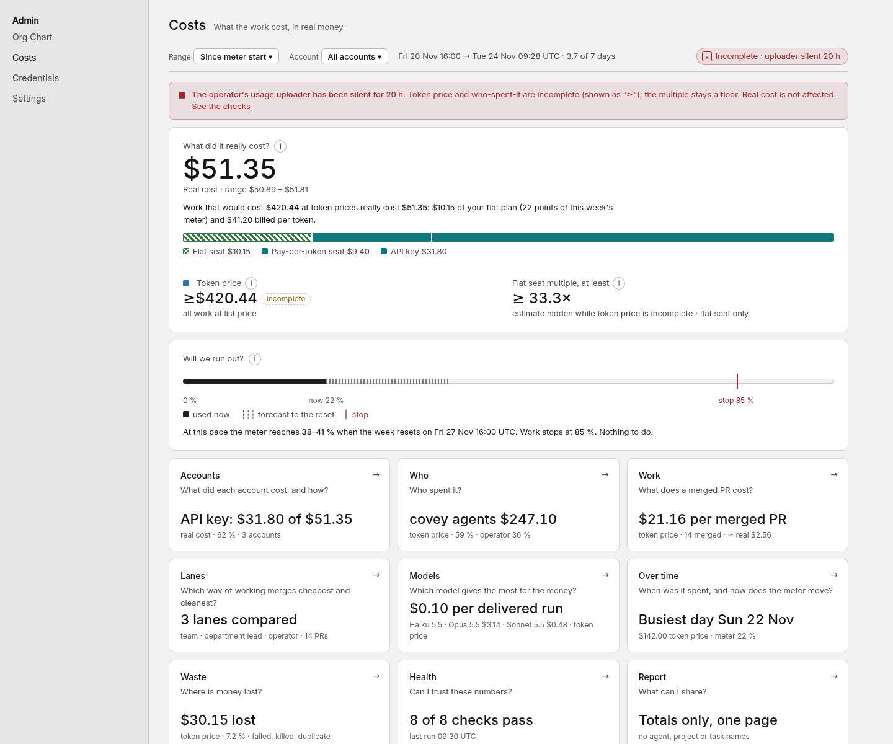

# Design: the cost home and its subviews (health first, one question per view)

Status: proposal **for the human's approval**. Nothing is built. `Part of #161` (the redesign brief); the lane view is #181, the trust badge #178, the meter line #170. Starting point: the operator's draft of questions Q1–Q10 and views (approved direction: health first). Files this will touch later: `web/src/pages/Costs.tsx` and a new `web/src/pages/costs/` folder, `AppShell.tsx` routes, `format.ts`, the ten locale files. Colours and tokens: `web/src/styles.css`. Mock-ups (static HTML with covey's tokens, rendered in both themes) are in `docs/design/cost-home/mockup/`; every number on them comes from one seeded sample (§3) and is **sample data, not a measurement**. Start with `cost-home/1-home-1440.png`.



**The question the home answers:** *What did the work really cost?* Everything else on the page either explains that figure (token price, multiple), guards it (the burn gauge and the trust badge, which only speak up when something is wrong) or is one click away (nine cards, one question each).

## 1. The ten questions, and the one view each lives in

| Q | Question | View (route) | Headline figure (the answer first) |
|---|---|---|---|
| Q1 | What did it really cost? | home `/costs` and `/costs/accounts` | **Real cost** $51.35 (range $50.89 – $51.81) |
| Q2 | What is the token price? | home band, `/costs/time` | **Token price** $420.44 |
| Q3 | How many times over (metered windows only)? | home band, `/costs/accounts` | **≥ 33.3×** (flat seat; estimate 34.8×) |
| Q4 | Who spent it? | `/costs/who` | covey agents $247.10 (59 %) |
| Q5 | On what work? | `/costs/work` | $21.16 token price per merged PR |
| Q6 | Which model gives the most for the money? | `/costs/models` | $0.10 per delivered run (cheapest model) |
| Q7 | Will we run out? | home gauge, `/costs/time` | **38–41 %** at the reset; work stops at 85 % |
| Q8 | Per account? | `/costs/accounts` | API key $31.80 of $51.35 real (62 %) |
| Q9 | Can I trust these numbers? | the badge on every view, `/costs/health` | 8 of 8 checks pass |
| Q10 | Where is the waste? | `/costs/waste` | $30.15 lost (7.2 % of token price) |
| — | Which way of working merges cheapest and cleanest? (#181) | `/costs/lanes` | 3 lanes, 14 merged PRs |
| — | What can I share? | `/costs/report` | totals only, one page |

**Relation to the headline spec (`cost-page-headline.md`).** That spec fixed seven tiles for the old single page. Here they find their homes: Real, Billed and the multiple are the Accounts view (and three of them the home band), Reported and the price-table check are in Health (`Reported` is Claude Code's own number and answers no question of its own), Input/Output tokens are in Models and Waste. Its rules carry over unchanged: all-or-nothing sums over credentials, the `noMultiple` reasons, a tile that cannot answer says why in one line and keeps its place, the window of a figure is stated. If both specs are approved, the headline spec's tiles become the accounts view's per-account facts and this spec wins where they differ.

## 2. Principles, applied (the checklist a reviewer uses)

| Principle | How it shows |
|---|---|
| One question per view, answer first | Each view opens with its question as a sentence, then one big figure, then the evidence. The home's one question is Q1. |
| Real vs token price always labelled | The words **Real cost** and **Token price** stand next to every dollar figure, on every card, row and chart bar. A bare `$` figure does not exist. Token price carries a blue swatch, real cost has none (it is a sum of two sources, §3). |
| Range and account always visible | The context strip (§4) is on every view; it is sticky, it is in the URL, it is in every report. |
| Parts sum to totals | Every table has a total row that is the sum of the unrounded parts; displayed cents follow the largest-remainder rule so the displayed parts add to the displayed total (example: `who` real shares 40.10 + 4.35 + 6.33 + 0.57 = 51.35, the exact values being 40.102, 4.350, 6.334, 0.565). A test compares each view's total with the home's. |
| Trust badge | Every view, in the strip. §7. |
| "How is this computed" | One ⓘ per figure opens a drawer in plain words with this page's own numbers (§5). |
| 390 px, light, dark, accessible | §10. |
| All strings in the locale files | §11. |

## 3. Vocabulary, colour code, the sample

**Words.** Plain words on the page; the technical word only inside the drawer or Health.

| On the page | Means | Not said on the page |
|---|---|---|
| Real cost | the money the work used: a flat seat's metered share of the plan price + what was billed per token | reported, recomputed, engine |
| Token price | the same tokens priced at Anthropic's list (`recomputed` in the code) | list price, recomputed |
| Flat seat | a subscription with a weekly meter | seat, credential, oauth |
| Pay-per-token seat / API key | an account billed per token | basis, usage charges |
| points of this week's meter | whole percent points the weekly meter moved | chunks, baseline, lag, unattributed |
| at least 33.3× | token price ÷ the highest real cost the meter allows (a **floor**) | multiple range |

**Colour: one colour, one meaning.** No new token.

| Token | Means, everywhere on `/costs/*` | Never used for |
|---|---|---|
| `--cost-recomputed` (blue) | token price | status, who, models |
| `--cost-real` (green, **hatched**) | real cost of a **flat seat** (meter × plan price) | health or "OK" |
| `--cost-billed` (teal, solid) | real cost **billed per token** (API key bill, pay-per-token seat's charges) | anything else |
| `--cost-meter` (ink, dashed line) | the weekly meter, in % (#170) | — |
| `--cost-type-*` (blue family) | token types (Waste: cache reads) | sources, accounts |
| `--text-warning` + `--bg-warning` | a **check needs a look** (WARN), a forecast within 10 points of the stop level | — |
| `--text-danger` + `--danger-tint` | a **check failed** (FAIL), the stop level, a forecast at or past it | — |
| neutral ink + ✓ | all checks pass | green (see D1) |
| `--cost-reported` (grey) | Claude Code's own number, **Health only** | — |

Real cost has two sources (green hatched and teal), so its total has no colour of its own: a stacked bar shows the parts, the total is plain text. Who, models, lanes and accounts are **rows, not colours**: bars in those views are all blue because they split a token price, and the row label says who. Hatch against solid, not hue, is what separates green from teal (colour-blind safe).

**The sample behind every figure** (seeded install; weekly meter reset Fri 20 Nov 16:00 UTC, "now" Tue 24 Nov 09:28 UTC, so 3.73 of 7 days; flat seat on a $200/month plan).

| Account | Token price | Real cost | How real is measured |
|---|---|---|---|
| Flat seat | $353.12 | **$10.15** | 22 points × $0.4615 (= $200 × 12 ÷ 52 ÷ 100); range ±1 point = $9.69 – $10.61 |
| Pay-per-token seat | $15.00 | **$9.40** | usage charges |
| API key | $52.32 | **$31.80** | Anthropic's bill |
| **Total** | **$420.44** | **$51.35** (range $50.89 – $51.81) | sum of the three |

Multiple (flat seat only): $353.12 ÷ $10.15 = **34.8×**; range $353.12 ÷ $10.61 = 33.3× to $353.12 ÷ $9.69 = 36.4×; the **floor** shown first is the low end, 33.3×.

## 4. The shell every view shares

```
┌ Costs › <view>                                                          ┐
│ Range [Since meter start ▾]  Account [All accounts ▾]   <span>   (✓ Numbers checked · 8 of 8) │  ← sticky strip
│ <alert, only when a check is WARN/FAIL>                                 │
│ ┌ <the view's question> (i) ───────────────────────────────────────────┐ │
│ │ <the headline figure, big>   <its range or bound, small>              │ │
│ │ <one plain sentence that says it with the page's numbers>             │ │
│ └───────────────────────────────────────────────────────────────────────┘ │
│  evidence: table or chart, total row, "Show as table" always available  │
└─────────────────────────────────────────────────────────────────────────┘
```

- **Range** presets: **Since meter start** (default: the meter's current week, so the multiple, the real cost and the token price share one window), 24 h, 7 days, 30 days, custom. When the range is not the meter's span the multiple says "since {{date}}" and covers only the metered part; every other figure follows the range. **The span line** states the window in words: `Fri 20 Nov 16:00 → Tue 24 Nov 09:28 UTC · 3.7 of 7 days`. One window for the whole page (#161 problem 4).
- **Account**: All accounts, or one account. A view that cannot follow it (Lanes, Report) **greys its figures and says "all accounts only"**, it does not show a different scope.
- Both controls live in the URL (`?range=…&account=…`) and persist across views; a shared link restores them. Plan price, cost basis and usage charges are **not** here: they are a ⚙ drawer on each account row (#161: settings apart from view controls). The source chips, layout and split toggles of the old page are gone; the chart's legend entries toggle series.
- **The trust badge** (§7) sits at the strip's right end and is a link to `/costs/health`. Its text is one line: `Numbers checked · 8 of 8`, or the worst reason.
- **Sticky at 390 px**: the strip collapses to one line `Since meter start · All accounts · ✓`; tapping opens a sheet with the two selectors and the span line.

## 5. The "how is this computed" drawer

One ⓘ button per headline figure (hit area 44 × 44, visible circle 20). It opens a **right drawer 420 px wide** (a **bottom sheet, up to 82 % of the height** at < 600 px; `role="dialog"`, labelled by its title, focus moves in and is trapped, Esc and a Close button close it, focus returns to the ⓘ). Five fixed blocks, each one or two sentences, **with the numbers of the page filled in** (the same values, through the same formatters, so a test can compare them with the screen):

1. **In one sentence** — what the figure is.
2. **With this page's numbers** — the arithmetic: `22 points × $0.4615 = $10.15`.
3. **Where its inputs come from** — in words ("one point costs the plan's weekly price ÷ 100").
4. **Why a range, a "≥" or a dash** — only when one applies now.
5. **What it does not include.**

Mock-up: `cost-home/1-home-drawer-dark-390.png`.



## 6. The home `/costs`

```
 Costs                                                   What the work cost, in real money
 Range [Since meter start ▾] Account [All accounts ▾]  Fri 20 Nov 16:00 → Tue 24 Nov 09:28 UTC · 3.7 of 7 days  (✓ Numbers checked · 8 of 8)
┌────────────────────────────────────────────────────────────────────────────────────────┐
│ What did it really cost? (i)                                                            │
│ $51.35                                       ← Real cost, 44 px                         │
│ Real cost · range $50.89 – $51.81                                                       │
│ Work that would cost $420.44 at token prices really cost $51.35: $10.15 of your flat    │
│ plan (22 points of this week's meter) and $41.20 billed per token.                      │
│ ▨▨▨▨▨▨▨▨▨▨▨▨▨▨▨█████████ ███████████████████████████████████████████████  (the parts)   │
│ ▨ Flat seat $10.15   ■ Pay-per-token seat $9.40   ■ API key $31.80                      │
│ ──────────────────────────────────────────────────────────────────────────────────────  │
│ ■ Token price (i)                     Flat seat multiple, at least (i)                  │
│ $420.44                               ≥ 33.3×                                           │
│ all work at list price                ≈ 34.8× · range 33.3× – 36.4× · flat seat only    │
└────────────────────────────────────────────────────────────────────────────────────────┘
┌ Will we run out? (i) ──────────────────────────────────────────────────────────────────┐
│ ━━━━━━━━━┆┆┆┆┆┆┆┆┆┆┆┆┆┆┆┆┆┆┆┆┆┆┆                                    ▏                  │
│ 0 %      now 22 %                                                stop 85 %              │
│ At this pace the meter reaches 38–41 % when the week resets on Fri 27 Nov 16:00 UTC.   │
│ Work stops at 85 %. Nothing to do.                                                      │
└────────────────────────────────────────────────────────────────────────────────────────┘
 [Accounts] [Who] [Work]        each card: title, its question, headline figure (labelled),
 [Lanes]    [Models] [Over time] one grey sub-line; the whole card is the link.
 [Waste]    [Health] [Report]
```

| Figure | Formula | Label | Notes |
|---|---|---|---|
| Real cost | R = Σ over accounts: flat seat **points × weekly price ÷ 100**, pay-per-token seat usage charges, API key bill. Range = R ± 1 point per flat seat | Real cost | all-or-nothing over accounts (headline spec §3): one account without a figure → "–" plus the reason, never a smaller sum |
| the parts bar | the three account figures | Flat seat / Pay-per-token seat / API key | green hatched + teal; the total stands once, above |
| Token price | T = Σ recomputed list price of all lines in the range, all accounts, covey and outside | Token price | "≥" while a check says part of it is missing (§7) |
| Multiple | floor = T_flat ÷ (R_flat + 1 point); estimate T_flat ÷ R_flat; range floor – T_flat ÷ (R_flat − 1 point). T_flat = token price of the flat seat over the **meter's span**. Needs ≥ 3 points moved (headline spec) | Flat seat multiple, at least | floor is the headline: it can only be too low |
| Gauge | now = latest weekly meter %. **Forecast** = now + pace × days to the next reset; low pace = the last 24 h, high pace = the whole week so far (22 ÷ 3.73 d = 5.9 points/day; last 24 h 5 points → 38 %, 41 %). Stop level = the org's stop % | Will we run out? | needs ≥ 24 h of readings, else "too early to forecast" and no hatched band |

Gauge states: **neutral** while forecast high < stop − 10 points (sample); **amber** `--text-warning` and the sentence "may reach the stop level before the reset" when the high end is within 10 points of the stop; **red** `--text-danger` "will stop work on {{day}} around {{hour}} UTC" when the low end ≥ stop. The state is the **sentence and the marker's shape**, not the fill colour. The stop marker is a line with the words "stop 85 %".

Cards (each: one question, one labelled figure, one sub-line; mockup `1-home-1440.png`): Accounts, Who, Work, Lanes, Models, Over time, Waste, Health, Report. The home never shows a figure twice: the Health card's "8 of 8 checks pass" is the count, the badge's text is the worst reason.

**Home states.** Empty (no usage in the range): the band reads "No work in this range" with the range-widening presets as buttons; no `$0.00` headline. First load: same frame, `--tint` bars, `aria-busy`. Reloading after a change: old values at 45 % opacity. Error: "Could not load cost figures · Retry" in the band, the strip stays. WARN and FAIL: §7, mockups `1-home-stale-1440.png`, `1-home-red-1440.png`.




## 7. Trust: the badge, the alert, and what a failing check does to a figure

The badge has four faces; **colour is never the only cue** (shape + words):

| State | Look | Text (en) | Source |
|---|---|---|---|
| all pass | neutral outline, ✓ in a circle | Numbers checked · 8 of 8 | every check PASS or info |
| WARN | `--bg-warning`, ◆ | Check · {{reason}} | any WARN, no FAIL |
| FAIL | `--danger-tint`, ■ | Incomplete · {{reason}} | any FAIL |
| unknown | dashed outline, ? | Checks not run yet | no result |

The reason is the worst check's one-liner (#178). WARN and FAIL also raise **one alert line** under the strip with what it means for the figures and a link to Health. A FAIL **never shows a smaller number silently**; the check decides how the figures say so:

| Check (#178) | WARN | FAIL | What the figures do |
|---|---|---|---|
| C1 uploader fresh | — | no push within 75 min | token price, who, work, lanes, models, waste: **"≥"** + chip "incomplete"; the multiple keeps its floor and hides its estimate and range; **real cost is unaffected** |
| C2 meter fresh | reading stale (says if the fleet is paused) | — | real cost, multiple and gauge keep their value with "as of {{time}}"; stale is amber, not red |
| C3 meter monotonic | — | a drop inside one reset period | flat seat real cost "≥", multiple "–" (a smaller meter delta would inflate it) |
| C4 no double booking | — | a duplicate key | token price and who marked "may include duplicates"; no ≥ or ≤ |
| C5 models priced | — | a used model has no price | token price "≥"; Models shows the row "no list price" with its tokens |
| C6 cost basis set | — | a spending seat without basis | that account's real "–" with the reason; real total "≥"; multiple "–" |
| C7 bill sync | — | import failing | billed parts "≥", "complete to {{time}}" |
| C8 pre-meter usage | info only | — | never a state, listed in Health |

`≥` needs a formatter: **`fmtUSDAtLeast`** in `format.ts` (`≥ $420.44`, de `≥ 420,44 $`), next to `fmtUSDBelow`. A view whose figure is a bound says it in the drawer's block 4.

## 8. The subviews

Each section: question, headline, wireframe, figures with formulas, states. All share §4's strip, drawer and states; only what is specific is written. Numbers are the sample's.

### 8.1 `/costs/accounts` — Q1, Q8: what did each account cost, and how?

Headline: **$51.35 real cost** over three accounts; sentence "The API key is $31.80 of it (62 %)."

```
 Account                  Token price   Real cost    Token price ÷ real   How real is measured
 ▨ Flat seat              $353.12       $10.15       ≈ 34.8×  (33.3–36.4×) 22 points × $0.4615     ⚙ ▾
 ■ Pay-per-token seat     $15.00        $9.40        1.6×                  usage charges            ⚙ ▾
 ■ API key                $52.32        $31.80       1.6×                  Anthropic's bill, complete to 09:00 UTC  ⚙ ▾
 Total                    $420.44       $51.35
```

- Token price ÷ real: flat seat is an estimate with a range (meter in whole points); the other two are exact ratios (a bill). Real as a share of the total: 19.8 %, 18.3 %, 61.9 %.
- ▾ expands the account: plan price and its source, the meter's span and last reading time, readings count, the per-account rows the old "Subscription meter per credential" card carried (so that card goes). ⚙ opens the settings drawer (plan price, cost basis, usage charges) for `org_admin` and `security`; others see the read-only line.
- States per account: **no figure** (dashed row, reason: no meter reading / no plan price / no bill, the existing strings of the headline spec §4), **greyed** when an account is picked in the strip and the row is another account's.

### 8.2 `/costs/who` — Q4: who spent it?

Headline: **covey agents $247.10 · 59 % of token price**.

```
 Who                          Token price   Share    ≈ Real cost
 ███████████████████ covey agents          $247.10   58.8 %   ≈ $40.10  ▾
 ████████████ operator (outside covey)     $151.32   36.0 %   ≈ $4.35   ▾
 █ other projects (outside covey)          $18.90    4.5 %    ≈ $6.33   ▾
 ▏ probes                                  $3.12     0.7 %    ≈ $0.57   ▾
 Total                                     $420.44   100 %    $51.35
```

- Bars are one colour (token price), the length is the share. **Four fixed groups**; ▾ opens the agents (grouped by department as the agent filter is today) or the outside projects, with the rows summing to the group.
- **≈ Real cost** = each row's token price per account × that account's real ÷ token price (flat 2.87 %, pay-per-token seat 62.7 %, key 60.8 %), summed over accounts. It is an estimate (the meter does not say who moved it): the column header says "≈", the drawer says so, the total row is exact. This is why the operator, working entirely on the flat seat, has a real cost of $4.35 for $151.32 of token price.
- Operator, other projects: labelled "outside covey" wherever they appear (the human's rule, #161). "Probes" = the cost of covey's own health and connectivity probes (assumption A3).
- Empty: "No outside usage in this range" when only covey has rows; C1 FAIL marks the outside rows "incomplete".

### 8.3 `/costs/work` — Q5: what does a merged PR cost?

Headline: **$21.16 token price per merged PR** · ≈ real $2.56 · 14 merged PRs. Scope: covey agents + operator ($398.42 of the $420.44; other projects and probes are not work on covey PRs).

```
 Where the covey work went                 Token price   ≈ Real cost   PRs
 Linked to a merged PR                     $296.30       ≈ $35.88      14
   #170 costs: meter line                   $48.20  …    top 3 shown, then "11 others $169.25"
 Linked to an open or unmerged PR          $40.84        ≈ $3.85       3
 Not linked to any PR                      $61.28        ≈ $4.72
 Total covey work                          $398.42       $44.45
 Per merged PR = 296.30 ÷ 14 = $21.16 · ≈ real 35.88 ÷ 14 = $2.56
```

- A cost is linked to a PR by `Fixes #n` / `Part of #n` and the branch (#181 gap 3). The three rows plus total always sum; "not linked" is shown, never dropped, so $ per PR cannot be flattered by excluding cost.
- Sub-table: the most expensive merged PRs (number, token price, hours to merge, rounds), top 5 then the rest as one row.
- Empty: "No PR merged in this range" (the per-PR figure becomes "–", the rows stay). Needs-data state until #181 ships (§12).

### 8.4 `/costs/models` — Q6: which model gives the most for the money?

Headline: **$0.10 per delivered run (Haiku 5.5)** next to Opus 5.5 $3.14.

```
 Model         Token price   Share    Runs delivered / all   Token price per delivered run
 Opus 5.5      $301.20       71.6 %   96 / 118  (81 %)       $3.14
 Sonnet 5.5    $101.30       24.1 %   212 / 240 (88 %)       $0.48
 Haiku 5.5     $17.94        4.3 %    188 / 205 (92 %)       $0.10
 Total         $420.44       100 %
 No list price: model X — 0.9 M tokens, in no figure above (C5)
```

- **Delivered run** = a run that ended with a result (not failed, not killed). Token price per delivered run = token price ÷ delivered runs (cost of failures is in the numerator, so a model that fails often looks dearer: that is the point).
- Not "better": a sub-line says "Price per run compares cost, not quality; waste is in Waste." Tokens in/out per model in the row's ▾, with cache-read share.

### 8.5 `/costs/time` — Q2, Q3, Q7: when was it spent, and how fast does the meter move?

Headline: **22 % of this week's meter used · forecast 38–41 % at the next reset**. Mock-up: `cost-home/2-time-1440.png`.


- Bars per day (UTC; hour/week/month by range): token price (blue) beside real cost (teal solid for billed, green hatched on top for the flat seat), the weekly meter as the dashed line on the right axis (#170: the line replaces labels; gaps stay gaps; **a reset is a solid fall**), forecast as a hatched wedge to the next reset, "work stops at 85 %" drawn **only from now to the reset** (a full-width line would cross bars of another axis), plus a tick on the axis. **Resets are marked** by a dotted vertical line labelled "reset · week 2 starts, Fri 20 16:00"; a range spanning a reset shows the old week's last value falling to the new one.
- Per-day parts sum to the totals in the table beneath (always rendered; "Show as table" focuses it).
- Per bar tooltip: the day, token price, real cost per account kind, meter readings of that day with times (the first four and last four when more than eight).
- Empty / stale: meter line absent when no reading ("no meter readings in this range"); a gap in readings is a gap in the line with the words "no readings 02:00 – 09:00".

### 8.6 `/costs/waste` — Q10: where is the waste?

Headline: **$30.15 of token price lost (7.2 %)**.

```
 Where it was lost             Token price   Share of token price   Runs
 Failed runs                   $14.20        3.4 %                  17
 Killed runs                   $6.85         1.6 %                  9
 Duplicate runs                $9.10         2.2 %                  6
 Total lost                    $30.15        7.2 %
 ──── not counted as waste ───────────────────────────────────────────────
 Cache reads (context re-read)  $186.00 token price · 44.2 % of T · 92 % of input tokens
```

- Definitions in plain words (drawer block 1): **failed** ended with an error; **killed** stopped by hand or a guard rail; **duplicate** a run on a task that already had a result from another run (assumption A4). A run is in exactly one row. Real-cost equivalent per row is **not** shown: waste is measured in token price, because real cost does not follow single runs; the sub-line says so.
- Cache reads are a **rate, not a loss**: shown below the line, with `--cost-type-cache-read`, "context re-read each turn is cheap per token but large".
- Top 5 costliest wasted runs (task, agent, reason, token price) with the rest as one row.

### 8.7 `/costs/health` — Q9: can I trust these numbers?

Headline: **8 of 8 checks pass** (or the worst reason).

```
 Last run 09:30 UTC · runs on page load and hourly                                  [Run now]
 ✓ Pass   C1 Uploader fresh        2 hosts, last push 09:12 UTC (16 min ago)            affects: Token price, Who
 ✓ Pass   C2 Meter fresh           last reading 09:28 UTC                               affects: Real cost, Multiple, Gauge
 ✓ Pass   C3 Meter monotonic       no drop inside the week                              affects: Real cost, Multiple
 ✓ Pass   C4 No double booking     0 duplicate keys in 41,208 lines                     affects: Token price
 ✓ Pass   C5 Models priced         3 of 3 models have a list price                      affects: Token price
 ✓ Pass   C6 Cost basis set        3 of 3 accounts                                      affects: Real cost
 ✓ Pass   C7 Bill sync             API key bill complete to 09:00 UTC                   affects: Real cost (API key)
 i Info   C8 Usage before the meter  $62.00 of token price predates the first reading, never divided by the meter
 Price-table check: Claude Code's own price differs from the token price by −0.4 %   (replaces the old Gap column; shown only when it is not zero)
```

- WARN ◆ amber, FAIL ■ red, PASS ✓ neutral, info ⓘ: **icon and word in every row**. Each row's reason is the server's one line; "affects" names the figures that carry the bound (§7), as links back.
- Also here (from the old "Check the numbers" tab): the meter's span and readings per account and the bill reconciliation per API key, collapsed under each check's ▾.

### 8.8 `/costs/report` — what can I share?

A **static snapshot**, generated on request and stored read-only; light theme only, one column, printable; **aggregates only**: no agent, task, PR, project, session or key names, no descriptions.

```
 Cost report · Since meter start (Fri 20 Nov 16:00 → Tue 24 Nov 09:28 UTC) · all accounts · generated Tue 24 Nov 09:31 UTC
 (✓ Numbers checked · 8 of 8 at generation)   ← if not OK, a banner on top that cannot be removed
 Real cost $51.35 (range $50.89 – $51.81) · Token price $420.44 · Flat seat multiple at least 33.3×
 Real cost by account kind: Flat seat $10.15 · Pay-per-token seat $9.40 · API key $31.80
 Token price by group: covey agents $247.10 · operator $151.32 · other projects $18.90 · probes $3.12
 Per merged PR: $21.16 token price · waste $30.15 (7.2 %)
 How this is computed: <the five drawer blocks for each figure, inline, in plain words>
```

Sample/empty/stale: the report states the freshness of each source at generation; a snapshot never refreshes. Not available when the user's role cannot see the cost page.

## 9. `/costs/lanes` — which way of working merges cheapest and cleanest? (#181)

Mock-up `cost-home/3-lanes-1440.png`. Headline: **14 merged PRs, three lanes**. Lanes: **covey team**, **department lead + subagents**, **operator session + subagents**.


| Column | Formula | Label |
|---|---|---|
| Token price per PR | Σ token price linked to the lane's merged PRs ÷ the lane's merged PRs (team 163.20 ÷ 8 = $20.40) | Token price per PR |
| Real per PR | Σ of those lines at their account's real ÷ token price ÷ PRs | Real per PR (≈) |
| Hours to merge | **median** of (merged at − first queued at); the "all lanes" row is the pooled median, not the mean of medians | Hours to merge (median) |
| Review rounds | Σ rounds ÷ PRs (team 15 ÷ 8 = 1.9) | Review rounds (mean) |
| Majors per PR | Σ majors found by the outside review ÷ PRs (team 5 ÷ 8 = 0.6) | Majors per PR |

- **A lane with fewer than 3 PRs is shown, muted, with "n PRs: too few to compare"**, and takes no highlight; no lane is marked "best". The all-lanes row is the sum/pool of the lanes and is the home's Work figure.
- Token price per PR compares the work (every lane priced by the same list). Real per PR depends on the account that paid, so a lane on the flat seat reads cheap there: the footnote says so in plain words.
- Cost not linked to a merged PR is in Work, not in a lane (the footnote shows it).
- Account in the strip is ignored: "all accounts only" greyed note when one is picked. Per-session tree and per-subagent type (#181 view 4) are **not** designed here (A5).

## 10. Phone, dark, accessibility

**390 px (content ≈ 362).** One column. First screen (844 px) holds the strip (collapsed), **Real cost**, the sentence, the parts bar, Token price and the multiple, and the top of the gauge (`1-home-390.png` / `1-home-dark-390.png`, measured on the mock-up with the strip not yet collapsed: Real cost at y ≈ 240, the multiple ≈ 590, the gauge's bar ≈ 710; the collapsed strip gives back about 100 px). Cards in one column, 3 lines each. Tables show **name · token price · real** and put the rest behind ▾ (as a definition list). The time chart keeps 8 day columns (weekday initial, date in the tooltip and table), the table beneath is the full reading. Drawer = bottom sheet. Touch targets ≥ 44 px (ⓘ, row ▾, strip).


**Dark mode.** Tokens only (`light-dark()` pairs), hatching drawn with the series colour so it works on both grounds; rendered: `1-home-dark-1440.png`, `1-home-dark-390.png`. Status text uses `--text-warning`/`--text-danger` on their tints, which the tokens file measures at ≥ 5.1:1.

**Accessibility.** Every chart has its table; bars and the meter line have an `aria-label` that states the numbers; the gauge is `role="img"` with the sentence as label. Statuses use shape + word. Cards are links with the title as their name; focus ring is the page's 2 px `:focus-visible`. Hover is never the only way to a tooltip (focus and tap too). The badge is `aria-live="polite"` and announces a state change once. `prefers-reduced-motion`: no transitions. The accessible name of ⓘ contains the figure ("How is Real cost computed?"), per org-lessons 11.

## 11. Strings (the frontend adds all ten locales)

New namespaces under `costs.`: `home.*` (question, sentence templates with `{{real}}`, `{{token}}`, `{{points}}`, `{{pointPrice}}`), `view.<accounts|who|work|lanes|models|time|waste|health|report>.*` (question, headline label, column labels, empty, needs-data), `drawer.<figure>.{one,numbers,inputs,why,not}`, `trust.*` (four faces, the eight checks' titles, `affects`), `gauge.*` (three states, "too early to forecast", "no stop level set"), `state.*` (empty, loading, error, stale `as of {{time}}`, incomplete). Rules: no jargon word of §3's right column in any value outside `drawer.*` and `view.health.*`; numbers through `fmtUSD`, `fmtNumber`, `fmtUSDBelow`, **new `fmtUSDAtLeast`** and a **new `fmtMultiple`** (one decimal, `×`); dates through the UTC clock helpers; German keeps the 105 px budget the headline spec measured for money pairs. The drawer's formula lines are templates, not numbers typed into text.

## 12. Data each figure needs (what exists, what does not)

| Figure | Today | Needs |
|---|---|---|
| Real cost, token price, multiple, accounts, time chart, meter line | cost cells, meter coverage, billed report, usage readings exist (`api.ts` `CostCell`, `MeterCoverage`, `BilledReport`) | nothing; the forecast is a pure function of the readings |
| **Stop %** | not found in the code as a setting (assumption A1) | an org setting with a default; until set, the marker is hidden and the sentence says "no stop level set" |
| Who: operator / other projects / probes | outside usage per project (`external_usage.origin`, `--source-per-project`), covey agents | a "probe" marker (A3) |
| Trust, health | **#178, being built** | its API (`/cost/health`) as the badge's source |
| Work, Lanes: merged PRs, hours, rounds, majors | none | **#181** gap 3 (PR ↔ task link, outcomes) |
| Models: delivered runs | `/cost/models` has `runs` per agent × model | a delivered flag (result without failure or kill) |
| Waste: failed, killed, duplicate | run status exists; indicators carry `failed` | the duplicate definition (A4) |
| Report | — | a snapshot store (small) |

Build order that follows the data: home band + gauge + context strip + drawer, Accounts, Time (all on existing data), Health (#178), Who (A3), Models, then Work, Waste, Lanes (data), Report last. Views whose data is missing show the **needs-data state**: the question, a dashed card "Not measured yet: {{what}}", and the card on the home greyed with the same line, never a `$0.00`.

## 13. Acceptance criteria (a reviewer can check each)

1. Every route in §1 exists; the home has nine cards, each with a question, a labelled headline figure and a sub-line; each card links to its view.
2. At 1440 and 390, with the sample data, Real cost, Token price and the multiple are visible without scrolling (844 px high at 390).
3. The strip (range, account, span, badge) is on every view; changing range or account changes the URL and persists across views; a view that cannot follow the account says "all accounts only" and greys, it does not show another scope.
4. A figure and its label: no bare `$` figure; the words Real cost / Token price stand beside every one.
5. For the sample: real $51.35, token price $420.44, flat seat multiple floor 33.3× (≈ 34.8×, 33.3–36.4×); each view's total equals the home's (a test compares them, org-lessons 14); parts in a table sum to the displayed total (largest remainder).
6. The drawer opens from every headline figure's ⓘ, shows the five blocks with the page's own numbers (a test compares drawer numbers with the screen), traps focus, closes on Esc and returns focus.
7. The badge shows the four faces by shape and word; FAIL on C1 makes token price "≥ …" with an "incomplete" chip and leaves real cost unchanged; FAIL on C3 makes the multiple "–".
8. The gauge shows now %, the stop marker with its word, a forecast range from the last-24-h and whole-week paces, and its three states by sentence; with < 24 h of readings it says "too early to forecast".
9. Time view: meter as a dashed line on the right axis, resets marked, the stop line only from now to the reset, a table with the same sums.
10. Lanes: a lane with < 3 PRs is muted and labelled and never highlighted; the all-lanes row is pooled; the median row is not a mean of medians.
11. Waste: failed + killed + duplicate = total; cache reads are shown below the line and not in the total.
12. Report contains no agent, task, PR, project or key name and does not update after creation (test with a fixture containing such names).
13. Colours: only the tokens in §3; no colour has two meanings (a grep test over `web/src/pages/costs/` for raw colour values, org-lessons 14 spirit).
14. All strings in the ten locale files (parity test); no German in English; jargon words only in drawer and Health.
15. 390 px: no horizontal scroll on any view; touch targets ≥ 44 px; light and dark screenshots attached to the PR.
16. Keyboard: strip, cards, ⓘ, ▾, drawer reachable and operable; a screen reader reads a status as "Pass / Warning / Failed", not just a symbol.

## 14. Decisions for the human, and assumptions

**Decisions (my recommendation first, please approve or change):**

- **D1. All-clear is neutral, not green.** #178 says green / amber / red. Green is already **real cost** here; a green "OK" next to a green money bar is one colour with two meanings. Recommendation: the all-pass badge is a neutral outline with a ✓. If you prefer green, real cost would need another colour.
- **D2. The headline multiple is the floor ("at least 33.3×"), with the estimate (34.8×) and the range beside it**, not "≈ 41×" alone as in #161. The meter moves in whole points; the floor can only be too low, so it can never be quoted as more than it is.
- **D3. "Token price" and "Real cost" replace "Recomputed"/"Reported"/"Real (estimate)" on the page.** Reported (Claude Code's own number) appears only in Health.
- **D4. The multiple is the flat seat's only**; billed accounts show their exact ratio in Accounts (1.6×), not on the home.

**Assumptions (settled by me; reviewers please name any you reject):**

- A1. The **stop %** is an org-level setting (sample 85 %); the code has no such setting today. Until it exists the marker is hidden.
- A2. The forecast is linear: now + pace × days left, with the last-24-h and whole-week paces as the range.
- A3. **Probes** are covey's own probe runs and a probe-tagged outside usage; the marker has to exist.
- A4. A **duplicate run** is a run on a task that already had a result from another run started within one hour; needs the data owner's confirmation.
- A5. The per-session tree and per-subagent-type views of #181 are a later design.
- A6. Sample numbers are invented for consistency (they sum), not measured.

**Not checked:** the contrast of the new combinations (amber, red on their tints) was read from the tokens file, not re-measured; the mock-ups use media queries where the build should use container queries; German and other long locales were not rendered for the home cards; nothing was tested on a real device.
