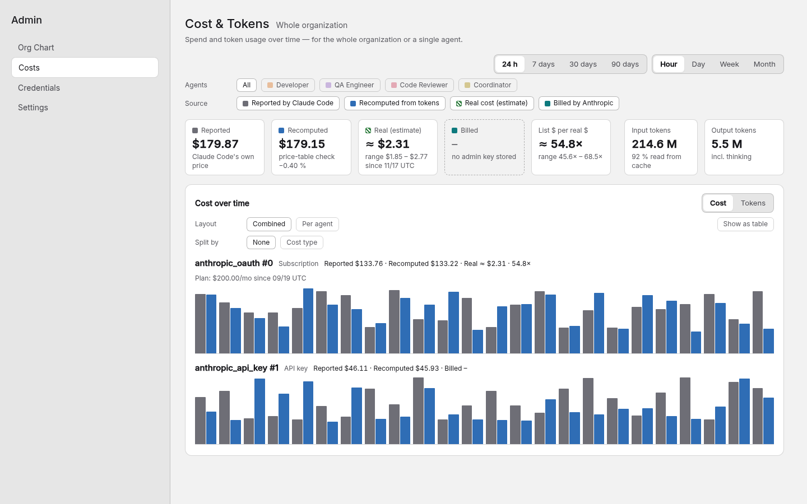
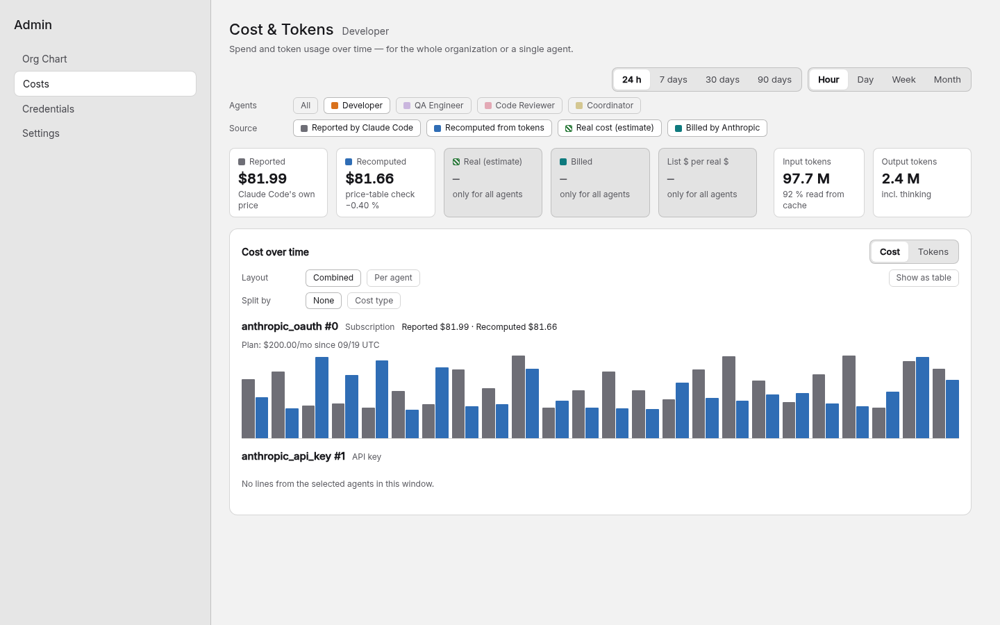
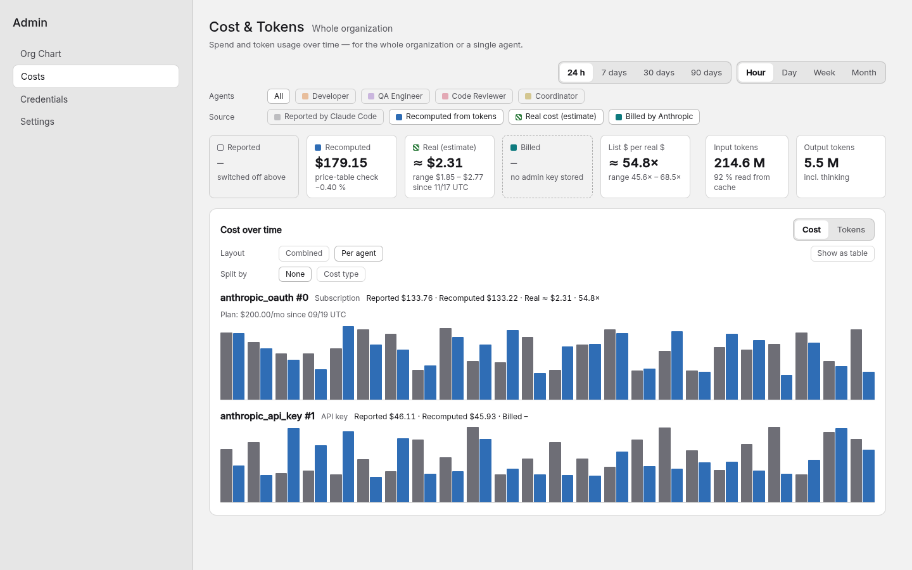

# Design: the headline of the cost page (a fixed set of tiles, no figure twice)

Status: proposal, revised after review round 1 (head of the first round: 93b579f4). Design for the human's wishes of 2026-11-18 behind issues #28 and #70 (`Part of`, not `Fixes`: the filter bar, the chart card and the one agent/model table are other pieces). Code references are to `main` @ 5b1b0abc, which holds the cost module (#74) and its follow-ups #79, #80 and #91; #96 (number formats, the text of `costs.fig.billedWindow`) is open and changes no key or formula this spec names. Files: `web/src/pages/Costs.tsx`, `StackedCostChart.tsx`, `CostInsights.tsx`, `costFigures.ts`, `costSources.ts`, `PlanPrice.tsx`. Nothing is implemented. The numbers in the mockups come from a seeded install (two credentials, five agents, 24 hours by the hour). The charts in the mockups are stand-ins; they are not part of this spec. Mockups (static HTML with covey's tokens) are in `docs/design/cost-page-headline/mockup/`. Start with `after-1-default-1440.png`.

> Wishes (2026-11-18): “This is bad: repeated info, bad use of space, and somehow the toggles and filter should modify all that is seen. Maybe grey out, or not, so the screen does not jump around.” (#28) and “No repeated figures: Reported/Recomputed appear in the KPI row and again in each credential's tiles (identical with one credential), and output tokens repeat their value as the sub-line.” (#70)

**The question the headline answers:** *What did the slice I picked cost by each measure, what did the work really cost, and how many tokens was it?* Seven tiles, one row, always the same seven in the same places. A tile that cannot answer says why in one short line and stays where it is.

**What changed under this spec since it was first written.** The first version cited `feat/cost-insights` @ 66584cad. On `main` the page has gained: the plan price line under every subscription's header, with a “Set plan price” form for `org_admin` and `security` (`PlanPrice.tsx`, `StackedCostChart.tsx:701`); the “Compare” row with the Real-versus-list view and the hourly real bars (#80: `:850-854`, `:636-657`); the Usage per model table with the four sources as columns, its own remembered column chips and a row per credential kind under the total (#79, #91: `CostInsights.tsx:60-253`); `perCredentialTotals` and `SourceTotal` with the rule that a sum over fewer credentials than there are is not shown (`costFigures.ts:570-636`); and `MeterCoverage.baseline_before_window` (`api.ts:774`). Each is placed below. The “before” screenshots are of 66584cad and lack the plan line and the Compare row; the findings they show hold on `main` (re-measured at 1440 and 390, §1).

## 1. What is wrong today (measured on the running page)

| # | Finding | Evidence |
|---|---|---|
| 1 | **12 tiles for 4 questions** (5 KPI tiles, 4 for the subscription credential, 3 for the API key; 14 once a bill has landed). With one credential, Reported and Recomputed stand twice with the same value. | `before-1-default-1440.png`; `Costs.tsx:330-341`, `StackedCostChart.tsx:470-541` |
| 2 | **The set of tiles changes with the filter.** An agent filter turns “Real cost (estimate)” into “≈ share of real”, **removes the multiple tile**, and turns “Billed” into “–”. | `before-2-agent-filter-1440.png`; `StackedCostChart.tsx:490-493`, `:504-508` (no multiple: `costFigures.ts:500`), `:514-515` |
| 3 | **A credential none of the selected agents used stays, with $0.00 tiles and an empty chart.** `credentialFigures` registers every credential from all cells (`costFigures.ts:465`) and applies the agent scope afterwards (`:477`), so the section does not vanish; it reads Reported $0.00, Recomputed $0.00, Billed “–” above a chart of zero bars (`before-2-agent-filter-1440.png`, `anthropic_api_key #1`). The defect is $0.00 standing for a scope that has no lines. | `costFigures.ts:465, 477`; `StackedCostChart.tsx:570, 680-683` |
| 4 | **The Per agent layout changes the headline too**, although it only rearranges the chart (`filtered={filtered \|\| layout === "agents"}`). | `before-3-per-agent-1440.png`; `StackedCostChart.tsx:702`; `costFigures.ts:500` |
| 5 | **The source chips do not touch the tiles.** Switching “Reported” off keeps both Reported tiles at full strength. The chips sit inside the chart card and their state is local to it (`useState` at `StackedCostChart.tsx:820`), so no tile could follow them. | `before-4-source-off-1440.png` |
| 6 | **Tile heights follow the text** (about 100 px for the KPI tiles, about 200 px for the Real and multiple tiles), so the first chart starts about 820 px down at 1440 and about 2,290 px down at 390 (re-measured on `main`; the plan line added about 30 px). | `before-1-default-1440.png`, `before-5-default-390.png` |
| 7 | **Output tokens repeat their value** as the sub-line (`5.5 M` over `5,488,364`, `Costs.tsx:339`). “Total tokens” is Input + Output, and Input is 92 % cache reads, so it is a big number that answers nothing. | `Costs.tsx:340` |
| 8 | **The agent chips carry an amount** (`Developer $81.66`), and the per-agent table repeats it as the Recomputed column. Its Gap column shows the same −0.40 % as the Recomputed tile's price-table check in every row. | `StackedCostChart.tsx:189`, `:768`, `:781` |
| 9 | **The same Real arithmetic stands up to five times**: in the Real tile, the multiple tile, the table caption, the meter card (“≈ $2.22 · range $1.75 – $2.68 · 4.8 points × $0.46”, “real since 11/17, 06:00 PM UTC (meter baseline), last reading …”) and, with the Real column on, the “Subscription seats” row of Usage per model. The multiple and the list price of the span stand twice (tile, meter card). | `StackedCostChart.tsx:497-508`, `:761`; `CostInsights.tsx:298-304`, `:231-244` |
| 10 | **The colour key above the chart repeats the source chips** (same swatches, same names). | `StackedCostChart.tsx:793-808`, `:835` |
| 11 | At 390 px the tiles stack one per row. The page is wider than the screen even with no agent selected (445 px: the per-agent table does not fit; with an agent selected it was 474 px). | `before-5-default-390.png`, `before-6-agent-filter-390.png`; re-measured on `main` |

## 2. What this spec settles

1. **One headline row of seven tiles, fixed**: Reported, Recomputed, Real (estimate), Billed, List $ per real $, Input tokens, Output tokens. Per-credential tiles, the KPI row and “Total tokens” go.
2. **Seven tiles, seven states.** A tile that cannot answer is greyed (the filter cannot answer, one line says what to change) or dashed (the data cannot answer, one line says why). It keeps its size and its place. It never shows 0 $ or another scope's value, and never a sum over only some of the credentials it claims to add up (§3, “Several credentials of one kind”).
3. **The headline follows the window, the agent selection and the source chips. The layout and the split never touch it.**
4. **A figure stands once.** The headline carries every figure of the whole slice. What is below it explains or splits: the credential line, the meter card (derivation only), the per-agent table (without chip amounts and without the Gap column).
5. **Fixed sizes** per container width, so nothing around the headline moves.

**Why grey, not the “whole organization” badge.** On `main` the cards that cannot follow the agent filter show the organization's figure and say so (`OrgWide`, `costs.orgWide`: the meter card and the credential rows of Usage per model). That is right under a card of its own. In a row of seven tiles it is not: the tiles read as one slice, and a Real figure of the whole organization beside the Reported of one agent is the mix #28 complains about. So the headline greys; the cards below keep the badge.

## 3. The tiles

Order is fixed, left to right at wide widths and row by row on narrower ones. Money first (what it cost), then volume. Each value comes from the functions the page uses now; the formulas are the existing ones, only their scope is the whole slice. `cellTotals` (today `StackedCostChart.tsx:933-942`) moves into `costFigures.ts` next to a pure headline function that takes the cells, the credential figures and the selection; the Real and Billed sums extend `perCredentialTotals` (`costFigures.ts:603-636`), which the Usage per model table already uses, so the page has one sum, not two. Numbers go through `fmtUSD`, `fmtNumber`, `fmtCount` and `exact` (`format.ts`); this spec does not touch the number style.

| # | Label (en) | Swatch | Value | Sub-line | Follows |
|---|---|---|---|---|---|
| 1 | Reported | `--cost-reported` | **R** = Σ `engine_usd` of the cells in scope, over all credentials (`cellTotals().reported`) | “Claude Code's own price” | window, agents, source Reported |
| 2 | Recomputed | `--cost-recomputed` | **Rc** = Σ recomputed list price of the cells in scope (`recomputedOf`, unattributed bookings excluded) | “price-table check -0.40 %” = (Rc − R) ÷ R through `pct()`; “–” when R = 0 | window, agents, source Recomputed |
| 3 | Real (estimate) | `--cost-real`, hatched | **Re** = Σ `real.value` over the seat credentials (`isSeat`: a subscription, or a credential of unknown kind with a meter), only when every seat has a priced figure (below) | “range $1.85 – $2.77” = Σ low – Σ high; “< $0.92” as value and “no whole point moved” when no seat's meter moved; **a second line “since 11/17 UTC” when the span differs from the window** (below) | window (the span of its meter, see below), source Real; **all agents only** |
| 4 | Billed | `--cost-billed` | **B** = Σ `billedFigure().usd` over the API-key credentials, only when every key has a bill (`state = measured`) | “complete to 02:00 PM UTC” while any bill is incomplete (the earliest `completeTo`), “pending” when one has none; else “62 % of list” = ΣB ÷ Σ list price per Anthropic (`ratio`) | the bill's own window (below), source Billed; **all agents only** |
| 5 | List $ per real $ | none | **X** = ΣM ÷ ΣRe, M = the recomputed list price of the credential's lines over the meter's own span (`aligned`, `MeterCoverage.measured_usd`) | “range 45.6× – 68.5×” = ΣM ÷ Σhigh – ΣM ÷ Σlow | the meter span, sources Recomputed **and** Real; **all agents only** |
| 6 | Input tokens | none | **I** = input + cache read + cache write 5 m + cache write 1 h (`Costs.tsx:282`) | “92 % read from cache” = cache read ÷ I (cache writes are misses, not hits) | window, agents |
| 7 | Output tokens | none | **O** = output, thinking included | “incl. thinking” (a fixed text: no value is repeated) | window, agents |

- **The Real tile says when its period is not the window.** The real figure covers the meter's span: from the baseline reading, which lies up to eight days before the window when a reading exists there (`MeterCoverage.baseline_before_window`, `internal/observability/stacked.go:430-436`), to the last reading. The page already says so wherever the figure stands (`StackedCostChart.tsx:482-484`, and `Costs.test.tsx:222` pins it). The tile keeps that, in one short line: the sub-line's second line reads “since {{from}}” with the baseline's UTC date (`fmtBucket(baseline_at, "day")`) **when the span differs from the window**, that is when `baseline_at` is before the window's start (`baseline_before_window`) or later than the start by more than one bucket (the first reading came late, so the figure covers less than the window). The tooltip always carries the full span (`costs.fig.realSince`: baseline, last reading). With several seats the line names the earliest baseline and the tooltip lists each seat's span, as the Usage per model rows already do (`CostInsights.tsx:131-138`). The multiple (tile 5) covers the same span and follows the same rule in its tooltip; its tile carries no second line, because X is a ratio of the span's own figures.
- **The Billed tile says the bill's own window.** `billedFigure` covers whole billed buckets from the first one at or after the page's start (`costFigures.ts:303-305`), so with day buckets the bill can lack up to about 24 h against R and Rc beside it. The tooltip is `costs.fig.billedWindow` (the bill's window, with the **same window's** reported and recomputed figures), followed by `costs.fig.billedLastSyncFailed` when the last sync failed (`billedFigure().error`; the bill is shown and the failure is not hidden). Where `completeTo` is null the sub-line is `costs.fig.billedPending` (“pending”), as the tile reads today (`StackedCostChart.tsx:513`). #96 rewrites the text of `billedWindow` (“compared until …”); the keys stay.
- **Several credentials of one kind: all or nothing.** A sum over fewer credentials than there are is not the total (`SourceTotal.with < of`, `costFigures.ts:561-569`; the Usage per model rows show “–” then, `CostInsights.tsx:107-109`). The headline follows the same rule, for Re and for B:
  - Re and the multiple need **every seat** to have a meter and a plan price for every point; B needs **every API key** to have a bill. If one does not, the tile shows “–” with the reason “{{n}} of {{m}} seats without a figure” (“keys” for Billed), dashed. With one credential of the kind the reason is that credential's own (the table in §4).
  - The tooltip lists the parts: each credential with its figure or its own reason (“anthropic_oauth #1: no meter reading”). The credential line (§5) shows the parts that have one.
  - A seat whose meter did not move counts as 0 in the sum, and its range is (0, one point's price), as `perCell` says (`CostInsights.tsx:113-115`); it is not “without a figure”.
  - **X needs more than Re.** It needs every seat's `aligned` (the sum of `aligned` is null where one is missing, `costFigures.ts:618`) and **Σ points ≥ 3 over the pooled seats**, then `multipleOf` on the pooled value, low and high. The pooled range already adds each seat's ±1 point (and each week's, as `realFromWeeks` does over weeks, `:140-153`), so a weak seat widens the range instead of hiding in the sum: a pooled 2 + 5 = 7 points shows its wider range, never a narrow one. Below 3 points the range only; 0 points no multiple. A per-seat threshold was considered and rejected: one idle seat (0 points, no lines) would blank the multiple of every other seat.
  - **Seats of one kind add** (Re, B; X is the ratio of sums, not a mean of ratios: a mean would weight a $2 seat like a $200 one). **Assumption for cost-controller to confirm on the implementation PR:** two credentials that read the same account-wide meter would double count, and nothing dedupes them (`pickMeter` is per key and slot, `costFigures.ts:159-164`). Until decided, seats add and the credential line shows the parts.
- **The multiple's numerator is Recomputed, never Reported** (#28 acceptance 6; the fixture has Reported ≠ Recomputed). The rule per case is in the table of §4 (“Tile 5 from `noMultiple`”).
- **Removed from the headline:** “Total tokens” (= I + O, derivable, dominated by cache reads); the multiple's long note “an estimate, not a bound …” (it moves to the tooltip, `costs.fig.multipleHint`, and to the meter card's footer, which already holds the account-wide caveat); “List price per Anthropic” and “Billed / list” as tiles (the ratio is the Billed tile's sub-line, the list price its tooltip).
- **Runs** (PR #8's seventh tile) is not in this set: `CostCell` has no run count (`api.ts:722-737`); only `/cost/models` has `runs`, per agent × model. What a cost entry is changes with 83d536fa. It can return as an eighth slot, in the volume group, when that is settled.
- **Tooltips** (on hover and on keyboard focus; the tile is focusable with `tabIndex=0` and `aria-describedby`): the exact value (money with `fmtNumber(v, 4)`, tokens with `exact()`), the definition (`sourceHint(t, source)`, `costSources.ts:62-66`, which the chips already use, so the words are the same), the window or span, and for a grey or dashed tile the long reason (the existing strings in §4). Strings for the parts in §8 (`costs.head.tip.*`).

## 4. States

Priority when several apply: **error › loading › switched off › no figure › greyed › normal.** The cause the user can remove with a click comes after the one they cannot (a missing admin key stays the reason with an agent filter on, because clearing the filter would not help).

| State | Look | Value | Sub-line | Cue that is not colour |
|---|---|---|---|---|
| normal | `--surface-2`, 0.5 px `--border` | the figure | as §3 | — |
| first load | same frame, `--tint` bars for value and sub-line, `aria-busy` | — | — | the bars |
| reloading after a change | old values at 45 % opacity until the answer arrives, no skeleton flash | old | old | `aria-busy` |
| **switched off** (the source chip) | no fill, hollow swatch, muted value | “–” | “switched off above” | hollow swatch |
| **greyed**: the filter cannot answer | `--tint` fill, muted value | “–” | the reason that tells what to change | grey fill |
| **no figure**: the data cannot answer, or the thing does not exist here | dashed 1 px `--border-strong`, no fill, muted value | “–” | the reason | dashed border |
| error | normal frame | “–” | “load failed · Retry” in `--text-danger`; Retry is a button | text |
| keyboard focus | 2 px `--text-accent` outline (the page's `:focus-visible`) | — | — | outline |

**Reasons** (the short line in the tile; the long form is the tooltip). With one credential of the kind the reason is that credential's; with two or more, any credential without a figure gives “{{n}} of {{m}} seats (keys) without a figure” and the tooltip lists each one's own reason.

| Tile | Reason | State | Tooltip (existing string unless marked new) |
|---|---|---|---|
| 1–4 | switched off above | switched off | — |
| 3, 4, 5 | only for all agents | greyed | `costs.fig.filteredRealNote` (3, 4; shown once here, no longer once per credential), `costs.fig.noMultipleAgents` (5; reworded, see §8) |
| 5 | needs Recomputed and Real | greyed (one of the two is off) | — |
| 3 | no meter reading | no figure | `costs.fig.noMeter` |
| 3 | no plan price stored | no figure | `costs.fig.noPlan`, then: for `org_admin` and `security` (`canSetPlan`, `PlanPrice.tsx:25`) “Set it in the plan line of {{name}} below.” (new `tip.setPlan`, the credential's plan line has the “Set plan price” button, `StackedCostChart.tsx:701`); for other roles “A plan price is set by an organization admin or the security role.” (new `tip.setPlanAsk`). The tile stays text: a button inside the fixed 100 px tile would take the focus the tooltip needs. |
| 3 | no price for {{n}} of {{m}} points | no figure | `costs.fig.noPlanPricePoints`, then the same sentence as above |
| 3 | {{n}} of {{m}} seats without a figure | no figure | parts listed (new `tip.seat`) |
| 3 | no subscription seat | no figure (no seat in the window) | — |
| 4 | no admin key stored | no figure | `costs.fig.billedUnconfigured` |
| 4 | key not mapped | no figure | `costs.fig.billedUnmapped` |
| 4 | bill sync failed | no figure | `costs.fig.billedSyncFailed` (with the error) |
| 4 | not landed yet | no figure | `costs.fig.billedNotLanded` |
| 4 | bill unreadable | no figure | `costs.fig.billedUnavailable` |
| 4 | {{n}} of {{m}} keys without a figure | no figure | parts listed (new `tip.seat`) |
| 4 | no API-key credential | no figure (none in the window) | — |

**Tile 5 from `noMultiple`** (`costFigures.ts:420, 500-504`; the tile's reason is the first row that applies):

| `noMultiple` | Meaning | Tile 5 | Short line | Tooltip |
|---|---|---|---|---|
| `"agents"` | an agent is selected | greyed | only for all agents | `costs.fig.noMultipleAgents` |
| `"meter"` without a meter | no coverage | no figure | no meter reading | `costs.fig.noMeter` |
| `"meter"` with a meter but no `aligned` (`measured_usd` is optional, `api.ts:785`) | Real has a value, the list price of its span is missing | no figure | no list price for the span | — |
| `"unpriced"` | points without a plan price | no figure | tile 3's reason (“no price for {{n}} of {{m}} points” or “no plan price stored”) | as tile 3 |
| `"movement"`, 1–2 points | enough for a range only | no figure | meter moved {{pts}} of 3 points | `costs.fig.notEnoughMovement` (with the range) |
| `"movement"`, 0 points | the meter did not move | no figure | no whole point moved | `costs.fig.notEnoughMovementNone` |
| several credentials, one without a figure | §3 | no figure | {{n}} of {{m}} seats without a figure | parts listed |

Tokens never grey: they have no source and every agent selection can answer them.

## 5. What is below the headline (and what leaves)

| Today | Change | Why |
|---|---|---|
| Per-credential tiles (`CredentialTiles`, `StackedCostChart.tsx:470-541`) | **Removed.** | The headline carries the figures. |
| `NoMultiple` paragraph (`:543-558`) | **Removed**; its text is the multiple tile's reason and tooltip. | The tile says it. |
| Credential header (`:697-700`) | **Stays**: name and kind; the plan text only for kinds that are not a subscription (as `:699`). With **two or more credentials in the window** it carries the credential's own parts in one line (`anthropic_oauth #0 · Subscription · Reported $133.76 · Recomputed $133.22 · Real ≈ $2.31 · 54.8×`): Reported and Recomputed always (of the selected agents), Real and the multiple on a seat and Billed on a key **only without an agent selected** (they are whole-credential figures), and only the sources whose chip is on. With one credential the line has no figures, because the headline is that credential. The count is of credentials in the window, not of those the agent filter leaves, so the line does not appear and vanish with the filter. | They are the parts the headline adds up; with one credential they would be a copy. A credential without a figure shows its own reason in the line's place of that figure (“Real –, no meter reading”), which is what the tile's tooltip lists. |
| Plan line of a subscription (`PlanPrice`, `:701`) | **Stays unchanged**, directly under the header: the stored plan (“Plan: $200.00/mo since 09/19 UTC”) and, for `org_admin` and `security`, the “Set plan price” form. It is an input, not a figure of the headline. The Real and multiple tiles' reason “no plan price stored” points to it (§4). | The fix for the reason lives where the credential is. |
| A credential none of the selected agents used (`:570`, `costFigures.ts:465`: it stays today, with $0.00 tiles and an empty chart) | **Stays as its header line, with no tiles and no chart**, and the line “No lines from the selected agents in this window.” (`costs.head.credential.empty`). | $0.00 standing for “no lines” is the defect; the section staying keeps what is below from moving. |
| `filtered \|\| layout === "agents"` on the tiles (`:702`) and `layout` into `credentialFigures` (`:824`, `costFigures.ts:500`) | **Removed**; the layout is only about the chart. | Finding 4. |
| Booking-check warning (`:704-712`), unattributed note (`:713`) | **Stay**, per credential, above its chart. They describe that credential's bookings, not a figure of the headline. | Not figures; they cannot go into a tile. |
| Hour note for the real bars (`:737-739`), “Real vs list” notes (`:736`, `:741-743`) | **Stay** with the chart they explain. The Compare row (#80) stays on the chart card. | Chart explanations. |
| `filteredRealNote` under each credential (`:744`) | **Removed** from the credential blocks; its text is the tooltip of the greyed tiles 3 and 4, once. | With three credentials it said the same thing three times. |
| Meter card (`MeterFigures`, `CostInsights.tsx:255-313`) | Keeps what the tiles do not have: the span row (“75.6 % → 80.4 %: 4.8 points from 12 readings”, `:298-301`), the 5-hour window, dropped readings and the account-wide caveat once. **The three result rows go** (Real `:302`, list price `:303`, multiple `:304`) **and one derivation line takes their place**: “5 points × $0.46 = $2.31 · list price of the span $126.40 ÷ $2.31 = 54.8×” (`costs.head.meter.derivation`; without a multiple, “5 points × $0.46 = $2.31”, `meter.derivationReal`). A seat with no figure shows the span row only; its reason is the tile's. The rule: **one equation line is allowed, no separate result rows.** | Tile = result, card = derivation. |
| “real since 11/17, 10:00 AM UTC (meter baseline), last reading …” (`realSpan`, in the Real and multiple tiles and the table caption: `:484`, `:761`) | The Real tile carries “since {{from}}” when the span differs from the window and the full span in its tooltip (§3); **the table caption** says “share of the real cost of the meter span, not of the window” without dates (`costs.head.table.shareOfRealSpan`). The meter card's span row has it in full. | The span is said where it matters, once per place. |
| Agent chips with amounts (`StackedCostChart.tsx:189`) | **Name and swatch only.** The chips are already ordered by cost. The amount stays in the per-agent table. | Finding 8. |
| Per-agent table Gap column (`:768`, `:781`) | **Removed.** The per-agent gap is the tooltip of the Recomputed cell (“-0.40 % against Reported”, `costs.head.table.vsReported`). | It repeats the headline's check in every row. |
| Colour key above the chart (`ColourKey`, `:793-808`, `:835`) | **Removed.** The source chips carry the same swatches and names; the hatched swatch already marks the estimate. The “What the four figures mean” disclosure stays. | Finding 10. |
| Source chips (state at `:820`, `toggleSrc` `:828-831`) | **Lifted to `Costs`** and shown in the filter block directly above the headline, under the agent chips, **and shown for both chart metrics** (Cost and Tokens), because they drive the headline. At least one stays on (as `:830`). Layout, compare, split, scale and “Show as table” stay on the chart card. The placement is this spec's own (PR #8, which had one, is closed, §11); the filter-bar piece (#28) may move the block as a whole. | The tiles can only follow what the page knows. |
| “Token types” card (`Costs.tsx:371-375`) | Unchanged here. **Note for the table piece (#70):** its “92 %” of the Input tile is of the input side, its “90 %” is of all tokens; one of the two should go when that card is revisited. | Out of this item. |
| “Usage per model” (`CostInsights.tsx:60-253`) | Unchanged here (#70, one sortable table). It keeps its own source chips (what the table shows, remembered in `localStorage`, `:39-58`) and its credential rows under the total, which show the org-wide Real and Billed with the badge (`:231-244`). **Note for the table piece:** with the Real or Billed column on, those rows repeat the headline's Real and Billed, and two chip rows carry the same four names; one of the two should go. | Out of this item. |

## 6. Layout (by container width, never by data)

The tiles live in the content column, so widths are of that column (container queries). Tile height is fixed at 100 px: 10 px padding, label 16 px, value 30 px, two lines of sub-line (16 px each, clamped), 10 px padding. Labels never wrap or ellipsise; the sub-line wraps to two lines and is clamped there, the full text is in the tooltip. The Real tile's two lines are the range and “since …”.

| Content width | Headline | Height |
|---|---|---|
| ≥ 1000 px (1440 viewport with the rail open: 1069 px) | 1 row of 7 equal columns, 12 px gap, 24 px between money (1–5) and volume (6–7) | 100 px |
| 600–999 px | 4 columns: row 1 Reported, Recomputed, Real, Billed; row 2 List $ per real $, Input, Output | 212 px |
| < 600 px (390 viewport: about 300 px) | 2 columns, 8 px gap: Reported · Recomputed / Real · Billed / List $ per real $ across both columns / Input · Output | 4 × 100 + 3 × 8 = 424 px |

At 390 px the headline begins at about 390 px (below the title and the filter block, source chips now included) and ends at about 815 px, so it is inside the first screen (844 px) and the chart card starts at about 830 px, against about 2,290 px for the first chart on `main`. The filter block above it stays as it is (window, bucket, agents, sources wrap); how it shrinks is the filter-bar piece.

Value size is 20 px with `font-variant-numeric: tabular-nums`. **Budget: values ≤ 10 characters** (`$12,346`, `≈ 54.8×`, `214.6 M`, German `≈ 12.346 $`; with `≈` up to $999,999). **This holds only with `fmtUSD`**, which drops the cents from 1,000 up and writes two decimals below (`format.ts`, the `fmtUSD` header comment); a formatter that keeps two decimals at any size (PR #8's `fmtMoney`) would make `≈ 12.345,67 $` 13 characters and break the budget. Labels ≤ 18 characters, sub-lines ≤ 36 characters in en and de, every one of them counted by the test in acceptance 12.

## 7. Colour code

No new colour and no new token. Source colours stay `--cost-reported` (grey), `--cost-recomputed` (blue), `--cost-real` (green, hatched), `--cost-billed` (teal), as in `styles.css:169-172`, and always stand beside the source's name. The states use `--surface-2`, `--tint`, `--tint-weak`, `--border`, `--border-strong`, `--text-muted`, `--text-danger`, `--text-accent` only. Grey fill, dashed border and hollow swatch each come with a text, so no state depends on colour alone. Both themes were rendered (`after-1-default-dark-1440.png`).

## 8. Strings (new keys under `costs.head.*`; all ten locale files; the frontend translates the rest)

A key that already exists with the same text is reused, not copied (marked “existing”). The German labels match the page: `Gemeldet`, `Nachgerechnet` and `Abgerechnet` are the column names of Usage per model (`costs.insights.col_reported`, `col_recomputed`, `col_billed`); the chips say “Von Anthropic berechnet”, the tile is the short form of the same figure. A percent has a space before it in every language (`92 % read from cache`), as the page's own figures built in code do (`pct()`, the bill's ratio, the share column); `costs.cachedShare` (no space in en) goes with the KPI row.

| Key | en | de |
|---|---|---|
| `group.label` | Headline figures | Kennzahlen |
| `label.reported` | Reported | Gemeldet |
| `label.recomputed` | Recomputed | Nachgerechnet |
| `label.real` | Real (estimate) | Echt (Schätzung) |
| `label.billed` | Billed | Abgerechnet |
| `label.multiple` | List $ per real $ | Vielfaches |
| `label.input` | Input tokens | Input-Token |
| `label.output` | Output tokens | Output-Token |
| `sub.reported` | Claude Code's own price | Claude Codes eigener Preis |
| `costs.fig.priceTableCheck` (existing) | price-table check {{pct}} | Preistabellen-Prüfung {{pct}} |
| `sub.range` | range {{low}} – {{high}} | Spanne {{low}} – {{high}} |
| `sub.since` | since {{from}} | seit {{from}} |
| `sub.belowOne` | no whole point moved | kein ganzer Punkt bewegt |
| `sub.billedPartial` | complete to {{time}} | vollständig bis {{time}} |
| `costs.fig.billedPending` (existing) | pending | ausstehend |
| `costs.fig.billedComplete` (existing) | complete | vollständig |
| `sub.billedRatio` | {{pct}} % of list | {{pct}} % vom Listenpreis |
| `sub.cacheRead` | {{pct}} % read from cache | {{pct}} % aus dem Cache gelesen |
| `sub.thinking` | incl. thinking | einschl. Thinking |
| `why.off` | switched off above | oben ausgeschaltet |
| `why.allAgents` | only for all agents | nur für alle Agenten |
| `why.needsBoth` | needs Recomputed and Real | braucht Nachgerechnet und Echt |
| `why.noMeter` | no meter reading | keine Zählerablesung |
| `costs.fig.noPlan` (existing) | no plan price stored | kein Tarifpreis hinterlegt |
| `why.noPlanPoints` | no price for {{n}} of {{m}} points | kein Preis für {{n}} von {{m}} Punkten |
| `why.noSpanList` | no list price for the span | kein Listenpreis für den Zeitraum |
| `why.noSeat` | no subscription seat | kein Abonnement |
| `why.someSeats` | {{n}} of {{m}} seats without a figure | {{n}} von {{m}} Zugängen ohne Zahl |
| `why.someKeys` | {{n}} of {{m}} keys without a figure | {{n}} von {{m}} Schlüsseln ohne Zahl |
| `why.noAdminKey` | no admin key stored | kein Admin-Schlüssel |
| `why.unmapped` | key not mapped | Schlüssel nicht zugeordnet |
| `why.syncFailed` | bill sync failed | Rechnungsabgleich fehlgeschlagen |
| `why.notLanded` | not landed yet | noch nicht da |
| `why.unreadable` | bill unreadable | Rechnung nicht lesbar |
| `why.noKey` | no API-key credential | kein API-Schlüssel |
| `why.movement` | meter moved {{pts}} of 3 points | Zähler: {{pts}} von 3 Punkten |
| `why.loadFailed` | load failed | Laden fehlgeschlagen |
| `retry` | Retry | Erneut |
| `tip.window` | Window: {{from}} – {{to}} | Zeitraum: {{from}} – {{to}} |
| `tip.multiple` | Recomputed list price of the meter span ÷ real cost. | Nachgerechneter Listenpreis des Zählerzeitraums ÷ echte Kosten. |
| `tip.input` | Input + cache read + cache write 5 min + cache write 1 h: {{exact}} | Input + Cache-Lesen + Cache-Schreiben 5 Min + Cache-Schreiben 1 Std: {{exact}} |
| `tip.output` | Output including thinking: {{exact}} | Output einschließlich Thinking: {{exact}} |
| `tip.seat` | {{name}}: {{text}} | {{name}}: {{text}} |
| `tip.setPlan` | Set it in the plan line of {{name}} below. | Hinterlege ihn in der Tarifzeile von {{name}} weiter unten. |
| `tip.setPlanAsk` | A plan price is set by an organization admin or the security role. | Einen Tarifpreis hinterlegen Organisations-Admins oder die Rolle Security. |
| `a11y.noValue` | {{label}}, no value: {{reason}} | {{label}}, kein Wert: {{reason}} |
| `a11y.updated` | Figures updated for {{scope}}, {{window}} | Zahlen aktualisiert für {{scope}}, {{window}} |
| `credential.part` | {{label}} {{value}} | {{label}} {{value}} |
| `credential.empty` | No lines from the selected agents in this window. | Keine Zeilen der gewählten Agenten in diesem Zeitraum. |
| `meter.derivation` | {{pts}} points × {{pp}} = {{real}} · list price of the span {{list}} ÷ {{real}} = {{multiple}} | {{pts}} Punkte × {{pp}} = {{real}} · Listenpreis des Zeitraums {{list}} ÷ {{real}} = {{multiple}} |
| `meter.derivationReal` | {{pts}} points × {{pp}} = {{real}} | {{pts}} Punkte × {{pp}} = {{real}} |
| `table.shareOfRealSpan` | share of the real cost of the meter span, not of the window | Anteil an den echten Kosten des Zählerzeitraums, nicht des Zeitraums der Seite |
| `table.vsReported` | {{pct}} against Reported | {{pct}} gegenüber Gemeldet |

- The credential line is built from `credential.part` (label from `label.*`, value as the tile writes it) joined with “ · ”, the separator the page's other note lines use in code; it is a glyph, not a word. `a11y.updated`'s `{{scope}}` is `costs.wholeOrg`, the agent's name or `costs.filter.nSelected`, and `{{window}}` is `costs.range24h` or `costs.rangeDays`.
- The German label of tile 5 is “Vielfaches”, not “Listen-$ je echtem $” (20 characters do not fit a tile of about 117 px); the tooltip carries the long name (`costs.fig.multiple`).
- **Reworded in all ten files:** `costs.fig.noMultipleAgents` says “with an agent filter or per agent”, which no longer holds once the layout does not touch the headline. New en text: “No multiple with an agent filter: the meter covers the whole credential.” (de: “Kein Vielfaches mit Agentenfilter: Der Zähler gilt für die ganzen Zugangsdaten.”). It is the tooltip of tile 5, no longer a paragraph.
- The existing keys stay for the chips, the tooltips and the card: `costs.fig.reported`, `…recomputed`, `…realEstimate`, `…billed`, `…multiple`, `…realSince`, `…billedWindow`, `…billedLastSyncFailed`, `…noMeter`, `…noPlanPricePoints`, `…notEnoughMovement`, `…notEnoughMovementNone`, `…multipleHint`, `…filteredRealNote`. Keys that go with the removed parts and that nothing else uses once they are gone: `costs.kpiAllCredentials`, `costs.totalTokens`, `costs.cachedShare`, `costs.fig.shareOfRealSub`, `costs.fig.shareOfRealSpan`, `costs.fig.key`, `costs.fig.keyReported`, `…keyRecomputed`, `…keyReal`, `…keyBilled`, `costs.fig.gap`, `costs.fig.listPerAnthropic`, `costs.fig.billedPerList` and `costs.fig.billedPerListSub`. The implementation PR checks each with a search and removes the unused ones from all ten files together.

## 9. Accessibility

- The headline is `role="group"` with the accessible name `group.label`; each tile is `role="group"` with `aria-label` = label, focusable, and its tooltip is `aria-describedby`. A greyed or dashed tile reads its reason through `a11y.noValue` (“Real (estimate), no value: only for all agents”).
- While loading the group has `aria-busy="true"`; a change of state is not announced tile by tile (one `aria-live="polite"` line for the group, `a11y.updated`: “Figures updated for Developer, 24 h”).
- Hit areas: the Retry button 24 px high at least; chips as today.
- Contrast: muted text on `--tint` is `--text-muted` on the page's own tint, measured by the token comment in `styles.css` (≥ 5.4:1 on the three grounds); the tint is 6 % black or white, so the pairing stays above 4.5:1.

## 10. Acceptance criteria

Tests (each fails without the change):

1. **Seven tiles, always.** For every combination of source chips (15, at least one on), agent selection (none, one, two) and data (empty, one credential, two credentials, API key with and without a bill) the headline has exactly seven tiles with the ids `reported recomputed real billed multiple input output` in that order.
2. **Greyed in place.** With an agent selected, tiles 3–5 show “–” and the reason `only for all agents`, never `$0.00` and never another scope's value. With Reported off, tile 1 shows `switched off above`; with Recomputed or Real off, tile 5 shows `needs Recomputed and Real`. With the source on again the tile has the same box.
3. **The layout never touches the headline:** the headline's text is identical for Combined and Per agent.
4. **No figure twice, on rows.** With one credential and two agents, `fmtUSD(reported)` and `fmtUSD(recomputed)` each appear once outside the per-agent table; with two credentials the credential lines hold the parts and their sum is the headline's value. The Output tile's sub-line is not its value. The meter card has no row for Real, for the list price or for the multiple (one derivation line is allowed).
5. **The agent chips show no amount; the table has no Gap column; the colour key is gone.**
6. **Formulas.** Table-driven tests of the headline function (pure, in `costFigures.ts`): R, Rc, Re, B, X, I, O for a fixture with Reported ≠ Recomputed (X uses Recomputed) and with two credentials of each kind. Pooled X for two seats of 2 and 5 points shows the value with the pooled range; 1–2 pooled points give the range only; 0 points give `< $…`.
7. **Partial coverage.** Two seats, one without a meter: Re and X are “–” with `1 of 2 seats without a figure` and the tooltip lists both. Two keys, one with a failed sync and one measured: B is “–” with `1 of 2 keys without a figure`. One seat with no movement and one with 5 points: Re is the sum with the range, not “without a figure”.
8. **Reasons by priority:** no admin key with an agent selected shows `no admin key stored`, not `only for all agents`. A table of the `noMultiple` rows of §4 (including `measured_usd` missing) gives the named reason for each.
9. **The Real tile's span.** A fixture with `baseline_before_window: true` shows `since 11/15 UTC` in the tile and the full span in the tooltip; a fixture whose baseline lies at the window's start shows no second line.
10. **The Billed tile's window.** The tooltip holds `billedWindow` with the same-window reported and recomputed figures, `billedLastSyncFailed` when `billed.error` is set, and the sub-line is “pending” when `completeTo` is null.
11. **The credential block.** With an agent selected, a credential without lines shows its header and `credential.empty`, no tiles and no chart; no credential block shows `filteredRealNote`.
12. **Strings:** a test lists the `costs.head.*` keys of §8 and checks that each is in all ten locale files (the parity test alone passes with none); in en and de labels ≤ 18, values ≤ 10 and sub-lines ≤ 36 characters (the strings, with their longest parameters); no German in the English file.
13. **Keyboard:** every tile is reachable by Tab and shows its tooltip on focus; Escape closes it.

Checks (done once, recorded in the PR; they are not tests):

14. **Sizes.** `web/` has no end-to-end harness, so this is a browser check: at 1440, 1000 and 390 px every tile's and the filter block's `getBoundingClientRect()` is identical (0 px delta) before and after each source chip, an agent selection, a window change, a layout change, a reload and during loading; at 390 px the headline is 424 px high and the page has no horizontal scroll with or without an agent selected.
15. **Numbers and colour.** All figures go through `fmtUSD`, `fmtNumber`, `fmtCount` and `exact`; no new colour and no hard-coded hex value. This passes today as well; it is a guard to keep it so, not a test of the change.

## 11. Against PR #8 (`docs/design/cost-page-top.md`, branch `design/cost-page-top`)

PR #8 was written before the cost module was on the fork, from a screenshot of build e662903, and the operator closed it on 2026-11-18 as superseded (this spec is the replacement). Its document is not on `main`. This spec **replaces its §1 tile row and §3 (tiles and states), and the parts of §2, §4, §5 and §7 listed here**; what it does not name is **not adopted by merging this PR** and is left to the piece that takes it up.

| PR #8 | This spec | Why |
|---|---|---|
| Three sources (Reported, Measured, Real) | Four (Reported, Recomputed, Real, Billed); “Measured” is the branch's “Recomputed” | The cost module books a bill per API key. |
| Seven tiles with Runs | Seven tiles with Billed instead of Runs | §3. |
| Real “whole organisation only” | Real adds the metered seats; greyed only by an agent selection | The credentials are the unit; PR #8 had no per-credential figures to place. |
| Plan $/month as a button in the Real tile | No input in the tile: the plan is a dated row per credential, set in the plan line below the credential header (`PlanPrice`) | The module stores plans per credential and `main` has the form. |
| Switched-off tile shows “—” with “switched off” | Same, plus the dashed “no figure” state | A bill that cannot exist is not a switch. |
| §3 tile 4 and §7 F3: X = **R** ÷ Re, range per bucket (min–max) | X = **aligned Recomputed** ÷ Re over the meter's span, range ΣM ÷ Σhigh – ΣM ÷ Σlow | The multiple's numerator is Recomputed (#28 acceptance 6), and the code's range is the meter's (`multipleOf`). |
| §2 sizes: ≥ 1120 / 900–1119 / 640–899 / < 640 px, 92 px high, below 640 money 2 × 2 at 80 px plus a usage list card | ≥ 1000 / 600–999 / < 600 px, 100 px high, 2 columns of tiles of one size, the volume tiles included (§6) | Seven tiles of one size, so nothing moves; the second line of the Real tile needs the 100 px. |
| §5 three new tokens `--src-reported`, `--src-measured`, `--src-real` with their own hex values | No new colour: `--cost-reported`, `--cost-recomputed`, `--cost-real`, `--cost-billed` exist (`styles.css:169-172`) | PR #74 added them; the page uses them everywhere. |
| §4 number style: `fmtMoney` with always 2 decimals, an integer percent, a delta with 1 decimal (`+0.4 %`), the multiple `68×` from 10 | `fmtUSD` (no cents from $1,000), the check with 2 decimals (`pct()`, `-0.40 %`), the multiple with 1 decimal (`54.8×`) | The value budget of §6 holds only with `fmtUSD`. The number style as a whole stays with the filter-bar piece (#28 “should”). |
| §3 tile 6: Output sub-line “16 k per run” = O ÷ N | “incl. thinking” | It needs the Runs tile (§3), which is out. |

What PR #8 has and this spec does not take: the filter bar itself (§2: one bar, sticky), the URL state, §6 (what follows the bar below the headline). They live only on the closed branch now. The filter-bar piece (#28) and #70 take them up; the source chips are placed in §5 so the headline has something to follow in the meantime.

## 12. Assumptions and what is left

- **Assumption (for cost-controller, on the implementation PR):** seats of one kind add (Re, B), X is the ratio of sums with the pooled threshold of §3, and two credentials that read one account-wide meter would double count. Default until decided.
- **Assumption:** the headline shows a figure only when every credential of its kind has one (§3), the rule the Usage per model rows already follow.
- **Assumption:** the tile is text, not a button, for the missing plan price (§4); the form is one scroll away in the credential's plan line.
- **Assumption:** “Recomputed” is kept as the label; issue #28 calls the same figure “Measured”. The branch, the chips, the `costs.fig.recomputed*` keys and the table all use it; a rename would touch all ten locale files outside this piece.
- **Assumption:** German “Abgerechnet” for the Billed tile, as in Usage per model; the chip's longer “Von Anthropic berechnet” does not fit a tile.
- **Not in this spec (other pieces):** the filter bar itself and the one agent selector (#28), URL state (#70), the chart card's fixed height (#28 acceptance 5: the credential sections below the headline still change height with the data), grouped bars per agent and the token view (#70), the one sortable agent/model table (#70), the number style (#28 should), the Token types card's percentages.
- **Found, not fixed here:** with Per agent the charts are wider than their card at 1440 (`before-3-per-agent-1440.png`), and the page is wider than the screen at 390 (445 px without an agent selected, 474 px with). Acceptance 14 covers the 390 case.
- **Mockups:** `after-1`, `after-1-dark`, `after-2`, `after-3` and `after-4` were re-rendered for this round (the Real tile's “since” line, the plan line under the credential header, the credential lines of one agent's slice, the new reasons). `after-5-mobile-390.png` was not: its Real tile lacks the “since” line and its credential cards are as before.
