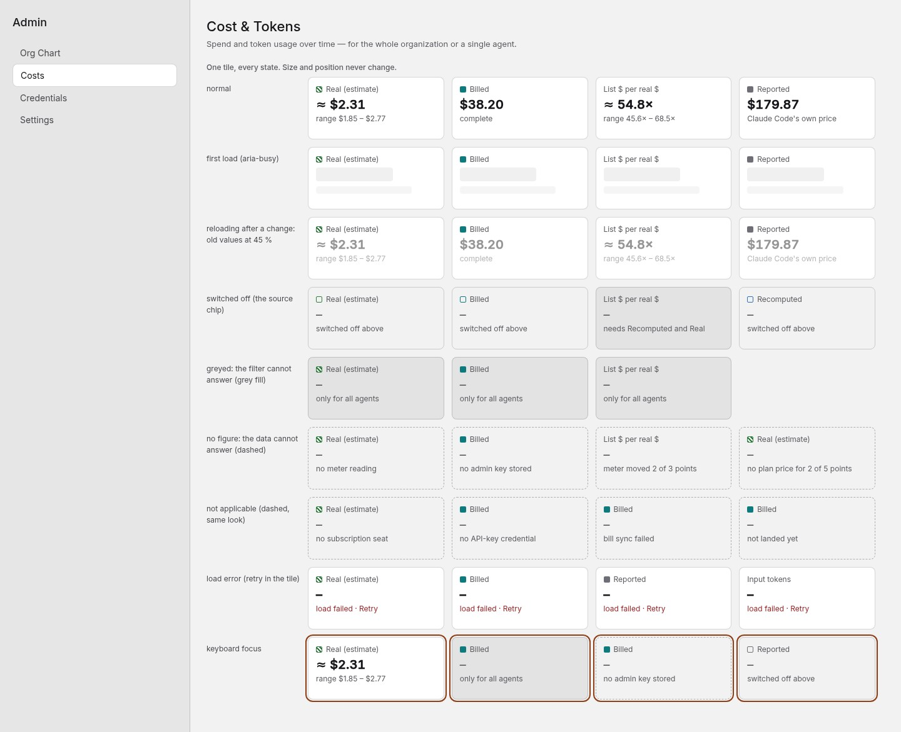
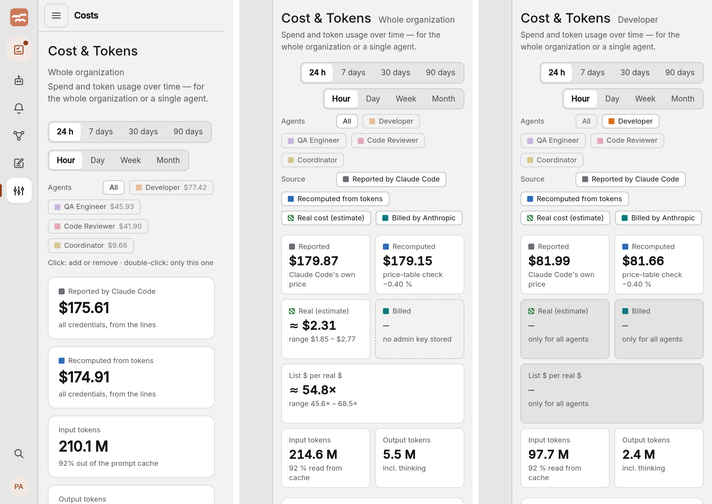

# Design: the headline of the cost page (a fixed set of tiles, no figure twice)

Status: proposal. Design for the human's wishes of 2026-11-18 behind issues #28 and #70 (`Part of`, not `Fixes`: the filter bar, the chart card and the one agent/model table are other pieces). Code references are to `feat/cost-insights` @ 66584cad (PR #74): `web/src/pages/Costs.tsx`, `StackedCostChart.tsx`, `CostInsights.tsx`, `costFigures.ts`. Nothing is implemented. The numbers in the mockups come from a seeded install (two credentials, five agents, 24 hours by the hour). The charts in the mockups are stand-ins; they are not part of this spec. Mockups (static HTML with covey's tokens) are in `docs/design/cost-page-headline/mockup/`. Start with `after-1-default-1440.png`.

> Wishes (2026-11-18): “This is bad: repeated info, bad use of space, and somehow the toggles and filter should modify all that is seen. Maybe grey out, or not, so the screen does not jump around.” (#28) and “No repeated figures: Reported/Recomputed appear in the KPI row and again in each credential's tiles (identical with one credential), and output tokens repeat their value as the sub-line.” (#70)

**The question the headline answers:** *What did the slice I picked cost by each measure, what did the work really cost, and how many tokens was it?* Seven tiles, one row, always the same seven in the same places. A tile that cannot answer says why in one short line and stays where it is.

## 1. What is wrong today (measured on the running page)

| # | Finding | Evidence |
|---|---|---|
| 1 | **12 tiles for 4 questions** (5 KPI tiles, 4 for the subscription credential, 3 for the API key; 14 once a bill has landed). With one credential, Reported and Recomputed stand twice with the same value. | `before-1-default-1440.png`; `Costs.tsx:329-337`, `StackedCostChart.tsx:433-503` |
| 2 | **The set of tiles changes with the filter.** An agent filter turns “Real cost (estimate)” into “≈ share of real”, **removes the multiple tile**, turns “Billed” into “–”, and removes the whole API-key section when none of the agent's lines used it. | `before-2-agent-filter-1440.png`; `StackedCostChart.tsx:452-455`, `:466-470`, `:476-477` |
| 3 | **The Per agent layout changes the headline too**, although it only rearranges the chart (`filtered={filtered \|\| layout === "agents"}`). | `before-3-per-agent-1440.png`; `StackedCostChart.tsx:624` |
| 4 | **The source chips do not touch the tiles.** Switching “Reported” off keeps both Reported tiles at full strength. The chips sit inside the chart card and their state is local to it (`useState` at `StackedCostChart.tsx:732`), so no tile could follow them. | `before-4-source-off-1440.png` |
| 5 | **Tile heights follow the text** (about 100 px for the KPI tiles, about 200 px for the Real and multiple tiles), so the first chart starts about 790 px down at 1440 and about 2,230 px down at 390. | `before-1-default-1440.png`, `before-5-default-390.png` |
| 6 | **Output tokens repeat their value** as the sub-line (`5.5 M` over `5,470,868`, `Costs.tsx:336`). “Total tokens” is Input + Output, and Input is 92 % cache reads, so it is a big number that answers nothing. | `Costs.tsx:337` |
| 7 | **The agent chips carry an amount** (`Developer $81.66`), and the per-agent table repeats it as the Recomputed column. Its Gap column shows the same −0.40 % as the Recomputed tile's price-table check in every row. | `StackedCostChart.tsx:172`, `:682`, `:695` |
| 8 | **The same Real arithmetic stands up to four times**: in the Real tile, the multiple tile, the table caption and the meter card (“≈ $2.31 · range $1.85 – $2.77 · 5 points × $0.46”, “real since 11/17, 10:00 AM UTC (meter baseline), last reading …”). The multiple and the list price of the span stand twice (tile, meter card). | `CostInsights.tsx:148-154`, `StackedCostChart.tsx:675` |
| 9 | **The colour key above the chart repeats the source chips** (same swatches, same names). | `StackedCostChart.tsx:706-722` |
| 10 | At 390 px the tiles stack one per row and the first chart starts about 2,230 px down. With an agent filter the page grows a horizontal scrollbar (474 px wide) because the per-agent table does not fit. | `before-6-agent-filter-390.png` |

## 2. What this spec settles

1. **One headline row of seven tiles, fixed**: Reported, Recomputed, Real (estimate), Billed, List $ per real $, Input tokens, Output tokens. Per-credential tiles, the KPI row and “Total tokens” go.
2. **Seven tiles, seven states.** A tile that cannot answer is greyed (the filter cannot answer, one line says what to change) or dashed (the data cannot answer, one line says why). It keeps its size and its place. It never shows 0 $ or another scope's value.
3. **The headline follows the window, the agent selection and the source chips. The layout and the split never touch it.**
4. **A figure stands once.** The headline carries every figure of the whole slice. What is below it explains or splits: the credential line, the meter card (derivation only), the per-agent table (without chip amounts and without the Gap column).
5. **Fixed sizes** per container width, so nothing around the headline moves.

## 3. The tiles

Order is fixed, left to right at wide widths and row by row on narrower ones. Money first (what it cost), then volume. Each value comes from the same functions the page uses now (`cellTotals`, `credentialFigures`); the formulas are the existing ones, only their scope is the whole slice. Numbers go through `fmtUSD`, `fmtCount` and `fmtNumber` (`format.ts`); this spec does not touch the number style.

| # | Label (en) | Swatch | Value | Sub-line | Follows |
|---|---|---|---|---|---|
| 1 | Reported | `--cost-reported` | **R** = Σ `engine_usd` of the cells in scope, over all credentials (`cellTotals().reported`) | “Claude Code's own price” | window, agents, source Reported |
| 2 | Recomputed | `--cost-recomputed` | **Rc** = Σ recomputed list price of the cells in scope (`recomputedOf`, unattributed bookings excluded) | “price-table check −0.40 %” = (Rc − R) ÷ R; “–” when R = 0 | window, agents, source Recomputed |
| 3 | Real (estimate) | `--cost-real`, hatched | **Re** = Σ over the metered subscription credentials of `real.value` (weeks and plan prices as `realFromWeeks`); the sub-line is the summed range | “range $1.85 – $2.77” = Σ low – Σ high; “< $0.92” as value and “no whole point moved” when the meter did not move | window, source Real; **all agents only** |
| 4 | Billed | `--cost-billed` | **B** = Σ `billedFigure().usd` over the API-key credentials with a bill (`state = measured`) | “complete to 14:00” while the bill is incomplete, else “62 % of list” = B ÷ list price per Anthropic (`ratio`) | window, source Billed; **all agents only** |
| 5 | List $ per real $ | none | **X** = ΣM ÷ ΣRe, M = the recomputed list price of the credential's lines over the meter's own span (`aligned`) | “range 45.6× – 68.5×” = ΣM ÷ Σhigh – ΣM ÷ Σlow | window, sources Recomputed **and** Real; **all agents only** |
| 6 | Input tokens | none | **I** = input + cache read + cache write 5 m + cache write 1 h | “92 % read from cache” = cache read ÷ I (cache writes are misses, not hits) | window, agents |
| 7 | Output tokens | none | **O** = output, thinking included | “incl. thinking” (a fixed text: no value is repeated) | window, agents |

- **The multiple's numerator is Recomputed, never Reported** (#28 acceptance 6; the fixture has Reported ≠ Recomputed). Today's rule stays: from 3 points of movement a value with its range, with 1–2 points the range only (the tile then reads “–” and “meter moved 2 of 3 points”, the range goes to the tooltip), 0 points no multiple.
- **Several credentials of one kind:** Re, B and the pooled X add up over them (a ratio of sums, not a mean of ratios). X needs every metered seat to be priced. The sub-line then ends with the number of seats (“2 seats”). **Assumption for cost-controller to confirm:** two seats of one account would share a meter and double count; until that is decided, seats add and the credential line (§5) shows the parts.
- **Removed from the headline:** “Total tokens” (= I + O, derivable, dominated by cache reads); the multiple's long note “an estimate, not a bound …” (it moves to the tooltip and to the meter card's footer, which already holds the account-wide caveat); “List price per Anthropic” and “Billed / list” as tiles (the ratio is the Billed tile's sub-line, the list price its tooltip).
- **Runs** (PR #8's seventh tile) is not in this set: the branch has no run count in the cells, and what a cost entry is changes with 83d536fa. It can return as an eighth slot, in the volume group, when that is settled.
- **Tooltips** (on hover and on keyboard focus; the tile is focusable with `tabIndex=0` and `aria-describedby`): the exact value, the formula in words with its inputs, the window, and for a grey or dashed tile the long reason (the existing strings `costs.fig.billedUnconfigured`, `…billedUnmapped`, `…noMultipleAgents` and so on). Tokens show `exact()`.

## 4. States

Priority when several apply: **error › loading › switched off › no figure › greyed › normal.** The cause the user can remove with a click comes after the one they cannot (a missing admin key stays the reason with an agent filter on, because clearing the filter would not help).

| State | Look | Value | Sub-line | Cue that is not colour |
|---|---|---|---|---|
| normal | `--surface-2`, 0.5 px `--border` | the figure | as §3 | — |
| first load | same frame, `--tint` bars for value and sub-line, `aria-busy` | — | — | the bars |
| reloading after a change | old values at 45 % opacity until the answer arrives, no skeleton flash | old | old | `aria-busy` |
| **switched off** (the source chip) | no fill, hollow swatch, muted value | “–” | “switched off above” | hollow swatch |
| **greyed**: the filter cannot answer | `--tint` fill, muted value | “–” | the reason that tells what to change | grey fill |
| **no figure**: the data cannot answer, or the thing does not exist here | dashed 1 px `--border-strong`, no fill, muted value | “–” | the reason | dashed border |
| error | normal frame | “–” | “load failed · Retry” in `--text-danger`; Retry is a button | text |
| keyboard focus | 2 px `--text-accent` outline (the page's `:focus-visible`) | — | — | outline |

**Reasons** (the short line in the tile; the long form is the tooltip):

| Tile | Reason | State | Tooltip (existing string) |
|---|---|---|---|
| 1–4 | switched off above | switched off | — |
| 3, 4, 5 | only for all agents | greyed | `costs.fig.filteredRealNote` / `noMultipleAgents` |
| 5 | needs Recomputed and Real | greyed (one of the two is off) | — |
| 3 | no meter reading | no figure | `costs.fig.noMeter` |
| 3 | no plan price stored | no figure | `costs.fig.noPlan` |
| 3 | no price for {{n}} of {{m}} points | no figure | `costs.fig.noPlanPricePoints` |
| 3 | no subscription seat | no figure (no such credential in the window) | — |
| 4 | no admin key stored | no figure | `costs.fig.billedUnconfigured` |
| 4 | key not mapped | no figure | `costs.fig.billedUnmapped` |
| 4 | bill sync failed | no figure | `costs.fig.billedSyncFailed` (with the error) |
| 4 | not landed yet | no figure | `costs.fig.billedNotLanded` |
| 4 | bill unreadable | no figure | `costs.fig.billedUnavailable` |
| 4 | no API-key credential | no figure (none in the window) | — |
| 5 | needs a real figure | no figure (no Real) | — |
| 5 | meter moved {{pts}} of 3 points | no figure | `costs.fig.notEnoughMovement` (with the range) |

Tokens never grey: they have no source and every agent selection can answer them.

## 5. What is below the headline (and what leaves)

| Today | Change | Why |
|---|---|---|
| Per-credential tiles (`CredentialTiles`, `StackedCostChart.tsx:433-503`) | **Removed.** | The headline carries the figures. |
| `NoMultiple` paragraph (`:506-520`) | **Removed**; its text is the multiple tile's reason and tooltip. | The tile says it. |
| Credential header (`:619-623`) | **Stays**: name, kind, plan. With **two or more credentials in the window** it carries the credential's own Reported · Recomputed · Real|Billed · multiple in one line (`anthropic_oauth #0 · Subscription · $200.00/mo plan · Reported $133.76 · Recomputed $133.22 · Real ≈ $2.31 · 54.8×`). With one credential the line has no figures, because the headline is that credential. The count is of credentials in the window, not of those the agent filter leaves, so the line does not appear and vanish with the filter. | They are the parts the headline adds up; with one credential they would be a copy. |
| A credential none of the selected agents used is dropped (`figures` has no cells) | **Stays as its header line** with “No lines from the selected agents in this window.” | A section that vanishes moves everything below it. |
| `filtered \|\| layout === "agents"` on the tiles (`:624`) | **Removed**; the layout is only about the chart. | Finding 3. |
| Meter card (`CostInsights.tsx:110-163`) | Keeps what the tiles do not have: the meter's span and readings (“75 % → 80 %: 5 points from 12 readings”), the derivation (“5 points × $0.46 = $2.31 · list price of the span $126.40 ÷ $2.31 = 54.8×”), the 5-hour window, dropped readings and the account-wide caveat once. **Removed:** the rows that repeat the Real range, the list price as a figure of its own and the multiple with its range. | Finding 8: tile = result, card = derivation. |
| “real since 11/17, 10:00 AM UTC (meter baseline), last reading …” (`realSpan`, in the Real tile, the multiple tile, the table caption) | **Only in the meter card's span row.** The per-agent table caption says “share of the real cost of the meter span, not of the window” without dates. | Finding 8. |
| Agent chips with amounts (`StackedCostChart.tsx:172`) | **Name and swatch only.** The chips are already ordered by cost. The amount stays in the per-agent table. | Finding 7. |
| Per-agent table Gap column (`:682`, `:695`) | **Removed.** The per-agent gap is the tooltip of the Recomputed cell (“−0.40 % against Reported”). | It repeats the headline's check in every row. |
| Colour key above the chart (`ColourKey`, `:706-722`, `:749`) | **Removed.** The source chips carry the same swatches and names; the hatched swatch already marks the estimate. The “What the four figures mean” disclosure stays. | Finding 9. |
| Source chips (state at `StackedCostChart.tsx:732`) | **Lifted to `Costs`** and shown in the filter block directly above the headline, under the agent chips (as PR #8 §2 has it; §6 below). Layout, split, scale and “Show as table” stay on the chart card. | The tiles can only follow what the page knows. |
| “Token types” card (`Costs.tsx:368-372`) | Unchanged here. **Note for the table piece (#70):** its “92 %” of the Input tile is of the input side, its “90 %” is of all tokens; one of the two should go when that card is revisited. | Out of this item. |
| “Usage per model” agent × model table | Unchanged here (#70, one sortable table). | Out of this item. |

## 6. Layout (by container width, never by data)

The tiles live in the content column, so widths are of that column (container queries), as PR #8 §2 has it. Tile height is fixed at 100 px: 10 px padding, label 16 px, value 30 px, two lines of sub-line (16 px each, clamped), 10 px padding. Labels never wrap or ellipsise; the sub-line wraps to two lines and is clamped there, the full text is in the tooltip.

| Content width | Headline | Height |
|---|---|---|
| ≥ 1000 px (1440 viewport with the rail open: 1069 px) | 1 row of 7 equal columns, 12 px gap, 24 px between money (1–5) and volume (6–7) | 100 px |
| 600–999 px | 4 columns: row 1 Reported, Recomputed, Real, Billed; row 2 List $ per real $, Input, Output | 212 px |
| < 600 px (390 viewport: about 300 px) | 2 columns, 8 px gap: Reported · Recomputed / Real · Billed / List $ per real $ across both columns / Input · Output | 4 × 100 + 3 × 8 = 424 px |

At 390 px the headline begins at about 390 px (below the title and the filter block as they are today) and ends at about 815 px, so it is inside the first screen (844 px) and the chart card starts at about 830 px, against about 2,230 px for the first chart today. The filter block above it stays as it is (window, bucket, agents, sources wrap); how it shrinks is the filter-bar piece.

Value size is 20 px with `font-variant-numeric: tabular-nums`. **Budget: values ≤ 10 characters** (`$12,346`, `≈ 54.8×`, `214.6 M`, German `≈ 12.346 $`); `fmtUSD` drops the cents from 1,000 up, so a large window does not overflow. Labels ≤ 18 characters, sub-lines ≤ 36 characters in en and de.

## 7. Colour code

No new colour and no new token. Source colours stay `--cost-reported` (grey), `--cost-recomputed` (blue), `--cost-real` (green, hatched), `--cost-billed` (teal), as in `styles.css:169-172`, and always stand beside the source's name. The states use `--surface-2`, `--tint`, `--tint-weak`, `--border`, `--border-strong`, `--text-muted`, `--text-danger`, `--text-accent` only. Grey fill, dashed border and hollow swatch each come with a text, so no state depends on colour alone. Both themes were rendered (`after-1-default-dark-1440.png`).

## 8. Strings (new keys under `costs.head.*`; all ten locale files; the frontend translates the rest)

| Key | en | de |
|---|---|---|
| `label.reported` | Reported | Gemeldet |
| `label.recomputed` | Recomputed | Nachgerechnet |
| `label.real` | Real (estimate) | Echt (Schätzung) |
| `label.billed` | Billed | Rechnung |
| `label.multiple` | List $ per real $ | Vielfaches |
| `label.input` | Input tokens | Input-Token |
| `label.output` | Output tokens | Output-Token |
| `sub.reported` | Claude Code's own price | Claude Codes eigener Preis |
| `sub.check` | price-table check {{pct}} | Preistabellen-Prüfung {{pct}} |
| `sub.range` | range {{low}} – {{high}} | Spanne {{low}} – {{high}} |
| `sub.seats` | {{count}} seats | {{count}} Zugänge |
| `sub.belowOne` | no whole point moved | kein ganzer Punkt bewegt |
| `sub.billedPartial` | complete to {{time}} | vollständig bis {{time}} |
| `sub.billedRatio` | {{pct}} % of list | {{pct}} % vom Listenpreis |
| `sub.cacheRead` | {{pct}} % read from cache | {{pct}} % aus dem Cache gelesen |
| `sub.thinking` | incl. thinking | einschl. Thinking |
| `why.off` | switched off above | oben ausgeschaltet |
| `why.allAgents` | only for all agents | nur für alle Agenten |
| `why.needsBoth` | needs Recomputed and Real | braucht Nachgerechnet und Echt |
| `why.noMeter` | no meter reading | keine Zählerablesung |
| `why.noPlan` | no plan price stored | kein Tarifpreis hinterlegt |
| `why.noPlanPoints` | no price for {{n}} of {{m}} points | kein Preis für {{n}} von {{m}} Punkten |
| `why.noSeat` | no subscription seat | kein Abonnement |
| `why.noAdminKey` | no admin key stored | kein Admin-Schlüssel |
| `why.unmapped` | key not mapped | Schlüssel nicht zugeordnet |
| `why.syncFailed` | bill sync failed | Rechnungsabgleich fehlgeschlagen |
| `why.notLanded` | not landed yet | noch nicht da |
| `why.unreadable` | bill unreadable | Rechnung nicht lesbar |
| `why.noKey` | no API-key credential | kein API-Schlüssel |
| `why.needsReal` | needs a real figure | braucht eine echte Zahl |
| `why.movement` | meter moved {{pts}} of 3 points | Zähler: {{pts}} von 3 Punkten |
| `why.loadFailed` | load failed | Laden fehlgeschlagen |
| `retry` | Retry | Erneut |
| `credential.line` | Reported {{reported}} · Recomputed {{recomputed}} | Gemeldet {{reported}} · Nachgerechnet {{recomputed}} |
| `credential.empty` | No lines from the selected agents in this window. | Keine Zeilen der gewählten Agenten in diesem Zeitraum. |

The German label of tile 5 is “Vielfaches”, not “Listen-$ je echtem $” (20 characters do not fit a tile of about 117 px); the tooltip carries the long name. The existing keys stay for the chips, the tooltips and the card: `costs.fig.reported`, `…recomputed`, `…realEstimate`, `…billed`, `…multiple`. Keys that go with the removed parts: `costs.kpiAllCredentials`, `costs.totalTokens`, `costs.cachedShare`, `costs.fig.shareOfRealSub`, `costs.fig.noMultipleAgents` (as a paragraph; the text stays as the tooltip), `costs.fig.key`, `costs.fig.keyReported`, `…keyRecomputed`, `…keyReal`, `…keyBilled`, `costs.fig.gap`, `costs.fig.listPerAnthropic` and `costs.fig.billedPerList` move into tooltips or go; the frontend removes them from all ten files together.

## 9. Accessibility

- The headline is `role="group"` with an accessible name; each tile is `role="group"` with `aria-label` = label, focusable, and its tooltip is `aria-describedby`. A greyed or dashed tile reads its reason (“Real (estimate), no value: only for all agents”).
- While loading the group has `aria-busy="true"`; a change of state is not announced tile by tile (one `aria-live="polite"` line for the group: “Figures updated for Developer, 24 h”).
- Hit areas: the Retry button 24 px high at least; chips as today.
- Contrast: muted text on `--tint` is `--text-muted` on the page's own tint, measured by the token comment in `styles.css` (≥ 5.4:1 on the three grounds); the tint is 6 % black or white, so the pairing stays above 4.5:1.

## 10. Acceptance criteria (each is a test that fails without the change)

1. **Seven tiles, always.** For every combination of source chips (15, at least one on), agent selection (none, one, two) and data (empty, one credential, two credentials, API key with and without a bill) the headline has exactly seven tiles with the ids `reported recomputed real billed multiple input output` in that order.
2. **Greyed in place.** With an agent selected, tiles 3–5 show “–” and the reason `only for all agents`, never `$0.00` and never another scope's value. With Reported off, tile 1 shows `switched off above`; with Recomputed or Real off, tile 5 shows `needs Recomputed and Real`. With the source on again the tile has the same box.
3. **The layout never touches the headline:** the headline's text is identical for Combined and Per agent.
4. **No figure twice.** With one credential and two agents, `fmtUSD(reported)` and `fmtUSD(recomputed)` each appear once outside the per-agent table; with two credentials the credential lines hold the parts and their sum is the headline's value. The Output tile's sub-line is not its value. The meter card shows no Real range, no list-price row and no multiple.
5. **The agent chips show no amount; the table has no Gap column.**
6. **Formulas.** Table-driven tests of the headline function (pure, in `costFigures.ts`): R, Rc, Re, B, X, I, O for a fixture with Reported ≠ Recomputed (X uses Recomputed) and with two credentials (pooled X; X is “–” with `needs a real figure` if one seat is unpriced); 1–2 points give the range only; 0 points give `< $…`.
7. **Reasons by priority:** no admin key with an agent selected shows `no admin key stored`, not `only for all agents`.
8. **Sizes.** In a browser check recorded in the PR: at 1440, 1000 and 390 px every tile's and the filter block's `getBoundingClientRect()` is identical (0 px delta) before and after each source chip, an agent selection, a window change, a layout change, a reload and during loading; at 390 px the headline is 424 px high and the page has no horizontal scroll with an agent selected.
9. **Strings:** all ten locale files have every `costs.head.*` key (parity test); in en and de labels ≤ 18, values ≤ 10 and sub-lines ≤ 36 characters; no German in the English file.
10. **Numbers** through `fmtUSD`, `fmtCount`, `fmtNumber` and `exact`; no new colour and no hard-coded hex value.
11. **Keyboard:** every tile is reachable by Tab and shows its tooltip on focus; Escape closes it.

## 11. Against PR #8 (`docs/design/cost-page-top.md`, branch `design/cost-page-top`)

PR #8 was written before `feat/cost-insights` was on the fork, from a screenshot of build e662903. This spec **replaces its §1 tile row and §3 (tiles and states)**, which contradict the branch:

| PR #8 | This spec | Why |
|---|---|---|
| Three sources (Reported, Measured, Real) | Four (Reported, Recomputed, Real, Billed); “Measured” is the branch's “Recomputed” | PR #74 books a bill per API key. |
| Seven tiles with Runs | Seven tiles with Billed instead of Runs | §3. |
| Real “whole organisation only” | Real adds the metered seats; greyed only by an agent selection | The credentials are the unit; PR #8 had no per-credential figures to place. |
| Plan $/month as a button in the Real tile | No input: plans are dated rows (`credential_plans`) | The branch stores plans per credential. |
| Switched-off tile shows “—” with “switched off” | Same, plus the dashed “no figure” state | A bill that cannot exist is not a switch. |

PR #8's **filter bar (§2), the sizes by container width (§2), the sticky behaviour, the URL state, §4 number style, §5 colour discussion and §6 are not touched**; wherever they name the tiles, this spec's seven are meant. The four source chips (not three) go into the bar. Closing PR #8 or cutting it down is for the coordinator.

## 12. Assumptions and what is left

- **Assumption (for cost-controller):** seats of one kind add (Re, B) and X is the ratio of sums (§3). Default until decided.
- **Assumption:** “Recomputed” is kept as the label; issue #28 calls the same figure “Measured”.
- **Not in this spec (other pieces):** the filter bar itself and the one agent selector (#28, PR #8 §2), URL state (#70), the chart card's fixed height (#28 acceptance 5: the credential sections below the headline still change height with the data), grouped bars per agent and the token view (#70), the one sortable agent/model table (#70), the number style (`fmtMoney`, #28 should), the Token types card's percentages.
- **Found, not fixed here:** with Per agent the charts are wider than their card at 1440 (`before-3-per-agent-1440.png`) and the page scrolls sideways at 390 with an agent selected (`before-6-agent-filter-390.png`). Acceptance 8 covers the 390 case.
