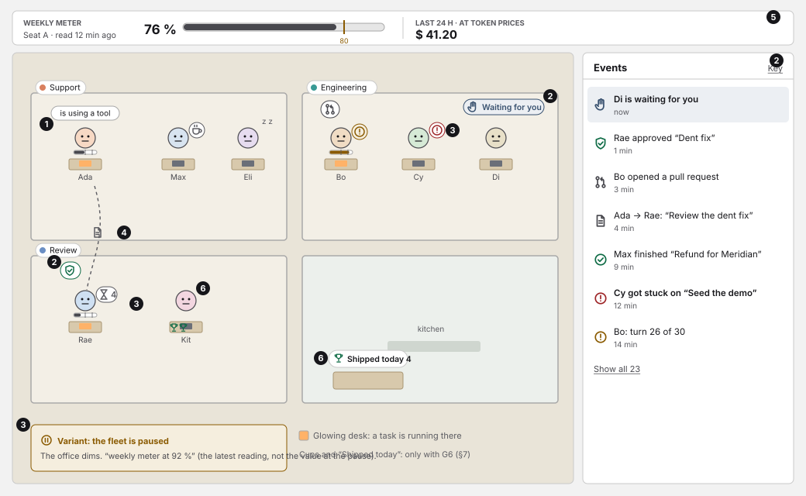
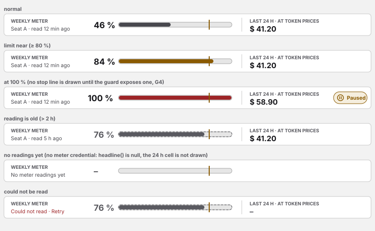
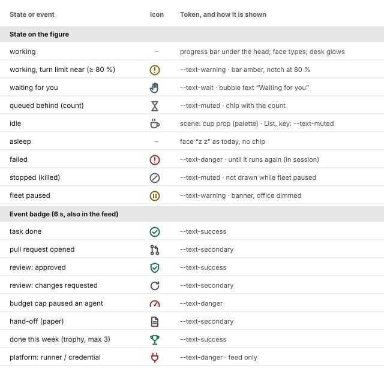

# Design: the office as a light game

Status: proposal, for the human's approval before any build. Part of #183 (design only, no code). Code references are to `main` @ f8934be3; the open PRs #137 (render on demand) and #142 (fit the viewport) are read as if merged, and `docs/design/office-signals.md` (part D of #122) as the base this builds on. Mockups are static SVG with the light values of covey's tokens and sample data; they are in `docs/design/office-game/` (`stage.svg`, `icons.svg`, `wall.svg`). Every figure in them is made up.

> Wish (2026-11-20): make the 3D office nicer and a little like a game. Integrate the notifications, show a progress bar on active tasks, add other simple things that add value.



**The question the game layer answers:** *what is happening in my workforce right now, how far along is it, and what is it asking of me?* It adds no second question. The lists answer *what*, the office (office-signals) answers *where and who*, and this layer adds *how far, what just happened, what is queued, what it costs*. Everything it shows is read from a record; nothing is invented to look lively.

## 0. What exists today (checked in the code)

| Need | Source today | What it gives | Gap |
|---|---|---|---|
| Who works, on what, since when, last step kind | `GET /org/running` (`internal/httpapi/running.go`, `LIMIT 20`), polled every 10 s (`Ueberblick.tsx:54-57`) | `task_id`, `title`, agent, `since`, `step` | **no turns used, no limit** (G1) |
| The turn limit | `Agent.max_turns` (`web/src/api.ts:50`); 0 means the orchestrator's default, `agents.DefaultMaxTurns` = 30 (`internal/agents/lint.go:112`) | the configured limit | the client would have to repeat the default (G1) |
| Turns used in a run | only the daemon at the end of a run (`num_turns`, `runtime_claudecode.go`); #42 (open) adds a counter for its 50 % / 80 % notices | nothing the UI can read | G1 |
| Waiting for the human | inbox poll every 30 s (`Ueberblick.tsx:37-40`) → `wartetBei` → state `wartet` (`Buero.tsx` `zustandVon`) | agent ids | none |
| Live changes | `GET /events` (SSE, `App.tsx:49`) with types `agent_status`, `task`, `recording`, `approval`, `guardrail`, `chat`, `roster` (`orchestrator/broadcast.go:14`). The client only invalidates queries. | agent id; `task` carries `task_id`, and `state` only when the API made the change (`httpapi/liveevents.go:48`), not when a run did (`orchestrator.go` `publishTask`) | the final state of a task, the sender of a hand-off, PR events (G3) |
| Notifications | `notify.Emit` writes the `notifications` table (`internal/notify/notify.go:181-209`); classes `decision`, `task` (off by default as noise), `cost`, `ops`; kinds `approval`, `improvement`, `task_done`, `task_failed`, `budget`, `fleet_killed`, `runner_gone`, `credential`, `delegation_refused` | a title and a link per row | **no endpoint lists them** (only the preferences, `server.go:357`) (G3) |
| Fleet switch | `GET /fleet` → `{fleet_killed}`; `Organization.fleet_killed` (`api.ts:1563`), which `Buero` already reads as `["own-org"]` | the flag | the meter at the time of the pause is not stored; see §2.5 |
| Meter and spend | cost page: `MeterCoverage` readings, `cost/subscription`, `cost/org` (`api.ts` 707-850); the line in open PR #170 | weekly % per seat, dollars | the guard's stop line is not exposed (G4) |
| Queue per agent | none org-wide | | G2 |
| Merged PRs | none: covey records an agent's `action` events, not a merge, which only the human does | | G3, decision D1 |
| Hand-off | `backlog_tasks.parent_task_id` and `created_by` exist (`backlog.go:140`, `api.ts:157`) | the link | not in an event (G3) |

The gaps become separate backend issues, as #183 asks. They are listed in §7. **Every build PR below says what it does when its data is absent, and the design below says it too: the element is not drawn. It is never drawn with a guessed value.**

## 1. Rules for the whole layer

**One colour, one meaning** (this extends office-signals §5; it adds no colour):

| Token | Means, and only this | Always paired with |
|---|---|---|
| `--office-screen-lit` (scene) | a task is running at this desk (unchanged) | the desk |
| `--text-wait` / `--bg-wait` | waiting **for you** (unchanged) | the raised hand, the words “Waiting for you” |
| `--text-warning` / `--bg-warning` | **a limit is near** (≥ 80 %): turns, the weekly meter; and the paused fleet, because a limit stopped it | a notch at 80 %, or the pause glyph |
| `--text-danger` | failed, or **a limit is reached**, or a platform fault | the `!` / stop / plug glyph |
| `--text-success` | finished well: done, approved, done this week | check / shield / cup glyph |
| `--text-secondary`, `--text-muted` | information with no ask: PR opened, changes requested, hand-off, queued, idle, stopped | the glyph |
| `--text-accent` | pointed at (unchanged); **never used for an event** | |

No new colour, no new token. The amber of `--text-warning` and the glow `--office-screen-lit` are close in hue, and that is accepted because they never share a surface: the glow is scene light, `--text-warning` is overlay chrome, and chrome in warning is always a bar with a notch or a glyph, so shape carries the meaning as well as colour. The scene needs no palette entry either: the cups and the coffee cup are built from `FARBEN.metall`, `holzDunkel` and `weiss`; the paper from `FARBEN.papier`.

**Data or nothing.** `buero/leben.ts` keeps what carries information apart from what is atmosphere, “a movement from which something could be read that no record holds would be a lie with charm”. This layer is all information. It lives in its own module (proposed `buero/signale.ts`, pure, with the time passed in) and does not touch `leben.ts`. No new ambient animation is added.

**Caps, so it never becomes noise** (#183 item 2, and the notify package's own finding that `task` is the class most likely to be noise):
- at most **6** transient badges visible at once in the whole house. Beyond that, the extra events go only to the feed, and the front-desk sign shows `+n`;
- a badge shows **6 s**; the timer pauses while the pointer or keyboard focus is on that figure;
- the feed keeps **50** lines for the session; the same kind of event for the same agent within 60 s is one line with `×n`;
- a switch “Events in the scene” (stage controls, remembered per browser, **on** by default) turns the badges, papers and sound off. The feed and the state icons stay.

**What it must not contradict** (checked against the two open PRs and office-signals):

| Rule from | Kept how |
|---|---|
| #137 B.1/B.3: the loop runs only while something changes; ≤ 30 fps | every new element is static between data changes. A change wakes exactly one frame through `wecken`. Papers ride the loop's `weiter` mode for 0.9 s and then it returns to `ruht` |
| #137 B.7: no layout read in the frame, writes are `transform` | new boxes (bar, chip, badge, board sign) are measured once through `buero/masse.ts` (the `ResizeObserver` cache) and moved only with `transform`; the bar's fill is `transform: scaleX()`, never `width` |
| #137 B.4: reduced motion followed live (`useRuhig()`) | §5; the new code reads `useRuhig()`, not `matchMedia` once |
| #137 B.6: the shadow map is drawn once per rebuild | the two geometry props (cup, trophies) change the scene only through the existing rebuild (`zustandKern`), one shadow pass per change; nothing else is geometry |
| #137 B.8: the faces' infinite CSS animations are what costs when idle | **no new infinite animation anywhere** (§6) |
| #142: the stage takes the window's free height; fit with a 6 % margin around the whole building | the feed docks beside the stage and the wall strip sits above it, both flex siblings; nothing is laid over the building, so the fit stays valid. A width change refits through #142's resize path |
| office-signals §2: collision priority, `wartet` bubbles never fold, faces never hidden, names yield first | §2.1 and §2.2 say where each new item sits in that list; none is added above rank 3 |
| office-signals §5: exactly one legend line | the legend line is unchanged. The icon key is a “Key” disclosure in the feed header (§2.2), not a second legend line |
| office-signals §2 accessible name `team.figurAria` | extended, not replaced (§2.1, §2.3) |

## 2. The six items

### 2.1 A progress bar over every working agent (#183 item 1)

```
      ┌──────────────────┐
      │ is using a tool  │   bubble: office-signals rank 7, unchanged
      └──────────────────┘
            (face)           head: rank 3
          ▕██████▏▏▏▏        bar: 30 × 5 px, notches at 50 % and 80 %
             Ada             name: rank 6
```

- **Where.** Between the head and the name, inside the figure's box. The bar belongs to the head's item in the collision order (rank 3, never hidden, moves only with its figure). The name moves down by the bar's height, and the figure's measured box includes it.
- **Size.** 30 × 5 px, radius 2.5; 24 px wide where `gesichtGroesse` drops to 24 (more than 40 agents). Track `--surface-2` with a 1 px `--border-strong` (it holds up on light `--surface-0`); two 1 px notches in `--text-muted` at 50 % and 80 %, reaching 1 px above and below the track.
- **Formula.** `fill = min(1, turns / max_turns)`, where `turns` is the turns used in the current run and `max_turns` the limit of that run, both from the running row (G1: the server resolves the default, the client never repeats `30`). Turns are counted as `--max-turns` counts them, per `claude` invocation, so a resumed run starts at 0 (#42). Two running tasks for one agent: the bar shows the row with the higher fill, and the card lists both.
- **Colour by state.** `turns < ceil(0.8 × max_turns)`: `--text-secondary` (working is already said by the lit desk and the typing face; a coloured bar for “fine” would spend a colour on nothing). From `ceil(0.8 × max_turns)`: `--text-warning`, the threshold of #42's second notice (turn 24 of 30, 64 of 80). At `max_turns`: `--text-danger`, which only shows until the run is marked failed. A figure that is `wartet` or `gestoppt` shows the bar frozen at its last value in `--text-muted`, dashed track; a stopped figure is dimmed like today.
- **Not a progress of the task.** #183 offers “turns, or the task's stage”. Stages are user-defined columns with no order or total, so a stage cannot make a fraction. The stage name goes in the card, not on the bar.
- **Where the number is.** On the bar nowhere (it is 30 px). In the card and in the “Running now” row as `14 / 30` through `fmtCount` and `fmtNumber` from `format.ts` (it has no percent formatter yet; the first PR that needs one adds it there, not inline). The row gets the same bar, 4 px high and full width of the row's text column, with the same notches.
- **Absent.** If the row has no `turns` (G1 not landed, or a runtime that does not count, such as sevencode which has no turn limit), no bar is drawn and the row shows only the duration, as today. There is no placeholder bar.
- **Accessible.** The bar is `aria-hidden` inside the figure's button. The button's label gains the turns: `team.figurAria` becomes `{{name}}, {{zustand}}` plus, for a running agent with a bar, `team.spiel.zuege` = “turn {{n}} of {{max}}”. In the “Running now” row the bar is a `role="progressbar"` with `aria-valuenow`, `aria-valuemax` and `aria-valuetext` = the same sentence, and the amber state adds `team.spiel.zuegeKnapp` = “close to the turn limit” to it, so colour is never the only carrier.

### 2.2 Notifications in the scene (#183 item 2)

```
 office view, ≥ 1100 px container                  office view, < 1100 px
┌─ wall strip (§2.5) ──────────────────────────┐  ┌ wall strip ──────────┐
├──────────────────────────────┬───────────────┤  ├──────────────────────┤
│                              │ Events   Key  │  │ stage                │
│  stage     ◔ badge over a    │ ✋ Di waits…  │  │               [Events 3]
│            desk, 6 s         │ ✓ Max done…   │  │                      │
│                              │ ⎇ Bo opened…  │  └──────────────────────┘
│                              │ Show all 23   │   the feed is a drawer over the
└──────────────────────────────┴───────────────┘   stage, opened by that button
```

**The badge.** A 24 px round chip with the event's glyph (§4), 1 px border and glyph in the event's token, fill `--surface-2`. It takes the **step bubble's slot** above the head (`.bu-denkt`); while it shows, the step bubble is hidden. It adds no participant to the collision function:
- ask events (needs you, failed) are not badges but **state** (§2.3): the existing bubble and the chip keep showing for as long as the state holds;
- transient events (done, PR opened, verdict, hand-off received, budget) take the slot for 6 s, then the step bubble returns;
- a `wartet` bubble (rank 4) is never replaced by a badge: the badge waits behind it (it is in the feed at once) and shows when the ask is answered.
Badges are `aria-hidden`; the feed is their accessible form.

**The feed.** A panel `280 px` wide, a flex sibling of the stage inside `.bu`, so the stage's height is untouched (#142) and its width shrinks, which the camera refits like any resize. Below 1100 px container width the panel is a drawer over the stage, closed, and its button shows the count of lines unread since it was last open. Content, newest first:
- row: glyph (§4), one line of text, age. The line is ellipsised at one line, the full text in `title`; `×n` when merged. Age is “now”, then whole minutes (“3 min”), refreshed by **one** shared 30 s tick, not one ticker per row (the `Dauer` component of “Running now” ticks every second per row; the feed does not copy that).
- the first 12 lines; “Show all {{count}}” unfolds to 50.
- the header's “Key” opens the icon key: the table of §4 with the glyphs and their words, at the feed's width. This is where the icons are explained; the stage keeps its one legend line.
- **At load** the feed is seeded with what is true now, never with history: who is waiting for you, whose last run failed and is not yet seen, the number of tasks running. Everything after is live. The feed is session-local and is empty after a reload except for that seed. (A persisted feed would need the notifications endpoint of G3.)
- **States.** Loading: three skeleton rows. Empty: “Nothing new since you opened this page.” Error, or the event stream down: a line “Live updates paused, reconnecting” in `--text-muted` (the same visible state the shell's stream gives, lesson 4), cleared when the stream reopens, which also fetches what was missed.

**Click.** A feed row and a badge go to the thing, with the keyboard as well (the row is a link, the badge's figure is a button that opens its card):

| Event | A click goes to |
|---|---|
| needs you, blocked on a human | the agent's conversation `/team/<agent_id>` (where the decision card sits, as the “Running now” rows do) |
| done, failed, budget, hand-off received, PR opened, verdict | the agent's page `/agents/<agent_id>` (its task and recording). The implementer confirms whether the agent page can deep-link to a task; if not, the page is the target |
| PR opened, verdict | the row also has a trailing `↗` to the PR, opened in a new tab with `rel="noopener noreferrer"`, only when the recorded URL is on the host of the connected target system |
| platform (runner, credential) | `/inbox` for approvals and decisions; the page named by the notification's own `link` otherwise |

**Sound** is off by default and designed in §2.6.

The full event list, with sources and durations, is §3.

### 2.3 State at a glance, by icon (#183 item 3)

```
 working          waiting for you     queued behind      idle        failed       stopped      fleet paused
  (face)         ╭ ✋ Waiting for you╮   (face) ⌛3       (face) ☕    (face) (!)   (face) ⊘     ░░ office dimmed ░░
 ▕███▏▏▏▏         (face)                                                                       ┌ ⏸ Paused · … ┐
  Ada               Di                  Rae          Max          Cy          Kit
```

The state is one of the five `Zustand`s the office already derives (`zustandVon`) plus two facts the office did not show: failed, and what is queued.

- **A chip** of 20 px (glyph 16) at the upper right of the head, border and glyph in the state's token on `--surface-2`. One chip per figure at most: priority failed > waiting for you > queued > idle. (Waiting for you also keeps its bubble; the hand in the chip is for when the bubble yields to a merge: `{{count}} waiting for you`, office-signals rank 4.) Working has no chip: its signs are the bar, the typing face and the lit desk. Asleep has none: the face's “z z” says it.
- **Queued.** The hourglass chip carries the **count of that agent's tasks waiting behind the one it runs** (or the ones it has, if it is not running one): `queued = open tasks assigned to the agent, not running, not parked`. It is its own channel and shows next to a working figure's bar. Neutral colour on purpose: it says *waiting for others*, which is not *waiting for you* (wait-blue, bubble only). Source: G2. Absent: no chip.
- **Idle.** A cup on the desk, geometry in the scene, changed through the existing state rebuild. It is the “frei” state's prop, not an icon over the head: idle people already walk to the kitchen (`leben.ts`), and a head chip on all of them would be noise. In the List and the key it is the cup glyph.
- **Failed.** A red `!` chip on an agent whose **latest task ended `failed`** (notify kind `task_failed`), until the agent starts another run, or the person opens its card or the feed row (then it is “seen”, session-local). It does not disappear by timer: a failure is something to act on.
- **Stopped** (`killed`): the existing dimmed figure (`.gestoppt`, opacity 0.45) plus a muted `⊘` chip, so that “stopped” is also readable on a screenshot where 0.45 opacity looks like a poor render.
- **Fleet paused** (`Organization.fleet_killed`): the whole stage is dimmed (a `--scrim-weak` veil over the canvas, below the overlay so bars, chips and the card stay at full contrast) and a banner sits at the top of the stage: `⏸ Fleet paused` and, when the meter has a reading, `· weekly meter at 76 %`. The percent is the **latest reading, not the value at the moment of the pause**, because the platform stores no such value; the banner says “weekly meter at”, never “paused at”, and the number carries its age (§2.5). Without a reading the banner has no number. It is `role="status"` and carries `team.spiel.pausiert`. The banner leaves the camera and the keyboard alone.
- **Accessible.** `team.figurAria` already holds the state word; it gains `team.spiel.fehlgeschlagen` = “last task failed”, `team.spiel.wartschlange` = “{{count}} waiting behind”, `team.spiel.gestoppt`. The chips are `aria-hidden`.
- **List view.** §5.

### 2.4 Hand-offs you can see (#183 item 4)

```
   Ada's desk  ──────╮ paper, 0.9 s, along an arc in screen space
                     ╰───────▶  Rae's desk   badge: paper, 4 s   queue ⌛ 3 → 4
```

A hand-off is a **task created for another agent** by an agent (`created_by` agent, `parent_task_id` set, sender ≠ receiver; a human's task is not a hand-off).
- **The paper.** A 14 × 18 px sheet (the paper glyph, `--text-secondary` on `--surface-2`), 0.9 s on a shallow arc from the sender's head to the receiver's head, drawn by the frame loop in its `weiter` mode (a transform per frame, 30 fps cap), then removed. Across floors: the paper flies to the stairwell marker of the floor, and the receiver's floor button gets the accent dot office-signals §4 already defines for an off-floor figure.
- **Receiving.** The receiver gets the paper badge for 4 s and its queue chip counts up (G2). The feed line reads `Ada → Rae: “<title>”`.
- **At most 6 papers in flight**; further ones are feed lines only.
- **Review queues visible** (the bottleneck the team measured): the queue chip of §2.3 is the reading. The feed header gains a one-line strip *under* the events when any queue is ≥ 1: `Waiting in line: Rae 4 · Kit 2` (top three by depth, ties by name), each name a link to its card. This is the sorted answer to “where is the line”, which a scattering of chips is not. Counts through `fmtCount`.
- **Absent.** Without G3 there is no paper, only the queue chip (G2) if that exists.
- **A refused hand-off** (notify kind `delegation_refused`: the chain brake closed): no paper reaches the receiver. The sender gets a `--text-danger` `!` badge for 6 s, and the feed line says why in the notification's own title.

### 2.5 The meter on the wall (#183 item 5)



**Where.** A strip of **44 px** above the stage, full width, in the `.bu` column (a flex block like the blocks above the stage in #142, so the stage's free height is reduced by 44 px and nothing covers the building). Under 720 px it is two rows (72 px). **Assumption (decision D2):** “on the wall” is read as the wall *of the stage*, not a wall *in the 3D house*. In the house, the walls that face the camera are cut down to a plinth (the cutaway rule at the head of `Buero.tsx`), so a screen on one wall is gone in about half of the four rotations and the implementer would have to move it at every quarter turn; text on a canvas texture is unreadable below zoom 1, cannot be read by a screen reader, and would be redrawn on every data change. The strip is styled as a wall display: `--surface-2`, 1 px `--border`, radius 6.

**What it shows**, in two cells (the “Shipped today” board is the sign at the front desk, §2.6, not a third cell):

| Cell | Content | Formula and source |
|---|---|---|
| Weekly meter, one row per subscription seat with a reading, at most 3 (then `+n more` linking to the cost page) | seat name, `76 %`, a bar with a notch at 80 % (`--text-warning`) and, where the guard exposes one, a dashed stop line (`--text-danger`) with its value; `read 12 min ago` | the **latest reading** of the seat's meter, the same value and the same function as the last point of the line in the cost chart (`MeterCoverage`, and `meterPoints` once #170 is merged). The office computes nothing of its own |
| Monthly limit, for a seat metered monthly (0152) | the same row, label `Month` | the latest reading in % of that month's limit, by the same rule |
| Today | `$ 41.20`, label “Today (UTC) · at list price” | the cost page's own headline figure for the window “today (UTC)”, through `fmtUSD`, with the partial-sum rule (`SourceTotal` with/of in `costFigures.ts`), the dent rule of #182 and the methodology spec of #187 (both open; the strip follows whichever merges): a part without a figure shows `–` and its reason, **never `≈ $0.00`** |

- **One rule for both gauges:** neutral up to 80 %, `--text-warning` from 80 %, `--text-danger` at the stop line or 100 %, so turns and the meter read alike.
- **Age is part of the number.** A reading older than 2 h (hourly readings are the norm; they only arrive in-band, #153) is drawn grey with a dashed track and says `read 5 h ago`: an old figure never looks current.
- **States** (all six in `wall.svg`): normal; limit near; at the stop line (with the “Paused” pill when `fleet_killed`); stale; empty (“No meter readings yet”, linking to the cost page); error (“Could not read · Retry”, keeping the last figure greyed).
- **Refresh.** The meter is refetched every 5 min while the strip is on screen and on focus, not on every SSE event; today's spend with the cost queries the page already uses. No new polling when the tab is hidden.
- **Numbers:** `fmtUSD`, `fmtCount`, `fmtNumber` (percent, as above), times through `fmtClockUTC`/`fmtDelta`. **A test compares the strip's figures with the cost page's for the same window** (lesson 14: a tile, its chart and its table must sum to one figure). **This item needs cost-controller's formula review before its PR** (charter directive 6).
- **Accessible.** The strip is a `section` named by `team.spiel.wand`; each gauge is a `role="meter"` with `aria-valuenow/min/max` and `aria-valuetext` = “76 % of the weekly limit, read 12 minutes ago”; the stop line is in the text, not only in the colour.

### 2.6 Light game touches (#183 item 6)

- **Trophies on the author's desk.** A small cup (geometry, `FARBEN.metall` on a `holzDunkel` base) for what the agent **got done this week** (rolling 7 days, UTC): 1, 2 or 3 cups, **capped at 3**; the exact count is in the card and in the List. The cups change the scene only through the existing rebuild: one rebuild per new cup, at most a few a day.
  - **Decision D1 (the human's):** the wish says *merged PRs*. covey does not know when a PR is merged (the human merges on GitHub; nothing in the platform records it), so this cannot be built on data that exists. **Recommended:** ship the first version as **tasks done in the last 7 days** (known today, from the `done` state), labelled in every place it is shown “Done this week”, and move to merged PRs when a source exists (G3). The label never says “merged” while it is a task count (charter 4: the number's formula is the label).
- **“Shipped today” board by the door.** A sign at the front desk (`tresen`), drawn with the department signs' machinery: `🏆 Shipped today 4`. It is a rank-5 item in office-signals' order (moves up only, at most 48 px, ellipsis at 120 px, never hidden). Formula: **tasks that reached `done` today (UTC)**, org-wide, counted from the same tasks as the trophies and tested against them. When the day has none: `Shipped today 0`, never hidden (a zero is information). Click: the feed filtered to done events.
- **Sound.** **Off by default** (#183). A speaker button in the stage controls (`aria-pressed`, remembered per browser). Two tones only, synthesised with the Web Audio API (no files, no download): a soft one for *needs you* and a softer one for *done*; at most one per 10 s; none while the tab is hidden; none until the person has clicked something on the page (browsers refuse earlier). **Recommendation: build it last, or drop it** (D3): it is the one item that needs no data and the one with an accessibility and workplace cost.

## 3. The event list

| # | Event | Source today → what the client does | In the scene | Feed line (English) | Click | Shown |
|---|---|---|---|---|---|---|
| E1 | **Needs you** (decision waits) | inbox poll (`wartetBei`) and SSE `approval` → state `wartet`; notify kind `approval` | the `wartet` bubble with the hand glyph and “Waiting for you”; merged to `{{count}} waiting for you` by office-signals rank 4; hand chip | `{{name}} is waiting for you` | the agent's conversation | **state**: while it holds |
| E2 | **Task done** | the row leaves `/org/running` and the task's final state is `done` (one `GET` per departure, ≤ 5 in flight; or the `state` in the event, G3); notify kind `task_done` | badge: check, `--text-success` | `{{name}} finished “{{title}}”` | the agent's page | 6 s |
| E3 | **Task failed** | same departure, final state `failed`; notify kind `task_failed` | red `!` chip (state, §2.3) and a danger badge for 6 s | `{{name}} got stuck on “{{title}}”` | the agent's page | **state**: until it runs again or is seen |
| E4 | **Blocked on something else** (parked on an external key, not the human) | departure with state `blocked` | no badge; hourglass is the queue chip only if tasks wait; the bar freezes | `{{name}} is waiting for an answer: “{{title}}”` | the agent's page | feed only |
| E5 | **Pull request opened** | recorded `action` event of the target system's create-PR action with a result; **no event reaches the client today** (G3) | badge: PR glyph, `--text-secondary` | `{{name}} opened a pull request` (+ `↗`) | the agent's page (+ the PR) | 6 s |
| E6 | **Review verdict** | the same, for an approve or changes-requested action (G3) | badge: shield-check (`--text-success`) or the circular arrow (`--text-secondary`) on the **reviewer** | `{{name}} approved “{{title}}”` / `{{name}} asked for changes on “{{title}}”` | the agent's page (+ the PR) | 6 s |
| E7 | **Hand-off** | SSE `task` for the receiver + the new task's `parent_task_id`/`created_by` (G3 for the sender in the event; until then one `GET`) | the paper flight and the paper badge on the receiver | `{{from}} → {{to}}: “{{title}}”` | the receiver's page | 0.9 s flight + 4 s |
| E8 | **Hand-off refused** | notify kind `delegation_refused` (G3 to read it) | `!` badge on the sender | the notification's title | the agent's page | 6 s |
| E9 | **Budget cap paused an agent** | notify kind `budget`, class `cost` (G3 to read it); the agent turns `gestoppt` | gauge badge, `--text-danger`; the agent's stopped chip | `{{name}} was paused by its budget` | the agent's page | 6 s |
| E10 | **Turn limit near** | the bar crossing 80 % (§2.1) | the bar turns amber; no badge | `{{name}}: turn {{n}} of {{max}}` | the agent's page | feed line once per run |
| E11 | **Fleet paused / resumed** | `Organization.fleet_killed` (the `["own-org"]` query: it is refetched on SSE `agent_status` and `roster`, a new invalidation) | dim + banner (§2.3) | `The fleet was paused` / `The fleet is running again` | the fleet control that already exists for the switch (the implementer links it) | **state** |
| E12 | **Runner gone, credential refused** | notify kinds `runner_gone`, `credential` (G3 to read them) | none: they belong to no desk | the notification's title | its `link` | feed only |
| E13 | **Open point from a review** (improvement) | notify kind `improvement` | none | the notification's title | `/inbox` | feed only |
| E14 | **Done this week** (trophy) | derived: done tasks in 7 days (D1) | a cup on the desk | no line (a count, not an event) | the card | state |

“Same events as the existing notifications” (#183): E2, E3, E1, E8, E9, E12, E13 are the notification kinds of `internal/notify`. The scene shows them from **the data the page already holds plus the SSE stream**, not by reading the `notifications` table: that table is per recipient, filtered by that person's class switches (the `task` class is off by default as noise) and has no endpoint. Reading it would make the scene depend on someone's mail settings. The cost of that choice is that E8, E9, E12 and E13 cannot show until G3 gives the page a way to see them; the design shows them as soon as it can and never earlier.

**Rate rules:** one `GET` per task departure, at most 5 in flight (the rest queue); a departure whose lookup fails produces no event (an unknown final state is never guessed `done`).

## 4. The icon set



Stroke icons on a 16 × 16 grid, 1.5 px stroke, round caps, `currentColor` so the token is applied by CSS. Drawn as one inline SVG `<symbol>` sheet (proposed `buero/zeichen.tsx`), used at 16 px in chips, 18 px in the feed and 20 px in the key. Shape is never only colour: each state has its own glyph.

| State or event | Glyph | Token | Where |
|---|---|---|---|
| working | none (bar + typing face + lit desk) | bar `--text-secondary` | figure |
| working, turn limit near | the bar's notch + `!` in the card | `--text-warning` | figure, row |
| waiting for you | raised hand | `--text-wait` | bubble, chip, feed |
| queued behind (count) | hourglass | `--text-muted` | chip |
| idle | cup (prop on the desk) | n/a (palette) | scene |
| asleep | the face's “z z” | n/a | face |
| failed | `!` in a circle | `--text-danger` | chip, badge, feed |
| stopped (killed) | circle with a slash | `--text-muted` | chip |
| fleet paused | pause in a circle | `--text-warning` | banner, strip pill |
| task done | check in a circle | `--text-success` | badge, feed |
| PR opened | branch | `--text-secondary` | badge, feed |
| review approved | shield with check | `--text-success` | badge, feed |
| changes requested | circular arrow | `--text-secondary` | badge, feed |
| budget cap | gauge | `--text-danger` | badge, feed |
| hand-off | paper | `--text-secondary` | paper, badge, feed |
| done this week | trophy (prop) / glyph | `--text-success` / palette | scene, card, List |
| runner / credential | plug | `--text-danger` | feed |

Contrast: the tokens are the ones of the rest of the interface in both themes, and every glyph sits on `--surface-2` (the chip's fill), the same surface the tokens' own contrast was chosen against. The implementer checks the 3:1 non-text contrast of every glyph on `--surface-2` in light and dark, and says so in the PR.

## 5. Reduced motion and the List view

**`prefers-reduced-motion: reduce`**, followed live (`useRuhig()`, #137 B.4):

| Item | Motion | Reduced |
|---|---|---|
| bar | the fill grows (`scaleX`, 300 ms) | jumps to the new value |
| badge | scales in (120 ms), fades out | appears and disappears, same 6 s |
| paper | flies 0.9 s | **no flight.** The receiver's desk gets the paper badge for 4 s, the sender's the same glyph for 2 s, and the feed line says `Ada → Rae` (the arrow is the connection) |
| fleet dim | fades in (200 ms) | instant |
| feed | rows slide in | rows appear |
| trophy, cup, hourglass | static | static |
| sound | | unchanged and still off by default; under reduced motion the first-use hint does not play a demo tone |

No state is told only by motion in any mode: every animation above repeats information a static element already carries.

**List view.** “Every signal also in the List view” (#183 item 7): both views read from **one hook** (proposed `useBueroSignale()`) that derives the events and states, so they cannot drift (lesson 5: two readers of one thing read it by one rule).

| Office | List (`/agents`) and “Running now” |
|---|---|
| bar over the head | the same bar, 4 px, in the “Running now” row and under the agent's name in the list row; `14 / 30` as text |
| state chip | the same glyph and token before the status word in the agent's row, with the word (“Waiting for you”, “Failed”, “Stopped”, “Idle”) |
| queue chip | `⌛ 3` in the row, and the feed's “Waiting in line” strip |
| badge | the feed's line |
| paper | the feed's `Ada → Rae` line |
| trophies | `🏆 3` in the row (“Done this week 3”) |
| fleet banner | the same banner at the top of the list |
| the strip | the same strip above the list |
| the feed | the feed panel is a component of the overview page and is mounted under the List view's header as a collapsed “Events” disclosure |

**Screen readers.** The feed is `role="log"` with `aria-live="polite"` and `aria-relevant="additions"`; announcements are coalesced to at most one per 5 s (“3 new events”), so a busy minute does not become a stream of speech. The stage's badges, chips and papers are `aria-hidden`; their content is in the feed, in the figure's `aria-label` and in the card. Every control (feed drawer, key, speaker, “Events in the scene”) is reachable by Tab in reading order, has a visible focus ring (`--text-accent` 2 px outline, as `.bu-wer:focus-visible`) and an accessible name that contains its visible label (lesson 11).

## 6. Performance budget

All figures are measured **the way #137 B.8 measured them** (CDP, headless Chromium, `Performance.getMetrics` TaskDuration delta, rAF frames, `gl.clear` calls, layouts, long tasks; the SwiftShader caveat stated), at 25 and 70 agents, against `main` with #137 and #142 merged. Each build PR carries the table. The targets are budgets to hold, not measurements; no number here has been measured on the new code.

| Budget | Target | How it is held |
|---|---|---|
| Idle: nothing changes | **≤ 1 % main-thread busy** (issue #183 and #137's target b); rAF frames 0, `gl.clear` 0, layouts 0, long tasks 0, **on top of** whatever #137 B.8 left for the faces' animations | no new infinite CSS animation anywhere (their finding: 125 infinite animations on 25 agents are what costs); badges and papers are finite and removed; no new `setInterval` per element |
| Timers | at most **3** new timers in the whole layer: one badge-expiry timer for the soonest expiry, the feed's 30 s age tick, the meter's 5 min refetch | the badge queue is one sorted list with one `setTimeout`; none runs while the tab is hidden (#137's `sichtWaechter`) |
| Frames | the loop runs only for a data change (one frame) or a paper in flight (≤ 0.9 s at ≤ 30 fps ≈ 27 frames) and then returns to `ruht`; a test like #137's `Buero.takt.test.tsx` asserts an empty rAF queue after a badge, a paper and a bar update | `wecken` for changes; papers in `weiter` |
| Layout reads in the frame | **0** | all new boxes measured by the `masse.ts` cache; writes are `transform` only |
| DOM added | per figure ≤ 3 elements (bar: 2, chip: 1) plus one badge element mounted only while it shows; bars only for running agents (≤ 20, the `LIMIT 20` of `/org/running`) → at 70 agents ≤ 60 + 70 + 6 elements; feed ≤ 50 rows | |
| Scene geometry | the cup and the trophies only; rebuild only when the 0–3 cup count of an agent or the idle set changes: a few per day; **one shadow-map pass per rebuild** (#137 B.6) | trophies are in the existing state key (`zustandKern`), not a new rebuild trigger |
| Network | **no new polling** beyond the meter (5 min, only while the strip is visible); the feed adds one `GET` per task departure, ≤ 5 in flight | events come from the stream the shell already holds (`App.tsx`) |
| Bundle | the icon sheet + `signale.ts` + the feed ≲ 8 kB gzipped across all PRs, measured in the first and last | no icon library, no animation library, no sound files |
| Memory | feed ≤ 50 lines; at most 6 badges and 6 papers alive | caps of §1 |

Frame time of the paper flight at 70 agents on a software GPU is measured and reported, not promised.

## 7. Data gaps (to become separate backend issues, as #183 asks)

Not filed with this PR: the human approves the design first, and some gaps vanish with D1 and D3. The frontend PRs degrade as described in §2 (the element is not drawn).

- **G1 — turns used and effective limit on a running row.** `/org/running` gains `turns` and `max_turns` (the effective limit: the agent's value, or the default when it is 0). Needs a live turn count, which #42's counter provides; if #42 lands a counter in the daemon, this is the read of it. Counted per `claude` invocation, as `--max-turns` counts; absent for a runtime without a limit.
- **G2 — queued tasks per agent.** An org-wide count of open, not-running, not-parked tasks per agent, in one request (not one per agent).
- **G3 — events the page cannot see.** (a) the final state and the agent's title on the SSE `task` event for a run (today only the API path adds `state`); (b) the sender on a hand-off (`parent_task_id` resolved to its agent); (c) PR opened and review verdict as a signal, from the recorded `action` events, with the PR's URL and its host; (d) read access to the person's notification rows (E8, E9, E12, E13) or the same events in the stream; (e) a merge signal, only if D1 chooses merged PRs.
- **G4 — the guard's stop line.** The value, and whether the fleet was paused by it, readable by the UI. I found no such guard on `main`. Until it exists the strip draws no stop line, and the banner says what `fleet_killed` says.
- **G5 (small, frontend):** `["own-org"]` is refetched on SSE `agent_status` and `roster`, so the banner follows a pause within a second, not within its 60 s `staleTime`.

## 8. Build order: small PRs

The order of #183 (1, 3, 2, 5, 4, 6). Every PR: one item, `Part of #183`, tests that fail without it, every string in all ten locale files with the parity test green and no German in English, numbers through `format.ts`, no new colour, a performance table (§6), screenshots at 1440×900 and 390×844 in light and dark, and a design review by covey-designer (these touch `web/`). The design of this document is the PR 0.

**Prerequisites:** #137 and #142 merged (as #183 says). Part D of #122 (the implementation of office-signals) should precede PR 3, because badges share the bubble slot and the collision function; PRs 1 and 2 only enlarge the figure's measured box and do not need it.

| PR | Item | Contents | Needs | Size |
|---|---|---|---|---|
| 1 | **Progress bar** (item 1) | `signale.ts` (the fill, the 80 % rule, pure, time not needed), the bar on figures and in “Running now” rows, `figurAria` extension, strings | G1 (without it the PR ships the code behind “no turns, no bar”; say so) | S |
| 2 | **State icons** (item 3) | `zeichen.tsx` sheet, chips (failed, waiting, stopped, queued), the cup prop, the fleet banner and dim, the List row glyphs, `useBueroSignale()` states | G2 for the count (without: no queue chip), G5 | M |
| 3 | **Events in the scene** (item 2) | `signale.ts` events, badges in the bubble slot, the feed panel and drawer, the key, the seed, click targets, caps, the “Events in the scene” switch. First slice: E1, E2, E3, E4, E10, E11 (derivable today) | office-signals implemented; G3 for the rest | M |
| 4 | **Wall strip** (item 5) | the strip, gauges, age, six states, refresh, the comparison test with the cost page | cost-controller formula review; G4 for the stop line | M |
| 5 | **Hand-offs** (item 4) | papers, receiving badge, “Waiting in line” strip, refused hand-off, E5/E6/E8/E9 added to the feed as G3 lands | G3 | M |
| 6a | **Trophies and the board** (item 6) | cups, the front-desk sign, D1's label | D1 | S |
| 6b | **Sound** | the speaker, two tones | D3 | S, optional |

Each PR names, in its description, which of E1–E14 and which states it adds, so a reviewer can tick them against §3.

## 9. Strings

New keys under `team.spiel.*` (in all ten locales, plural forms by each locale's CLDR rules as `team.wartenAnzahl` does): `zuege` “turn {{n}} of {{max}}”, `zuegeKnapp` “close to the turn limit”, `fehlgeschlagen`, `wartschlange`, `gestoppt`, `pausiert` “Fleet paused”, `pausiertMeter` “weekly meter at {{pct}}”, the event lines of §3 (`ereignis.*`), `ereignisse` “Events”, `ereignisseLeer`, `ereignisseAlle` “Show all {{count}}”, `schluessel` “Key”, `lebendAus` “Live updates paused, reconnecting”, `inDerSchlange` “Waiting in line”, `wand` “Meter and spend”, `heute` “Today (UTC) · at list price”, `ablesung` “read {{age}} ago”, `keineAblesung`, `nichtLesbar`, `schnellFertigDiese` “Done this week”, `heuteGeliefert` “Shipped today”, `ereignisseSzene` “Events in the scene”, `ton`. The exact list is each PR's; this is the families. `team.figurAria` and `team.bueroLegende` (office-signals) are unchanged in meaning. Nothing is hard-coded; the glyphs are SVG with `aria-hidden`.

## 10. Acceptance criteria (a reviewer can check these)

1. **No new colour and no new token**; every glyph, bar and chip uses a token of §1; no `--text-accent` on an event.
2. **Bar:** the fill is `min(1, turns / max_turns)` with the server's effective limit; amber from `ceil(0.8 × max_turns)`; notches at 50 % and 80 %; no `turns`, no bar; a resumed run starts at 0. A unit test over the fill and the threshold with `max_turns` 30, 80, 5 and 1.
3. **One chip per figure** with the priority failed > waiting > queued; the hourglass is neutral; the cup is geometry; stopped has a glyph as well as the dimming; the fleet dim does not lower the contrast of the overlay.
4. **Events:** E1–E14 as §3, each with the stated source, duration and click target; at most 6 badges, `×n` merging, 50 lines; the feed is seeded with the present state only; a lookup that fails makes no event. A test with the time passed in covers expiry, the pause on hover and the cap.
5. **Hand-off:** a human-created task makes no paper; a task an agent made for another does; at most 6 in flight; under reduced motion no flight and the glyph on both desks.
6. **Wall strip:** its weekly % equals the last point of the cost chart's line and its spend equals the cost page's headline for the same window (a test); a reading older than 2 h is greyed with its age; `–` and a reason, never `≈ $0.00`; all six states of `wall.svg`; the cost-controller's review is on the PR.
7. **Idle:** with the layer present and nothing changing, ≤ 1 % busy, 0 rAF frames, 0 `gl.clear`, 0 layouts, and **no new infinite animation** (a test greps the new CSS for `infinite`); after a badge, a paper and a bar change the rAF queue is empty again.
8. **List view:** every signal of §5's table is there, from the same hook; the “Events” disclosure works on `/agents`.
9. **Accessible:** the feed is a polite log, coalesced; the figure's name carries the state, the turns and the queue and contains its visible first name; the gauge is a `role="meter"`; every control has a visible focus and a name containing its label.
10. **Strings:** every key in all ten locales, parity test green, no English in the other nine.
11. **Screenshots** in each PR at 1440×900 and 390×844, light and dark, with 25 and 70 agents (the stress org of office-signals §2 (b)), and one with the fleet paused.

## 11. Decisions for the human

Only what the design cannot settle by itself. Each has a default, and the PRs are built on the default until the human says otherwise.

- **D1. What the trophies count.** The wish says merged PRs; the platform records no merge. **A:** tasks done in the last 7 days, labelled “Done this week”, now. **B:** wait for a merge signal (G3e). **C:** drop trophies. **Recommendation and default: A.**
- **D2. “The meter on the wall.”** **A:** a strip above the stage, always readable, accessible (§2.5). **B:** a screen in the 3D house, which disappears at two of the four rotations and cannot be read below zoom 1. **Recommendation and default: A.**
- **D3. Sound.** **A:** two synthesised tones, off by default, last in the order. **B:** leave it out of v1. **Recommendation: B; default: A, as the last PR, which can be dropped without touching the others.**

## 12. Not settled here

- Where the stop line comes from (G4): there is no guard on `main` that I found. If the human means the 80 % and 100 % marks of the plan's weekly limit, the strip already has them (the notch and the 100 % end) and no G4 is needed.
- Whether merged PRs are ever a platform fact (D1).
- The “Running now” pill's number is the time since `tasks.updated_at`, not run time (office-signals, not settled there either); the bar does not use it.
- A persisted feed (days of history) would need G3d and a decision about who may see whose events; out of scope.
